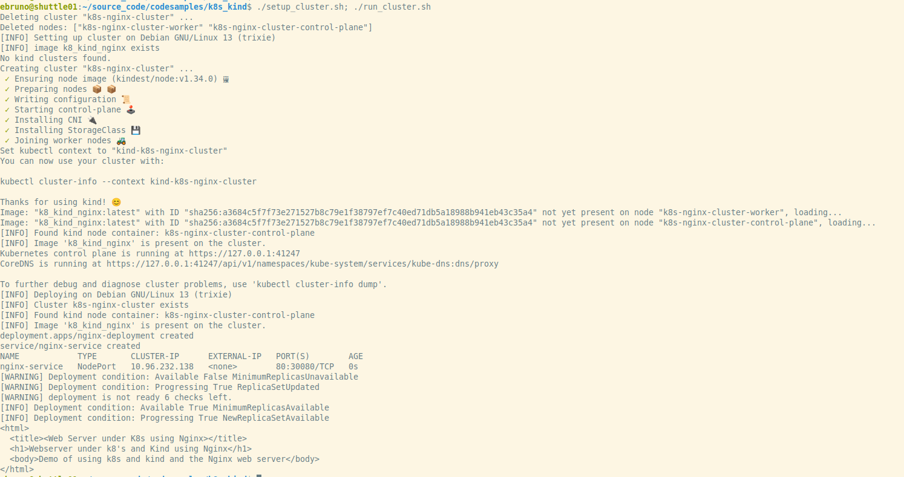

# Kubernetes (kind) Demo

Demonstration of an nginx server using [kind](https://kind.sigs.k8s.io) and Kubernetes.

This has been tested on the following environments

 * Debian 12/13 requires kind, kubectl, and Docker.
 * RHEL 10 requires kind, kubectl, and podman.
 * macOS requires kind, kubectl, and Docker.

## Running the Demo

```bash
./setup_cluster.sh
./run_cluster.sh

# When you are done:
./cleanup.sh
```


Sample Run


