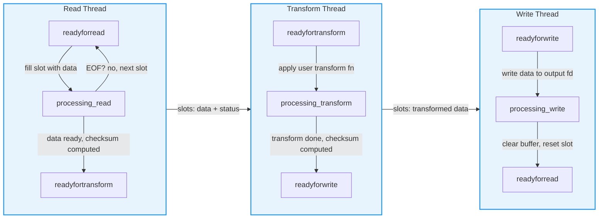

# Ringbuffer

A high-performance, cross-platform circular buffer library designed for binary symmetry and deterministic execution.

## What It Does

The Ringbuffer library implements a **three-stage pipelined architecture** (Read → Transform → Write) that connects independent threads through a fixed-size array of shared slots. Each slot carries its own state machine, checksum, and data buffer, enabling lock-free concurrent processing with cache-line-aligned counters to prevent false sharing.

**How the pipeline works:**

1. **Read thread** fills slots from an input file descriptor, marking each slot `readyfortransform` when full. On EOF, it marks the final slot with `LAST_BUFFER_TO_TRANSFORM`.
2. **Transform thread** applies a user-supplied `std::function` to each slot's data, computes an atomic checksum (MD5/SHA256/SHA512), and marks the slot `readyforwrite`.
3. **Write thread** writes transformed data to an output file descriptor, clears the slot buffer, and resets it to `readyforread`. On the last buffer, it flushes (`fsync`) before signaling completion.

Each stage uses its own independent atomic index counter, so threads operate on slots without contention. The `wait()` method blocks until all data has flowed through the entire pipeline and threads have joined cleanly via `std::jthread` cooperative cancellation.

## Overview
The Ringbuffer library implements a three-stage pipelined architecture (**Read $\rightarrow$ Transform $\rightarrow$ Write**) to ensure efficient data movement and processing. Each stage runs in its own thread, communicating through a fixed-size array of shared slots with independent atomic index counters. The core focus of the project is **binary symmetry**, meaning the source code remains identical across all supported operating systems to ensure maintainability and predictable behavior.

## Primary Goal
The objective is to provide a prompt-driven, immediate build-and-run functionality where the codebase can be regenerated or updated across multiple platforms using a single set of functional specifications.

## Development Methodology

This project was created entirely from scratch using an LLM (Large Language Model) as the primary development tool. Every aspect of the codebase — from architecture decisions to implementation details, build configuration, test infrastructure, and documentation — was generated through interactive prompt-driven development.

**How it works:**
- **Interactive Prompt Generation**: All workflow prompts were created through iterative dialogue with the LLM, refining specifications until they precisely captured the desired behavior.
- **Prompt-Driven Development**: The project follows a strict prompt-driven workflow where each phase (functional implementation, build setup, test infrastructure) is governed by well-defined prompt files in `prompts/`.
- **Binary Symmetry**: The LLM was instructed to produce identical source code across all target platforms, ensuring maintainability and predictable behavior regardless of OS.
- **Incremental Refinement**: The codebase evolved through multiple iterations — each prompt refinement produced targeted diffs rather than full rewrites, preserving manual overrides and reducing churn.

**Why this approach:**
- **Reproducibility**: Any platform can be regenerated from the same prompts, ensuring consistency.
- **Maintainability**: Specifications are explicit and version-controlled in the `prompts/` directory.
- **Speed**: Development cycles are dramatically shorter than traditional manual coding, with immediate build-and-run feedback.

## Key Specifications
- **Multi-OS Support**: Seamless deployment across various Linux distributions and macOS.
- **Multi-Language Support**: C++, Java, Python implementations with shared functional specifications.
- **Multi-Toolchain Compatibility**: Fully buildable using both **GCC** and **Clang**.
- **C++20 Standard**: Leverages `std::jthread`, cooperative cancellation, and advanced synchronization primitives.

## Core Features
- **Pipelined Architecture**: Decoupled read, transform, and write loops for maximum throughput.
- **Performance**: 
    - **Cache Alignment**: Buffer slots and counters are aligned to 64-byte boundaries to prevent false sharing.
    - **Small Binaries**: Optimized for dead code elimination (`-ffunction-sections`, `-fdata-sections`).
    - **Universal Binaries (macOS)**: Built with both `arm64` and `x86_64` slices via `lipo -create`, enabling execution on both Apple Silicon and Intel Macs.
    - **Compiler Flags**: `-fvisibility=hidden` (hide internal symbols), `-flto` (link-time optimization), `-ffunction-sections -fdata-sections` (enable dead code elimination).
- **Data Integrity**: Integrated checksumming (MD5, SHA256, SHA512) for every buffer slot.
- **Diagnostics**: Non-Virtual Public Interface (NVI) logging system with per-stage (read/transform/write) independently configurable verbosity levels.

## Quick Start: End-to-End Workflow (macOS Example)

The following sequence shows the complete prompt-driven workflow for setting up, building, verifying, and testing on macOS. Each step depends on the previous one — execute them in order.

### Step 1: Generate Source Code
```
"Use prompts/macos/cpp/create_functional.md to perform a full generation of the ringbuffer for macos"
```
Produces: `ringbuffer.hpp`, `status.hpp`, `swtr_ringbuffer_impl.hpp`, and all `.cpp` implementation files in `src/macos/cpp/`.

### Step 2: Create Build Environment
```
"Use prompts/macos/cpp/create_build.md to create the build environment for macos"
```
Produces: `Makefile`, `version.mk`, and built library artifacts (`.a` static, `.dylib` shared) in `src/macos/cpp/lib/`. Libraries are versioned as `libswtr_ringbuffer-<MAJOR>.<MINOR>.<SUBVERSION>-<BUILD_ID>` with unversioned symlinks for convenience.

### Step 3: Verify the Build
```
"Use prompts/common/verify_build.md to run build_verify for macos"
```
Confirms: library compiles, produces correct Mach-O binaries, symbol visibility is correct, and binary sizes are within expected ranges.

### Step 4: Set Up Test Infrastructure
```
"Use prompts/macos/cpp/create_regression.md to create the test environment for macos"
```
Produces: `tests/` directory with Makefile, test data (T001–T007), utility scripts, and builds `test001_staticlib` / `test001_dynamiclib`.

### Step 5: Execute Regression Tests
```
"Use prompts/common/run_regression.md to run regression_test on macos"
```
Executes: the full T001–T007 test matrix, generates `regression_report.md` and `regression_report_junit.xml`.

**Linux platforms:** Replace native commands with container-wrapped equivalents. For example, `make` becomes `container run --rm -v $(pwd):/app ringbuffer_ubuntu_test make`. The container runtime (`container` on macOS hosts, `podman` on Linux hosts) is selected automatically by the Makefile.

### Incremental Updates
After the initial setup, use update prompts to synchronize with changed specifications:
```
"Use prompts/macos/cpp/update_functional.md to synchronize the macos implementation with updated common specifications"
```

## Library API Example

The following example demonstrates the core Ringbuffer API — construction, transform setup, and pipeline execution:

```cpp
#include "ringbuffer.hpp"
#include "swtr_ringbuffer_impl.hpp"
using namespace swtr;

int main() {
    // Transform: convert input to uppercase
    auto transform = [](std::vector<uint8_t>& data, size_t& size) {
        for (size_t i = 0; i < size; ++i)
            if (data[i] >= 'a' && data[i] <= 'z') data[i] -= 32;
    };

    // Create a ring buffer with 4 slots, 4096 bytes each
    auto rb = std::make_unique<SwtrRingBuffer>(4, BufferStatus::readyforread, 4096, nullptr, transform);

    // Configure I/O: read from stdin, write to stdout
    rb->set_read_fd(STDIN_FILENO);
    rb->set_write_fd(STDOUT_FILENO);

    // Enable logging for diagnostics
    rb->set_logging_enabled(true);
    rb->set_output_stream(std::cerr);

    // Run the pipeline: reads until EOF, transforms each slot, writes output
    rb->start();
    rb->wait();   // blocks until all data flows through read $\rightarrow$ transform $\rightarrow$ write
    rb->stop();
}
```

Build with: `clang++ -std=c++20 main.cpp -I../src/macos/cpp -L../src/macos/cpp/lib -lswtr_ringbuffer -o main`

### Advanced Configuration

The Ringbuffer API supports per-stage logging, checksum algorithm selection, and custom error handlers:

```cpp
// Per-stage logging configuration (independent verbosity per stage)
rb->set_read_logging_enabled(true);
rb->set_read_verbosity(LogLevel::Debug);
rb->set_transform_logging_enabled(true);
rb->set_write_logging_enabled(true);

// Checksum algorithm per slot (NONE, MD5, SHA256, SHA512)
rb->set_checksum_alg(0, ChecksumAlgorithm::SHA256);

// Custom error handler (plain C function pointer)
int my_error_handler(size_t slot_idx, BufferStatus status) {
    std::cerr << "Error in slot " << slot_idx << ": "
              << static_cast<int>(status) << std::endl;
    return 0; // 0 = continue, non-zero = stop pipeline
}
auto rb = std::make_unique<SwtrRingBuffer>(4, BufferStatus::readyforread, 4096, my_error_handler, transform);
```

**Transform types**: `0` (identity/bypass), `1` (uppercase), `2` (XOR with 0xFF). User-supplied transforms are passed as `std::function<void(std::vector<uint8_t>&, size_t&)>` and can implement any custom logic.

### Pipeline Architecture Diagram

The following diagram shows how the three pipeline threads interact through shared slots:



**Key points:**
- Each stage uses its own independent atomic index counter (`read_index_`, `transform_index_`, `write_index_`)
- Slots transition through states: `readyforread` $\rightarrow$ `processing_read` $\rightarrow$ `readyfortransform` $\rightarrow$ `processing_transform` $\rightarrow$ `readyforwrite` $\rightarrow$ `processing_write` $\rightarrow$ `readyforread`
- On EOF, the read thread marks the final slot with `LAST_BUFFER_TO_TRANSFORM`, which propagates through transform (`LAST_BUFFER_TO_WRITE`) to write, then all threads break and `wait()` returns

### Pipeline Animation

The following animation demonstrates the three-stage pipeline in action, showing how data flows through the read $\rightarrow$ transform $\rightarrow$ write stages:


## Initial Development Environment
- **Operating System**: macOS 26.5.2 (Darwin 25.5.0)
- **Hardware**: Apple M4 Pro (arm64), 14 cores, 64 GB RAM
- **AI Tools**:
    - **Agent Harness**: LM Studio Bionic (CLI commit: 71bd99c)
    - **Model Name**: qwen3.6-35b-a3b-mlx
    - **Model Specs**: 37.75 GB, 162816 context window, parallelism factor 4, Decoder-only Transformer architecture, local execution.

## Project Structure
The project uses a **Deterministic File Mapping** strategy. Logic groups are mapped to specific filenames (e.g., `ReadOps.cpp`, `Threading.cpp`) with a strict constraint of **maximum 3 functions per file** to minimize git collisions and maximize modularity.

Each platform directory (`src/<os>/cpp/`) includes a `specs/` subdirectory containing copies of the specification files used to generate that platform's code, for reference and audit purposes.

**reference_linux**: A canonical reference platform in `prompts/reference_linux/cpp/` used for cross-platform verification. Source code is not generated here; it serves as the authoritative spec against which other platforms are compared.

**Platform-Insensitive Languages**: Java and Python implementations live in `src/common/` (not per-OS), as they are platform-independent. Each language has its own build system: Maven for Java, pure Python with `py_compile` for verification.

## Developer & Maintainer Guide

### Part A: The Golden Rules (Coding Standards)
- **Binary Symmetry**: Source code MUST be identical across all platforms.
- **File Distribution**: No `.cpp` file may contain more than 3 function definitions.
- **Include Discipline**: `ringbuffer.hpp` must be the first non-comment include, followed by alphabetical standard headers, then local headers.
- **Naming**: All private member variables MUST use the trailing underscore convention (e.g., `member_variable_`).
- **Hierarchy**: The implementation must strictly follow the `RingBuffer` $\rightarrow$ `SwtrRingBuffer` hierarchy.
- **Platform Sync**: When updating any platform's source, build, or test artifacts, the same changes MUST be applied to all other Linux platforms. Use the cross-platform update propagation directives in `update_functional.md`, `update_build.md`, and `update_testing.md`.

### Part B: The Prompt-Driven Workflow
This project is managed via a set of prompts that define the desired state of the codebase. The agent requires a valid path to the prompt file to execute the workflow.

#### Prompt-Driven Incremental Regeneration
The codebase supports incremental synchronization using a state-tracking system (`.gen_state.json`). This allows the AI to update only the files affected by a specification change.
- **State Tracking**: Uses SHA-256 hashes of prompts and file fingerprints to detect changes. Each platform has its own `.gen_state.json` at `src/<os>/cpp/.gen_state.json`.
- **3-Phase Sync**: Execution follows a strict pipeline: **Functional $\rightarrow$ Build $\rightarrow$ Regression**.
- **Delta Updates**: "Update" prompts are used to apply targeted diffs, preserving manual overrides and reducing churn.

#### Execution Examples

**Full Generation (Initial Setup):**
Use this when adding a new platform or resetting the codebase.
- *Prompt:* `prompts/<os>/cpp/create_functional.md`
- *Example:* `"Use prompts/ubuntu/cpp/create_functional.md to perform a full generation of the ringbuffer for ubuntu"`

**Incremental Update (Partial Regeneration):**
Use these to synchronize the codebase with updated specifications.
- *Functional Update:* `prompts/<os>/cpp/update_functional.md`
- *Build Update:* `prompts/<os>/cpp/update_build.md`
- *Testing Update:* `prompts/<os>/cpp/update_testing.md`
- *Example:* `"Use prompts/ubuntu/cpp/update_functional.md to synchronize the ubuntu implementation with the updated common specifications"`

**Verification & Testing:**
- *Build Verify:* `prompts/common/verify_build.md` — Use this for a first-pass sanity check on library compilation. Supports C/C++, Java, and Python verification.
  - *Example:* `"Use prompts/common/verify_build.md to run build_verify for debian and fedora"`
- *Regression Test:* `prompts/common/regression_test.md` — Use this for final validation of the library and test suite.
  - *Example:* `"Use prompts/common/regression_test.md to do regression_test on debian, fedora, macos"`

#### Test Data Pattern System
The Ringbuffer project uses a **pattern-driven** approach to test data generation. Instead of hardcoding pattern logic into each script, patterns are defined in standalone specification files that serve as the single source of truth. This ensures binary symmetry across all platforms and languages.

- **Pattern files** live in `prompts/common/testing/patterns/`. Each file defines:
  - The template string (48 characters)
  - Line format: `NNNN <payload> NNNN` (4-digit prefix, 47-char payload with zigzag space position, 4-digit suffix)
  - Validation regex: `^[0-9]{4} .{47} [0-9]{4}$`
  - The transformation algorithm (e.g., zig-zag space position)
  - A Python reference implementation (ground truth for all shell variants)
  - Validation regex, test file line counts, and JUnit test matrix
- **The `create_scripts.md` prompt** reads a pattern file and generates utility scripts in four shell languages (Bash, Zsh, Tcsh, Bourne) that produce byte-identical output.
- **Scripts are deployed** to each platform's `tests/utils/bin/` directory during test environment setup.

**Directory Structure:**
```
prompts/common/testing/
├── create_scripts.md          ← workflow prompt for generating scripts
└── patterns/
    ├── README.md              ← instructions + copy-paste template for new patterns
    └── zigzag.md              ← the default zig-zag pattern (also the only one)
```

**Usage Examples:**

- **Generate scripts from the default pattern:**
  - *Prompt:* `prompts/common/testing/create_scripts.md`
  - *Syntax Example:* `"Use prompts/common/testing/create_scripts.md to create utility scripts from the zigzag pattern"`

- **Update scripts after modifying a pattern:**
  - *Prompt:* `prompts/common/testing/create_scripts.md`
  - *Syntax Example:* `"Use prompts/common/testing/create_scripts.md to update the utility scripts. The pattern file is at prompts/common/testing/patterns/zigzag.md"`

- **Create a new pattern and generate scripts:**
  - *Syntax Example:* `"Create a new test data pattern at prompts/common/testing/patterns/sequential.md with template '0123456789ABCDEFGHIJKLMNOPQRSTUVWXYZ!@#$%^&*()<>', sequential numbering, and validation regex '^[0-9]{4} .{47} [0-9]{4}$'. Then generate the utility scripts."`

- **Verify generated scripts match the Python reference:**
  - *Syntax Example:* `"Use prompts/common/testing/create_scripts.md to regenerate scripts from zigzag.md and verify all shell variants produce byte-identical output against the Python reference implementation"`

#### Part C: Session Best Practices
The agent harness uses two key configuration files to maintain consistency across development sessions. These are **not** part of the generated README — they are operational files that guide how the agent behaves.

- **`.bionic`** — Session startup configuration loaded automatically at the beginning of every session. It contains:
  - Project structure quick-reference and path resolution rules
  - Workflow naming conventions (`implement_*`, `run_*`, `verify_*`)
  - Platform classification (native-only vs. containerized)
  - Operational discipline rules (read-before-write, logging format, scope boundaries)
  - Tool availability check and error handling / loop detection policies
  - Transitory markers for workflow coordination

  > **Note:** LM Studio Bionic does not always reliably auto-load `.bionic`. If you do not see the **Tool Availability Report** at session start, manually ask the agent to read `.bionic` to reinitialize session context.

- **`prompts/common/session_hints.md`** — Host-level quick-reference covering OS detection, macOS/Linux versioning, container runtime configuration, and memory calculation.

- **`prompts/common/cpp/session_hints.md`** — C++-specific quick-reference loaded when working on source code, Makefiles, or build configurations. It provides:
  - Platform-specific toolchain references (Linux tools vs. macOS tools)
  - Binary format quick-reference (ELF vs. Mach-O)
  - Shared library linking conventions per platform
  - Common pitfalls and gotchas (e.g., macOS Make built-in defaults)

**Best practice:** Always review `.bionic` at session start to confirm tool availability and operational rules. Reference `session_hints.md` for host-level context, and `prompts/common/cpp/session_hints.md` when working on C++-specific tasks to avoid platform-specific gotchas.

#### Test Matrix (T001–T007)
The test suite validates functional correctness, error handling, transform operations, and stress conditions:

| Test ID | Description | Transform | Error Mode | Expected Exit Code |
| :--- | :--- | :--- | :--- | :--- |
| T001 | Identity (normal) | 0 (none) | 0 (no error) | 0 |
| T002 | Stress test (1 slot, 1 byte) | 0 (none) | 0 (no error) | 0 |
| T003 | Uppercase transform | 1 (uppercase) | 0 (no error) | 0 |
| T004 | Small input, fast EOF | 0 (none) | 0 (no error) | 0 |
| T005 | Fatal error mode | 0 (none) | 1 (fatal) | 1 |
| T006 | Non-fatal error mode | 0 (none) | 2 (non-fatal) | 0 |
| T007 | XOR transform | 2 (XOR 0xFF) | 0 (no error) | 0 |

**Test program CLI**: `test001_staticlib [-o output_file] [-l log_file] [-s slots] [-b size] [-t transform_type] [-e error_mode] [-r] [-w <ip:port>] <input_file>`

#### Part D: Documentation & Media Assets

**README Generation (`prompts/common/generate_toplevel_readme.md`)**
The README.md is generated from a structured prompt that enforces a strict section order and content requirements. To regenerate the README after any changes:
- *Prompt:* `prompts/common/generate_toplevel_readme.md`
- *Syntax Example:* `"Use prompts/common/generate_toplevel_readme.md to regenerate the top-level README.md"`

The prompt gathers environment data (OS, hardware, AI tooling), scans the platform matrix from `src/`, and assembles all sections including the Pipeline Architecture Diagram, API examples, Developer & Maintainer Guide, and Supported Platforms table.

**Pipeline Animation (`animated_graphics/bin/generate_pipeline_animation.py`)**
Regenerates the `pipeline_animation.gif` demonstrating the three-stage pipeline with 45 frames at 1000ms each (~45s total cycle). The animation shows the Read → Transform → Write thread progression through shared slots with independent atomic index counters.
- *Usage:* `python3 animated_graphics/bin/generate_pipeline_animation.py [--output PATH]`
- *Output:* `animated_graphics/pipeline_animation.gif` (default)

**GIF to MP4 Conversion (`utils/bin/gif_to_mp4.sh`)**
Converts animated GIFs to MP4 format for embedding in documentation or presentations. Supports 720p and 1080p resolutions with automatic letterboxing/pillarboxing to preserve aspect ratio.
- *Usage:* `./utils/bin/gif_to_mp4.sh <input.gif> [720p|1080p]`
  - No resolution arg → generates BOTH 720p and 1080p
  - Single resolution arg → generates only that resolution
- *Output:* `images/<basename>_720p.mp4` and/or `images/<basename>_1080p.mp4`
- *Requirements:* ffmpeg, ffprobe

## Supported Platforms

| OS | Language | Version |
| :--- | :--- | :--- |
| macOS | C++ | v1.0.0 |
| Debian | C++ | v1.0.0 |
| Fedora | C++ | v1.0.0 |
| Ubuntu | C++ | v1.0.0 |
| macOS | Java | v1.0.0 |
| Debian | Java | v1.0.0 |
| Fedora | Java | v1.0.0 |
| Ubuntu | Java | v1.0.0 |
| macOS | Python | v1.0.0 |
| Debian | Python | v1.0.0 |
| Fedora | Python | v1.0.0 |
| Ubuntu | Python | v1.0.0 |
| ArchLinux | C++ | TBS |
| FreeBSD 14 | C++ | TBS |
| FreeBSD 15 | C++ | TBS |

`*TBS: To Be Supplied | WIP: Work In Progress`

## Where We Are At

### Current Status (as of 2026-08-14)

**Implementation:**
- **C++ implementation complete** for macOS, Debian, Fedora, and Ubuntu — all at v1.0.0
- **Java implementation complete** (common, platform-insensitive) — v1.0.0, built with Maven
- **Python implementation complete** (common, platform-insensitive) — v1.0.0, pure Python
- **Binary symmetry verified** across Linux platforms: 21 source files confirmed byte-identical between debian, fedora, and ubuntu via automated `verify_binary_symmetry.sh`
- **State tracking** operational on all C++ platforms — `.gen_state.json` tracks SHA-256 hashes of prompts, specs, and generated files for deterministic delta detection
- **Test infrastructure complete** — T001–T007 test matrix with JUnit XML report generation, pattern-driven test data (zigzag), and 4 shell variants producing byte-identical output

**Verification & Quality Gates:**
- **Automated binary symmetry check** — `verify_binary_symmetry.sh` compares all 21 source files across Linux platforms; integrated into `verify_build.md` as a mandatory post-build step (step 0.5)
- **Automated prompt linting** — `lint_prompts.sh` validates directory structure, required files per platform/language, excluded platform cleanliness, primary document naming, and common workflow completeness; integrated into `verify_build.md` as step 0.6
- **Prompt directory integrity** — All platform/language directories follow established conventions; excluded platforms (ArchLinux, FreeBSD 14/15) contain only zero-length placeholder files
- **Multi-language verification** — `verify_build.md` dispatches to language-specific checks: Java (`mvn compile`, `mvn package`, JAR artifact, classload test), Python (syntax check, import verification, class instantiation), C/C++ (binary format, symbol visibility)
- **Java regression testing** — Full T001–T007 test matrix executed across all 4 OSes (macOS native + 3 Linux containers); 18 assertions, 0 failures; Surefire-compatible test harness with `testAll()` method
- **Python build verification** — Pure Python implementation verified via `py_compile`, module import, and class instantiation across all 4 OSes; no compilation required

**Development Methodology:**
- Prompt-driven development with 27 prompt files across 8 OSes × 6 languages (common specs)
- Session isolation by design — each prompt file is self-contained for LLM-agent reliability
- Incremental regeneration via `.gen_state.json` delta detection (3-phase sync: Functional → Build → Regression)
- Two verification scripts integrated into the build workflow as mandatory gates

### What Works Today

| Capability | Status | Details |
|------------|--------|---------|
| C++ library (macOS) | ✅ Complete | Universal binaries (arm64 + x86_64), static + shared libs |
| C++ library (Linux) | ✅ Complete | Byte-identical source across debian/fedora/ubuntu |
| Java library (all OS) | ✅ Complete | Maven build, JAR artifact, classload test verified |
| Python library (all OS) | ✅ Complete | Pure Python, syntax/import/instantiation verified |
| Build system | ✅ Complete | Makefiles with container overrides, versioned artifacts |
| Test infrastructure | ✅ Complete | T001–T007 matrix, JUnit XML output, pattern-driven data |
| Binary symmetry | ✅ Verified | 21/21 source files identical across Linux platforms |
| Prompt linting | ✅ Operational | 10/13 checks pass (3 warnings for excluded platforms) |
| State tracking | ✅ Operational | `.gen_state.json` on all 4 active C++ platforms |
| Multi-language verify | ✅ Operational | `verify_build.md` dispatches to Java, Python, C/C++ checks |
| Java regression | ✅ Passed | 18 assertions, 0 failures across all 4 OSes (macOS native + debian/fedora/ubuntu containers) |

## Where We're Going

### Near-Term (Next Iterations)

- **Additional languages** — C, Go, and Rust scaffolding is in place. The multi-language/multi-OS directory structure means adding a new language requires only implementing the spec files; the scaffolding (zero-length placeholders, `.required_directory` markers) is already present.
- **Additional patterns** — The test data pattern system supports adding new patterns beyond zigzag (e.g., sequential, random). Each new pattern requires a single spec file in `prompts/common/testing/patterns/` and running `create_scripts.md`.
- **Enhanced CI/CD** — The automated verification scripts (`verify_binary_symmetry.sh`, `lint_prompts.sh`) are ready for CI integration. They can be added as pre-commit hooks or GitHub Actions to enforce quality gates before any code is committed.

### Medium-Term (Roadmap)

- **FreeBSD and ArchLinux implementation** — Currently excluded with zero-length placeholder files. The scaffolding exists; implementation requires writing the platform/language spec files and generating source code.
- **More comprehensive test coverage** — Additional test scenarios for edge cases (concurrent access patterns, memory pressure, signal handling).
- **Documentation expansion** — API reference generation from headers, performance benchmarking documentation, container deployment guides.

### Long-Term (Vision)

- **Full multi-language library** — The architecture is designed so that each language implementation shares the same functional specification. When all 6 languages are implemented, any platform can be built in any language from the same spec.
- **Cross-platform verification suite** — Automated comparison of behavior across all language/platform combinations, not just source-level binary symmetry.
- **Plugin ecosystem** — The transform function abstraction (`std::function<void(std::vector<uint8_t>&, size_t&)>`) is designed to support a plugin model where users can register custom transforms without modifying the library.

## License
This project is licensed under the **BSD 3-Clause License**.
