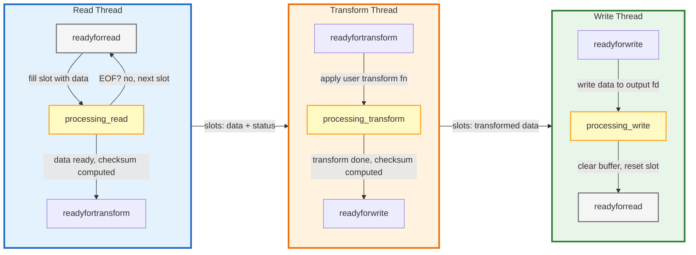
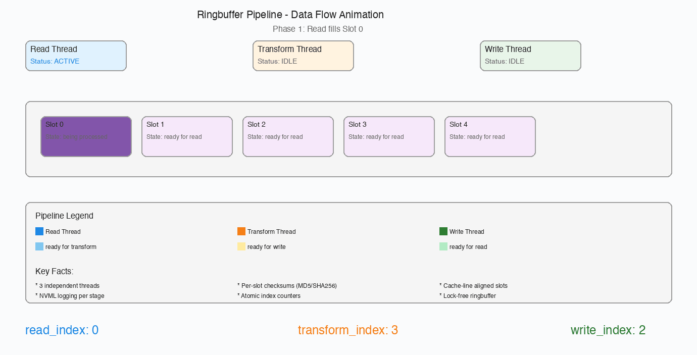
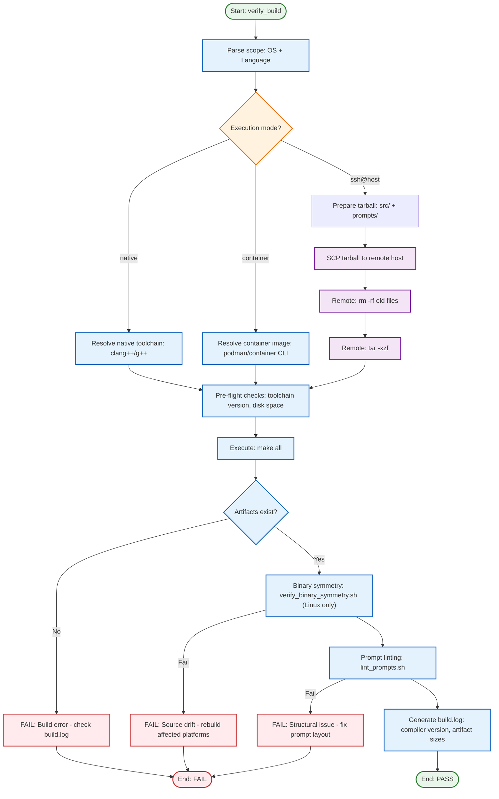
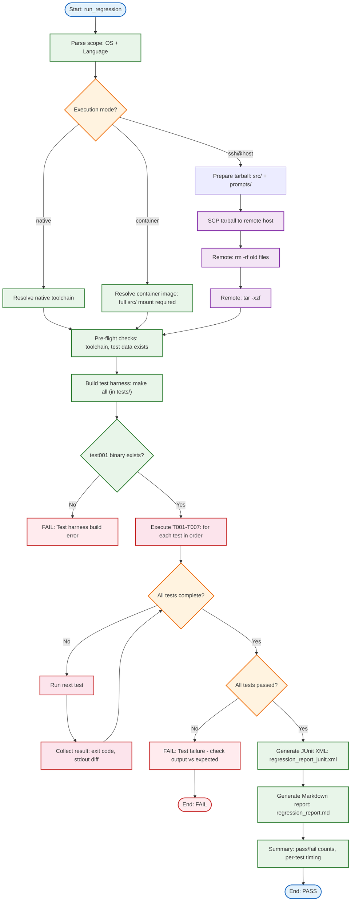
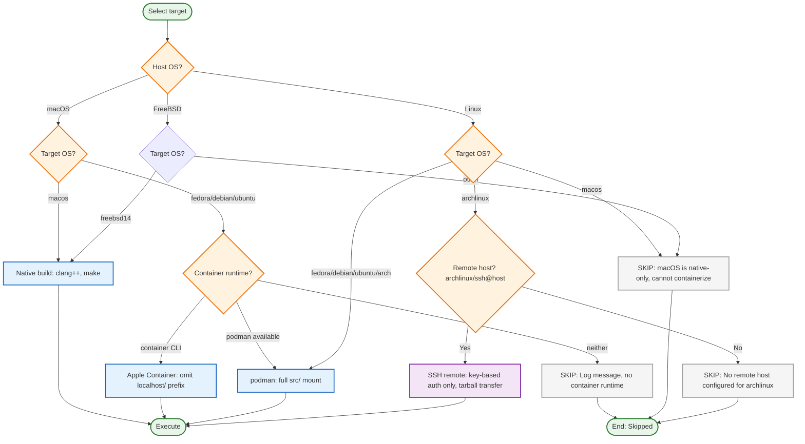

# Ringbuffer

A high-performance, cross-platform circular buffer library designed for binary symmetry and deterministic execution.

## What It Does

The Ringbuffer library implements a **three-stage pipelined architecture** (Read → Transform → Write) that connects independent threads through a fixed-size array of shared slots. Each slot carries its own state machine, checksum, and data buffer, enabling lock-free concurrent processing with cache-line-aligned counters to prevent false sharing.

**How the pipeline works:**

1. **Read thread** fills slots from an input file descriptor, marking each slot `readyfortransform` when full. On EOF, it marks the final slot with `LAST_BUFFER_TO_TRANSFORM`.
2. **Transform thread** applies a user-supplied `std::function` to each slot's data, computes an atomic checksum (MD5/SHA256/SHA512), and marks the slot `readyforwrite`.
3. **Write thread** writes transformed data to an output file descriptor, clears the slot buffer, and resets it to `readyforread`. On the last buffer, it flushes (`fsync`) before signaling completion.

Each stage uses its own independent atomic index counter, so threads operate on slots without contention. The `wait()` method blocks until all data has flowed through the entire pipeline and threads have joined cleanly via `std::jthread` cooperative cancellation.

## Overview
The Ringbuffer library implements a three-stage pipelined architecture (**Read $\rightarrow$ Transform $\rightarrow$ Write**) to ensure efficient data movement and processing. Each stage runs in its own thread, communicating through a fixed-size array of shared slots with independent atomic index counters.

The core focus of the project is **binary symmetry within OS families**, with minimal differences allowed when crossing OS boundaries:
- **Same OS Family (e.g., all Linux distros):** Source code is byte-identical across ALL platforms **by construction via symlinks to a single canonical source tree in `src/common/cpp/`**. The build system handles platform-specific flags (linker options, container images), but `.cpp` and `.hpp` files are byte-identical.
- **Cross OS Family (Linux vs macOS vs FreeBSD):** Differences should be minimal — limited only to `#ifdef` guards or macros that wrap OS-specific syscalls (e.g., file sync behavior, threading primitives). The core logic, architecture, and API surface remain identical.
- **Platform-Insensitive Languages (Java, Python, Go, Rust):** Source code is byte-identical across ALL platforms by design. These languages abstract platform differences through their standard libraries.
- **Platform-Sensitive Languages (C, C++):** Source code is byte-identical within the same OS family. Cross-family differences are limited to `#ifdef` guards for OS-specific behavior (e.g., macOS `F_FULLFSYNC` vs Linux `F_DATASYNC`).

**Goal:** A single canonical source tree that compiles and runs correctly on every target platform. The build system, not the source code, is responsible for platform-specific adaptation.

## Primary Goal
The objective is to provide a prompt-driven, immediate build-and-run functionality where the codebase can be regenerated or updated across multiple platforms using a single set of functional specifications.

The project follows a **develop-then-refactor** strategy with three phases:
1. **Phase A — Platform Development:** Implement the language on 2–3 representative platforms (typically macOS for native/Apple Silicon, one Linux distro for containerized builds). This validates correctness against real toolchains and OS behaviors.
2. **Phase B — Common Refactor:** Once Phase A passes all tests, extract the common logic into `src/common/<lang>/`. Platform-specific overrides (build flags, container images) remain per-OS; all shared logic lives in common.
3. **Phase C — Platform Rollout:** Generate source for remaining platforms from the common spec + per-OS overrides.

**Current Status:** C++ is in Phase B (common implementations exist at `src/common/cpp/` with symlinks from all 8 OS platforms — macOS, Debian, Fedora, Ubuntu, Raspios, Arch Linux, FreeBSD 14). Java and Python are in Phase B (common implementations exist at `src/common/java/` and `src/common/python/`). C, Go, and Rust are pre-Phase A (specs created, implementation pending).

**Note:** Unimplemented languages should not be considered a negative — the spec scaffolding is in place and the dispatcher prompt (`add_language.md`) routes correctly.

## Prompt Execution Pattern
Every workflow follows a consistent pattern:
1. **Common workflow** provides structure, image/version resolution, and routing decisions
2. **Platform-specific primary document** (`create_*.md`) is the authoritative execution guide
3. **Common spec** (`common/cpp/*.md` or `common/<lang>/*.md`) provides technical requirements
4. **Platform spec** (`<os>/cpp/*.md` or `<os>/<lang>/*.md`) provides platform-specific overrides

When a common workflow says "execute `create_*.md` as the PRIMARY document," it means: read it for directives and immediate requirements, follow its steps as the main execution path, use the common workflow for infrastructure (image resolution, routing) only.

## Development Methodology

This project was created entirely from scratch using an LLM (Large Language Model) as the primary development tool. Every aspect of the codebase — from architecture decisions to implementation details, build configuration, test infrastructure, and documentation — was generated through interactive prompt-driven development.

**How it works:**
- **Interactive Prompt Generation**: All workflow prompts were created through iterative dialogue with the LLM, refining specifications until they precisely captured the desired behavior.
- **Prompt-Driven Development**: The project follows a strict prompt-driven workflow where each phase (functional implementation, build setup, test infrastructure) is governed by well-defined prompt files in `prompts/`.
- **Binary Symmetry**: Source code is byte-identical across ALL platforms **by construction via symlinks to `src/common/cpp/`** (C++) or shared common directories (`src/common/java/`, `src/common/python/`). The goal is a single canonical source tree that compiles and runs correctly on every target platform. When running on the same OS family (e.g., all Linux distros), source code is naturally identical since toolchain changes are applied uniformly. When using pure C++, pure Java, or pure Python across different Unix-family OSes (Linux vs macOS vs FreeBSD), differences should be minimal — limited only to `#ifdef` guards or macros that wrap OS-specific syscalls. The core logic, architecture, and API surface remain identical across all platforms.
- **Incremental Refinement**: The codebase evolved through multiple iterations — each prompt refinement produced targeted diffs rather than full rewrites, preserving manual overrides and reducing churn.
- **Prompt Versioning**: Prompt files are tracked via `.gen_state.json` SHA-256 hashes for deterministic delta detection. A changelog mechanism (`prompts/common/CHANGELOG.md`) is available to document prompt changes between generations. The **post-commit hook** (`githooks/post-commit` + `utils/bin/suggest_changelog_entry.sh`) analyzes prompt diffs and suggests changelog entries — the hook is scoped to `ringbuffer/prompts/` when in a multi-project repo (controlled by `PROJECT_PREFIX` variable in the script).

**Why this approach:**
- **Reproducibility**: Any platform can be regenerated from the same prompts, ensuring consistency.
- **Maintainability**: Specifications are explicit and version-controlled in the `prompts/` directory.
- **Speed**: Development cycles are dramatically shorter than traditional manual coding, with immediate build-and-run feedback.

## Key Specifications
- **Multi-OS Support**: Seamless deployment across various Linux distributions and macOS.
- **Language Standards and Classification**:
  - C: C23 primary, C17/C11 fallback
  - C++: C++20 primary, C++17 fallback
  - Java: SE 25 primary, SE 24-17 fallback
  - Go: 1.24 primary, 1.23/1.22 fallback
  - Python: 3.14 primary, 3.13-3.10 fallback
  - Rust: 1.84.0 primary, 1.56.0 fallback
  - Minimum supported versions are enforced — implementations must detect and report actual toolchain version, stopping if below minimum.
  - **Platform-sensitive** (c, cpp): require per-OS overrides for threading primitives, I/O multiplexing (epoll vs kqueue), and build flags
  - **Platform-insensitive** (python, java, go, rust): use standard library abstractions for identical source everywhere
- **Language-Specific Build Systems**:
  - C/C++: GNU Make (`Makefile`) → `lib/libswtr_ringbuffer-<version>.{a|so|dylib}`
  - Java: Apache Maven (`pom.xml`) → `target/ringbuffer-<version>.jar`
  - Go: Go Modules (`go.mod`) with `-buildmode=c-{archive,shared}` → `lib/libringbuffer.{a|so|dylib}`
  - Python: Interpreted, no build system; depends on C library shared object via `ctypes`
  - Rust: Cargo (`Cargo.toml`) with `crate-type = ["staticlib", "cdylib"]` → `target/release/libswtr_ringbuffer.{a,so|dylib}`
- **Unified Build/Test Pattern** (all languages):
  - `verify_build` → `<os>/<lang>/Makefile all` — builds artifacts and creates symlinks (no tests)
  - `run_regression` → `tests/Makefile verify` — runs T001–T007 test matrix, generates reports
  - Main Makefile must have `test: all` → calls `$(MAKE) -C tests verify`
  - See `.bionic` section "Build vs Test Workflow Pattern (All Languages)" for full details
- **Multi-Language Support**: C++, Java, Python implementations with shared functional specifications; C, Go, Rust in development pipeline.
- **Multi-Toolchain Compatibility**: Fully buildable using both **GCC** and **Clang**.
- **C++20 Standard**: Leverages `std::jthread`, cooperative cancellation, and advanced synchronization primitives.
- **Library-First API Design**: The Ringbuffer is designed as a reusable library, not an application. All public APIs — including the ~20 slot-level accessor methods on `RingBuffer` (e.g., `get_data_buffer_size()`, `set_transformed_data_buffer_size()`, `get_slot_status()`) — are intentional design choices providing maximum flexibility to library consumers for debugging, monitoring, and testing. Granular slot state visibility is a feature, not a leaky abstraction.
- **Core Principle — Library-First Flexibility**: Consumer flexibility > API simplicity. No hidden abstractions — consumers should be able to observe and control state at any granularity without wrapper code. Opt-in complexity: basic usage is simple (construct, set transform, start), but advanced usage must not require extending the library. The abstract class interface is a stable public API contract.

## Core Features
- **Shared Behavioral Contract (All Languages)**: Every implementation must satisfy these requirements regardless of language:
  - **Three-stage pipeline**: Independent read, transform, and write stages operating on a shared pool of buffer slots
  - **Status-driven coordination**: Slots transition through states (`readyforread` → `readyfortransform` → `readyforwrite` → `readyforread`)
  - **Cooperative cancellation**: Pipeline stages must support graceful shutdown via a stop signal or equivalent mechanism
  - **Error handling**: An error handler callback that returns non-zero to trigger pipeline shutdown
  - **EOF detection**: When read returns EOF (0 bytes), the pipeline must propagate `LAST_BUFFER_TO_TRANSFORM` → `LAST_BUFFER_TO_WRITE` through all stages, then terminate cleanly
  - **Transform in-place**: The transform function receives the slot's data buffer and modifies it directly; `transformed_data_buffer_size` must be updated with the result size
- **Pipelined Architecture**: Decoupled read, transform, and write loops for maximum throughput.
- **Performance**: 
    - **Cache Alignment**: Buffer slots and counters are aligned to 64-byte boundaries to prevent false sharing.
    - **Small Binaries**: Optimized for dead code elimination (`-ffunction-sections`, `-fdata-sections`).
    - **Universal Binaries (macOS)**: Built with both `arm64` and `x86_64` slices via `lipo -create`, enabling execution on both Apple Silicon and Intel Macs.
    - **Compiler Flags**: `-fvisibility=hidden` (hide internal symbols), `-flto=thin` (thin link-time optimization), `-ffunction-sections -fdata-sections` (enable dead code elimination).
- **Data Integrity**: Integrated checksumming (MD5, SHA256, SHA512) for every buffer slot.
- **Diagnostics**: Non-Virtual Public Interface (NVI) logging system with per-stage (read/transform/write) independently configurable verbosity levels.
- **LLM Knowledge Package**: Versioned, shareable context packages that teach LLMs (Qwen family and compatible) how to use the ringbuffer library. Distributed via Ollama Modelfile (system prompt injection) and fine-tuned GGUF models. See [LLM Knowledge Package](#llm-knowledge-package) below.

## LLM Knowledge Package

The Ringbuffer project ships versioned knowledge packages that teach LLMs how to use the library. Each package covers all implemented languages (C++, Java, Python) and is distributed in two forms for different user needs.

### What It Contains

```
knowledge/
├── manifest.json                   # Version, SHA-256 checksums of every file
├── Modelfile                       # Ollama model definition (wraps Qwen3.6-35B)
├── system-prompt.md                # Lean core knowledge (~2KB, inline in Modelfile)
├── api-reference/                  # Full API docs by language (external, referenced by system prompt)
│   ├── cpp.md                      # C++ headers, types, full signatures
│   ├── java.md                     # Java API, class hierarchy, usage patterns
│   └── python.md                   # Python API, ctypes FFI, pure-Python impl
├── examples/                       # Copy-pasteable code snippets by language
│   ├── basic.cpp / .java / .py     # Construct, transform, run pipeline
│   └── advanced.cpp / .java / .py  # Per-stage logging, checksumming, error handlers
├── patterns/                       # Common usage patterns (all languages)
│   ├── logging-guide.md            # Per-stage verbosity configuration
│   └── checksumming.md             # MD5/SHA256/SHA512 per-slot
├── instruction-dataset/            # QLoRA training data (for 14B fine-tuning)
│   ├── train.jsonl                 # Instruction/response pairs
│   └── eval.jsonl                  # Held-out validation set
├── update.sh / update.zsh          # Regenerates docs + dataset from source headers
└── build_model.sh / .zsh           # QLoRA fine-tuning script for M4 Mac mini
```

### Distribution Paths

| Path | What it is | User command | Hardware needed |
|---|---|---|---|
| **System Prompt** (Modelfile) | Knowledge injected as text before every conversation | `ollama create swtr-ringbuffer -f Modelfile` | Any Qwen-compatible setup |
| **Fine-Tuned** (14B GGUF) | Knowledge baked into model weights via QLoRA | `ollama create swtr-ringbuffer --from model.gguf` | ~10GB RAM (M4 Mac mini or equivalent) |

**System Prompt approach:** The Modelfile wraps a base Qwen model with a lean system prompt (~2KB) containing architecture overview, key types, and quick examples. External API reference files are referenced for deep dives. Instant to use — no training required.

**Fine-Tuned approach:** A Qwen2.5-14B-Instruct model is fine-tuned (QLoRA) on an instruction dataset generated from the knowledge source. The resulting `.gguf` file has ringbuffer knowledge baked into its weights — zero context window cost at inference time. Built on the project's M4 Mac mini (64GB unified memory) and exported via llama.cpp.

### Versioning

Knowledge packages follow the same versioning scheme as the library itself, derived from `src/*/cpp/version.mk`:

| Component | Source | Example |
|---|---|---|
| MAJOR.MINOR.SUBVERSION | Auto-detected from `version.mk` | `1.0.0` |
| BUILD_ID | Manual input to `update.sh` (no auto-increment) | `build-1`, `build-2` |
| Full version string | `knowledge/manifest.json` | `1.0.0-build-1` |
| GGUF filename | Generated from version string | `swtr-ringbuffer-qwen2.5-14b-v1.0.0-build-1.gguf` |

The `BUILD_ID` is a manual parameter — if not supplied to `update.sh`, the current value is preserved. This gives full control over release numbering without auto-increment surprises.

### Update Process

When ringbuffer source code changes:

1. Run `./knowledge/update.sh <BUILD_ID>` — regenerates API docs, examples, and instruction dataset from actual `.hpp`/`.py` headers for all three languages (C++, Java, Python)
2. The script reads `version.mk` for MAJOR/MINOR/SUBVERSION, accepts BUILD_ID as argument (or preserves current value if omitted)
3. Updates checksums in `manifest.json` using the existing `.gen_state.json` SHA-256 pattern
4. Run `./knowledge/build_model.sh` on the M4 Mac mini — fine-tunes 14B, exports GGUF (~1-3 hours)
5. Release both artifacts (`Modelfile` + `.gguf`) via GitHub Releases

### Installation (End Users)

**Path A — System Prompt (any Qwen model, instant):**
```bash
curl -L https://github.com/<user>/ringbuffer/releases/download/v1.0.0-build-1/Modelfile -o Modelfile
ollama create swtr-ringbuffer -f Modelfile
ollama run swtr-ringbuffer "How do I configure per-stage logging?"
```

**Path B — Fine-Tuned 14B (zero-context inference):**
```bash
curl -L https://github.com/<user>/ringbuffer/releases/download/v1.0.0-build-1/swtr-ringbuffer-qwen2.5-14b-v1.0.0-build-1.gguf -o model.gguf
ollama create swtr-ringbuffer --from model.gguf
ollama run swtr-ringbuffer "How do I configure per-stage logging?"
```

### Development (Internal)

All knowledge package development happens in GitLab on private branches. The auto-replication pipeline syncs `main` to a public GitHub mirror, where releases are published. The knowledge source (`knowledge/`) is not visible on the public repo — only the built artifacts (Modelfile, GGUF) and installation instructions (README) are public.

## LinkedIn Post Generator

A lightweight, ad-hoc tool for generating personal LinkedIn posts about projects in this workspace. Posts follow engagement best practices: hook in the first 140 characters, short paragraphs for scannability, first-person tone, a call-to-action question at the end, and 3–5 relevant hashtags.

**Location:** `prompts/common/linkedin/generate_post.py`

### Usage

```bash
# Generate from a project metadata file:
python3 prompts/common/linkedin/generate_post.py --project prompts/common/linkedin/projects/ringbuffer.json
# (Update the `link` field in the JSON to point to your repo, e.g. https://github.com/ebruno/codesamples)

# Generate inline with CLI arguments:
python3 prompts/common/linkedin/generate_post.py \
    --name "My Project" \
    --description "What it does in one sentence" \
    --features "Feature 1, Feature 2, Feature 3" \
    --tech "C++20, Python" \
    --link "https://github.com/youruser/repo"

# Dry-run (show character count and validation warnings only):
python3 prompts/common/linkedin/generate_post.py --project <file> --dry-run

# Write to a file:
python3 prompts/common/linkedin/generate_post.py --project <file> -o post.txt
```

### Project Metadata Files

Store reusable project metadata as JSON in `prompts/common/linkedin/projects/`. Each file defines:

| Field | Description |
|-------|-------------|
| `name` | Project name |
| `description` | One-sentence summary of what it does |
| `features` | Array of key features |
| `tech` | Tech stack (e.g., "C++20, Java, Python") |
| `link` | Repository URL |
| `lesson` | What building it taught you |
| `feedback_area` | Specific area to ask for feedback on |

### Post Guidelines Enforced

- **Character count:** 1,000–1,500 optimal (max 3,000)
- **Hook:** Compelling statement in the first 140 characters (before "See more")
- **Formatting:** Single-sentence paragraphs, bullet-point features
- **Tone:** First-person, authentic and relatable
- **Call to action:** Ends with a question to invite comments
- **Hashtags:** 3–5 relevant tags auto-generated from the tech stack

## Quick Start: End-to-End Workflow (macOS Example)

The following sequence shows the complete prompt-driven workflow for setting up, building, verifying, and testing on macOS. Each step depends on the previous one — execute them in order.

### Step 1: Generate Source Code
```
"Use prompts/macos/cpp/create_functional.md to perform a full generation of the ringbuffer for macos"
```
Produces: `ringbuffer.hpp`, `status.hpp`, `swtr_ringbuffer_impl.hpp`, and all `.cpp` implementation files in `src/macos/cpp/`.

### Step 2: Create Build Environment
```
"Use prompts/macos/cpp/create_build.md to create the build environment for macos"
```
Produces: `Makefile`, `version.mk`, and built library artifacts (`.a` static, `.dylib` shared) in `src/macos/cpp/lib/`. Libraries are versioned as `libswtr_ringbuffer-<MAJOR>.<MINOR>.<SUBVERSION>-<BUILD_ID>` with unversioned symlinks for convenience.

### Step 3: Verify the Build
```
"Use prompts/common/verify_build.md to run build_verify for macos"
```
Runs: `<os>/<lang>/Makefile all` — builds library artifacts and creates symlinks (no tests). Confirms: library compiles, produces correct Mach-O binaries, symbol visibility is correct, and binary sizes are within expected ranges.

### Step 4: Set Up Test Infrastructure
```
"Use prompts/macos/cpp/create_regression.md to create the test environment for macos"
```
Produces: `tests/` directory with Makefile, test data (T001–T007), utility scripts, and builds `test001_staticlib` / `test001_dynamiclib`.

### Step 5: Execute Regression Tests
```
"Use prompts/common/run_regression.md to run regression_test on macos"
```
Runs: `tests/Makefile verify` — executes the full T001–T007 test matrix, generates `regression_report.md` and `regression_report_junit.xml`.

**Linux platforms:** Replace native commands with container-wrapped equivalents. For example, `make` becomes `container run --rm -v $(pwd):/app ringbuffer_ubuntu_test make`. The container runtime (`container` on macOS hosts, `podman` on Linux hosts) is selected automatically by the Makefile.

### Incremental Updates
After the initial setup, use update prompts to synchronize with changed specifications:
```
"Use prompts/macos/cpp/update_functional.md to synchronize the macos implementation with updated common specifications"
```

## Library API Example

The following example demonstrates the core Ringbuffer API — construction, transform setup, and pipeline execution:

```cpp
#include "ringbuffer.hpp"
#include "swtr_ringbuffer_impl.hpp"
using namespace swtr;

int main() {
    // Transform: convert input to uppercase
    auto transform = [](std::vector<uint8_t>& data, size_t& size) {
        for (size_t i = 0; i < size; ++i)
            if (data[i] >= 'a' && data[i] <= 'z') data[i] -= 32;
    };

    // Create a ring buffer with 4 slots, 4096 bytes each
    auto rb = std::make_unique<SwtrRingBuffer>(4, BufferStatus::readyforread, 4096, nullptr, transform);

    // Configure I/O: read from stdin, write to stdout
    rb->set_read_fd(STDIN_FILENO);
    rb->set_write_fd(STDOUT_FILENO);

    // Enable logging for diagnostics
    rb->set_logging_enabled(true);
    rb->set_output_stream(std::cerr);

    // Run the pipeline: reads until EOF, transforms each slot, writes output
    rb->start();
    rb->wait();   // blocks until all data flows through read $\rightarrow$ transform $\rightarrow$ write
    rb->stop();
}
```

Build with: `clang++ -std=c++20 main.cpp -I../src/macos/cpp -L../src/macos/cpp/lib -lswtr_ringbuffer -o main`

### Advanced Configuration

The Ringbuffer API supports per-stage logging, checksum algorithm selection, and custom error handlers:

```cpp
// Per-stage logging configuration (independent verbosity per stage)
rb->set_read_logging_enabled(true);
rb->set_read_verbosity(LogLevel::Debug);
rb->set_transform_logging_enabled(true);
rb->set_write_logging_enabled(true);

// Checksum algorithm per slot (NONE, MD5, SHA256, SHA512)
rb->set_checksum_alg(0, ChecksumAlgorithm::SHA256);

// Custom error handler (plain C function pointer)
int my_error_handler(size_t slot_idx, BufferStatus status) {
    std::cerr << "Error in slot " << slot_idx << ": "
              << static_cast<int>(status) << std::endl;
    return 0; // 0 = continue, non-zero = stop pipeline
}
auto rb = std::make_unique<SwtrRingBuffer>(4, BufferStatus::readyforread, 4096, my_error_handler, transform);
```

**Transform types**: `0` (identity/bypass), `1` (uppercase), `2` (XOR with 0xFF). User-supplied transforms are passed as `std::function<void(std::vector<uint8_t>&, size_t&)>` and can implement any custom logic.

### Version Propagation
All languages derive version from `version.mk` — each has a specific mechanism:
- **C/C++**: Makefile `include version.mk` (direct)
- **Java**: `version.sh` reads `version.mk`, injects into `pom.xml` as Maven properties
- **Go**: `version.sh` reads `version.mk`, generates `version.go` with typed constants
- **Python**: `version.sh` reads `version.mk`, generates `version.py` with module constants
- **Rust**: `build.rs` reads `version.mk`, generates `src/version.rs` with constants
- **Core Principle**: `version.mk` is the single source of truth — no language defines its own version independently.

### Pipeline Architecture Diagram

The following diagram shows how the three pipeline threads interact through shared slots:



**Key points:**
- Each stage uses its own independent atomic index counter (`read_index_`, `transform_index_`, `write_index_`)
- Slots transition through states: `readyforread` $\rightarrow$ `processing_read` $\rightarrow$ `readyfortransform` $\rightarrow$ `processing_transform` $\rightarrow$ `readyforwrite` $\rightarrow$ `processing_write` $\rightarrow$ `readyforread`
- On EOF, the read thread marks the final slot with `LAST_BUFFER_TO_TRANSFORM`, which propagates through transform (`LAST_BUFFER_TO_WRITE`) to write, then all threads break and `wait()` returns

### Pipeline Animation

The following animation demonstrates the three-stage pipeline in action, showing how data flows through the read $\rightarrow$ transform $\rightarrow$ write stages:



## Initial Development Environment
- **Operating System**: macOS 26.5.2 (Darwin 25.5.0)
- **Hardware**: Apple M4 Pro (arm64), 14 cores, 64 GB RAM
- **AI Tools**:
    - **Agent Harness**: LM Studio Bionic (CLI commit: 71bd99c)
    - **Model Name**: qwen3.6-35b-a3b-mlx
    - **Model Specs**: 37.75 GB, 162816 context window, parallelism factor 4, Decoder-only Transformer architecture, local execution.

> **Note:** This section documents the environment where the project was created. Development may occur on different hardware/OS configurations — see [Platform-Specific Notes](#platform-specific-notes) for build differences across platforms.

## Project Structure
The project uses a **Deterministic File Mapping** strategy. Logic groups are mapped to specific filenames (e.g., `ReadOps.cpp`, `Threading.cpp`) with a strict constraint of **maximum 3 functions per file** to minimize git collisions and maximize modularity.

Each platform directory (`src/<os>/cpp/`) includes a `specs/` subdirectory containing copies of the specification files used to generate that platform's code, for reference and audit purposes.

**reference_linux**: A canonical reference platform in `src/reference_linux/cpp/` used for cross-platform verification. Contains test infrastructure (Makefile, Dockerfile, test data) but no generated source code — it serves as the authoritative spec against which other platforms are compared.

**Platform-Insensitive Languages**: Java and Python implementations live in `src/common/` (not per-OS), as they are platform-independent. Each language has its own build system: Maven for Java, pure Python with `py_compile` for verification.

## Source File Layout & Symlink Usage

### How C++ Source Files Are Organized

The project uses a **common + per-OS override** pattern for C++ source files:

```
src/
├── common/cpp/                          ← Canonical source of truth (21 .hpp/.cpp files)
│   ├── ringbuffer.hpp                   ← All platforms read this file via symlink
│   ├── Lifecycle.cpp                    ← All platforms read this file via symlink
│   ├── ... (all 21 shared source files)
│   └── tests/                           ← Canonical test infrastructure
│       ├── src/test001.cpp              ← Test source (referenced by OS test Makefiles)
│       ├── data/expected/t*.txt         ← Expected outputs
│       ├── data/inputs/test*.txt        ← Test inputs
│       └── utils/bin/*                  ← Utility scripts (deployed to each OS)
│
├── common/java/                         ← Java implementation (Maven, platform-insensitive)
│   ├── pom.xml                          ← Maven build config
│   ├── swtr/                            ← Java source packages
│   └── tests/                           ← Test harness (T001-T007)
│
├── common/python/                       ← Python implementation (platform-insensitive)
│   ├── Makefile                         ← Build config
│   └── swtr_ringbuffer/                 ← Python source packages
│
├── macos/cpp/                           ← macOS-specific overrides only (real files)
│   ├── Makefile                         ← macOS build config (universal binaries, @rpath)
│   ├── version.mk                       ← BSD make syntax (${VAR})
│   ├── README.md                        ← macOS-specific docs
│   ├── LICENSE                          ← License file
│   └── ringbuffer.hpp → ../../common/cpp/ringbuffer.hpp  ← symlink to common
│   └── ... (all other .hpp/.cpp are symlinks)
│
├── fedora/cpp/                          ← Fedora-specific overrides only (real files)
│   ├── Makefile                         ← Fedora build config (dnf, container image)
│   └── ringbuffer.hpp → ../../common/cpp/ringbuffer.hpp    ← symlink to common
│   └── ... (all other .hpp/.cpp are symlinks)
│
├── debian/cpp/                          ← Debian-specific overrides only
├── ubuntu/cpp/                          ← Ubuntu-specific overrides only
├── raspios/cpp/                         ← Raspberry Pi OS-specific overrides only
├── archlinux/cpp/                       ← Arch Linux-specific overrides only
├── freebsd14/cpp/                       ← FreeBSD 14-specific overrides only
└── reference_linux/cpp/                 ← Reference platform (test infra only, no source)
```

**Key principle:** Source code lives in exactly one place (`src/common/cpp/`). Each OS directory contains only:

1. **Real files** — `Makefile`, `version.mk`, `README.md`, `LICENSE` (OS-specific build config and docs)
2. **Symlinks** — All `.hpp` and `.cpp` files pointing to `src/common/cpp/`
3. **Real `tests/` directory** — Each OS has its own test infrastructure (Makefile, containers/, data/) that references common test source and scripts

This ensures **binary symmetry by construction** — there is no possibility of source drift between platforms because every platform reads from the same canonical file.

### Symlink Awareness & Compatibility

| Aspect | Detail |
|--------|--------|
| **Symlinks are tracked in git** | Git stores symlinks as references on Unix. `git clone` preserves them automatically on macOS, Linux, and FreeBSD. |
| **Build tools** | All standard C++ toolchains (`clang++`, `g++`) follow symlinks transparently. No build changes needed. |
| **Source inspection** | `ls -la` shows symlink targets; `cat`, `grep`, and editors follow symlinks automatically. Use `readlink -f` to resolve the real path. |
| **`git blame`** | Shows history of `src/common/cpp/`, not the symlink. This is correct — the source lives in common/. |
| **`git diff`** | Shows changes to `src/common/cpp/`. Per-OS directories show no diffs for source files (they're symlinks). |
| **Web-based file viewers** | GitHub/GitLab show symlink target paths, not source content. To view source in a browser, navigate to `src/common/cpp/` directly or clone locally. |
| **IDE navigation** | Most IDEs (VS Code, CLion) follow symlinks for go-to-definition and search. Some may show the symlink path in breadcrumbs — this is cosmetic only. |
| **Test infrastructure** | NOT symlinked — each OS has its own real `tests/` directory with Makefile, containers/, and data/. Only the README.md in tests/ is symlinked to `../../../common/cpp/tests/README.md`. |

### Compatibility Matrix

| Platform | Symlink Support | Build Support | Notes |
|----------|----------------|---------------|-------|
| **macOS** | ✅ Native | ✅ Full | All toolchains work natively; universal binaries supported |
| **Linux (all distros)** | ✅ Native | ✅ Full | All toolchains work natively; containerized builds supported |
| **FreeBSD** | ✅ Native | ✅ Full | All toolchains work natively; static library only (RPATH limitation) |
| **Windows** | ⏳ Roadmap | ⏳ Roadmap | Not currently supported — see [Windows Support](#windows-support) below |

### Windows Support (Roadmap)

Windows is **not currently supported**. The project targets macOS, Linux distributions, and FreeBSD — all Unix-family platforms with native symlink support.

**Why Windows is excluded today:**
- Git on Windows defaults to `core.symlinks=false`, storing symlink targets as 0-byte text files instead of actual symlinks
- Without Developer Mode or admin privileges, Windows cannot create the symlinks that `src/<os>/cpp/` depends on
- The project's build toolchains (clang++, g++) are available on Windows via MSYS2/WSL, but the symlink-based source layout would break

**Roadmap:** Windows support is planned for a future release. Two approaches are under consideration:
1. **Symlink fallback** — A `make sync` target that detects broken symlinks and copies common source into per-OS directories, allowing builds without symlink support
2. **Git configuration guidance** — Document the `git config core.symlinks true` + Developer Mode setup required for Windows users

The symlink-based architecture makes this straightforward to support — the only change needed is a copy fallback when symlinks aren't available.

**Estimated timeline:** TBD — depends on demand and resource allocation.

### Why Symlinks Over Copying?

The alternative — copying `src/common/cpp/` into each OS directory before build — introduces **drift risk**: if the copy step is skipped or fails silently, an OS directory contains stale source that compiles but doesn't match the spec. Symlinks make drift **impossible** by construction: every platform always reads the current canonical source.

The tradeoff is reduced web-viewer clarity (GitHub/GitLab show symlink metadata rather than source content) and no Windows support today. For the project's target platforms (macOS + Linux + FreeBSD), symlinks provide the strongest guarantee of source consistency. Windows support is planned for a future release via a `make sync` fallback that copies common source when symlinks aren't available.

### How to Identify Symlinked vs Real Files

When browsing `src/<os>/cpp/`, use these commands to distinguish:

```bash
# List all files with symlink indicators (real files show size, symlinks show →)
ls -la src/macos/cpp/

# Resolve a symlink to its real path
readlink -f src/macos/cpp/ringbuffer.hpp
# → /path/to/ringbuffer/src/common/cpp/ringbuffer.hpp

# Find all symlinks in an OS directory
find src/macos/cpp -maxdepth 1 -type l

# Find all real files in an OS directory
find src/macos/cpp -maxdepth 1 -type f

# Verify a file is symlinked (exit 0 = symlink, exit 1 = real file)
[ -L src/macos/cpp/ringbuffer.hpp ] && echo "symlink" || echo "real file"
```

### Build Artifact Symlinks (Separate from Source)

In addition to source symlinks, each OS directory contains **versioned-name → unversioned-name** symlinks in the `lib/` subdirectory:

```
src/macos/cpp/lib/
├── libswtr_ringbuffer.a → libswtr_ringbuffer-1.0.0-1.a
└── libswtr_ringbuffer.dylib → libswtr_ringbuffer-1.0.0-1.dylib
```

These are build artifacts (gitignored) and serve a different purpose: allowing consumers to link against `libswtr_ringbuffer.a` without knowing the exact version string. They are created by each OS's `Makefile all` target and regenerated on every build.

## Project Policies

### Shell Script Portability

All shell scripts in this project follow strict portability rules to ensure they work identically across macOS (BSD), Linux (GNU), and FreeBSD:

**Supported shells:**
- **Bash (`bash`)** — primary target for all scripts
- **Zsh (`zsh`)** — acceptable alternative (macOS default)
- **Tcsh (`tcsh`)** — used only for FreeBSD 14 remote builds (FreeBSD default shell)

**Forbidden in bash/zsh scripts:**
The following external tools are **forbidden** because their behavior differs between GNU (Linux) and BSD (macOS/FreeBSD) implementations:
- `awk` — behavior varies between `gawk`, `mawk`, BSD `awk`
- `sed` — syntax differences between GNU `sed` and BSD `sed` (e.g., `-i` flag, extended regex)
- `grep` — feature flags (`-P`, `-E`) and behavior differ between GNU grep and BSD grep
- `cut`, `tr`, `sort`, `uniq` — minor behavioral differences across implementations
- `find`, `xargs` — flag syntax and behavior differ between GNU and BSD implementations
- **`which`** — external binary with inconsistent behavior; use `command -v` instead
- Any other utility not provided by the shell itself whose behavior is not guaranteed to be identical across platforms

**What is permitted:**
- **Shell builtins**: `echo`, `printf`, `test`/`[`, `[[`, `read`, `export`, `source`, `local`, `declare`, arrays, parameter expansion (`${var//pattern/replacement}`, `${#array[@]}`, `${file%.txt}`), arithmetic expansion `$((...))`, globbing
- **Standard POSIX utilities with guaranteed identical behavior**: `date` (timestamps), `cat`, `mkdir -p`, `rm -rf`, `cp`, `mv`, `chmod`
- **`command -v`** — use this instead of `which` to check if a command exists. It is a shell builtin (not an external binary), works identically in bash, zsh, and sh, and is faster (no process fork).

**tcsh exception:**
In tcsh scripts, `which` is a **builtin** (not the external `/usr/bin/which` binary), so it is permitted and preferred for command existence checks:
```csh
# tcsh — which is a builtin, perfectly portable
csh:which gcc && echo "gcc found"

# bash/zsh — use command -v instead (never which)
bash:command -v gcc && echo "gcc found"
```

**Shebang line rule:**
All shell scripts MUST use `env` for portability:
```bash
#!/usr/bin/env bash    # ✅ Correct — finds bash in PATH, works on all platforms
#!/bin/bash            # ❌ Hardcoded — may not exist on all platforms (e.g., Homebrew bash)
```

**Makefile recipe exception:**
Makefile recipes execute under `/bin/sh -c`, which is a restricted POSIX shell environment. Bash/zsh builtins like arrays, `<<<` (here-strings), and `[[ ]]` are **not available**. Makefile recipes may use external tools (`grep`, `sed`, `awk`, etc.) as needed, since the shell is already POSIX sh and cannot support bash/zsh builtins anyway.

### SSH Authentication Policy

**Golden Rule — Key-Based Authentication Only:**
SSH remote execution requires key-based authentication only. **Password authentication is not supported and prohibited.** All remote hosts must have the user's public key installed in `~/.ssh/authorized_keys`. If password authentication is required, the workflow cannot proceed.

**Rationale:**
- Automated workflows (CI pipelines, agent harnesses) cannot interactively enter passwords
- Password-based SSH is a security risk — keys are cryptographically stronger and can be revoked without changing passwords
- Key-based authentication enables passwordless automation, which is essential for remote build/test workflows

**Setup:**
```bash
# Generate a key pair (if you don't have one)
ssh-keygen -t ed25519 -C "ringbuffer-workspace"

# Install public key on remote host
cat ~/.ssh/id_ed25519.pub | ssh <user>@<host> "mkdir -p ~/.ssh && cat >> ~/.ssh/authorized_keys"

# Verify passwordless login works
ssh <user>@<host> "echo 'SSH key authentication working'"
```

**Verification:**
The workflow will fail immediately if SSH requires a password. If you encounter an authentication prompt, the key is not properly installed on the remote host.

### Git Discipline

- **NEVER attempt to commit.** The user always handles all commits. Do not run `git add`, `git commit`, or any git write operation.
- **NEVER commit reports, logs, or build artifacts.** These are regenerated on every run. The `.gitignore` covers them.
- If the user asks you to "commit" or "stage," decline and remind them they handle all commits.
- `.gen_state.json` is also excluded from commits (tracked in `.gitignore`).

### Build vs Test Workflow Pattern (All Languages)

Every language follows the same two-step pattern:

1. **`verify_build`** → `<os>/<lang>/Makefile all` (build only, no tests)
   - C/C++: `src/<os>/cpp/Makefile all` → builds static + shared libs, creates symlinks
   - Java: `src/common/java/Makefile all` → runs Maven, creates JAR symlink
   - Python: `src/common/python/Makefile all` → builds C++ shared lib, creates symlink
   - **Never** runs tests — only produces build artifacts and symlinks

2. **`run_regression`** → `tests/Makefile verify` (build + test matrix T001-T007)
   - C/C++: `src/<os>/cpp/tests/Makefile verify` → runs test harness with T001-T007
   - Java: `src/common/java/tests/Makefile verify` → runs TestRingbuffer T001-T007
   - Python: `src/common/python/tests/Makefile verify` → runs Concurrent + Pure Python T001-T007
   - The `tests/Makefile` has a `test: verify` target so `make test` also works

**Golden rule:** Never use `tests/Makefile verify` for build verification. Never use `<os>/<lang>/Makefile all` for regression testing.

### Container Commands (macOS)

- **NEVER use `podman` on macOS.** Use only the `container` CLI (Apple Container service).
- **Always omit `localhost/` prefix** from image names. The `container` CLI resolves images locally — prepending `localhost/` forces a network lookup that times out. Use `container run ringbuffer_debian_build:latest ...`, NOT `container run localhost/ringbuffer_debian_build:latest ...`.
- **Debian Makefile LTO_FLAG:** The Debian container's g++ does not support `-flto=thin`. Use `-flto` instead. The Makefile's LTO_FLAG logic must reflect this.

### Prompt Changelog Discipline

When modifying any prompt file that affects generated code, record the change in `prompts/common/CHANGELOG.md` using this format:

```markdown
## [YYYY-MM-DD] <short description>
- **File**: `prompts/<path>/functional.md`
- **Change**: <one-line description>
- **Rationale**: <why this change was made>
```

This is a documentation discipline — no automation logic uses the changelog at this time. The `utils/bin/suggest_changelog_entry.sh` script can analyze git diffs and suggest entries for manual review.

### Prompt Deduplication Discipline

Before adding repeated content (container runtime rules, host-target compatibility, spec precedence) to a new or existing prompt file:
1. Check if the content already exists in `prompts/common/session_hints.md` or another shared reference document.
2. If it does, add a relative link instead of duplicating the text.
3. If it doesn't, add it to `prompts/common/session_hints.md` first, then reference it from the platform-specific prompt.

### Makefile Tab Discipline

Makefiles require **real tab characters**, not spaces, for recipe indentation. When generating Makefiles programmatically (e.g., via Python or heredocs), use explicit `\t` for tabs. This is a common source of build failures — BSD make on macOS and GNU make on Linux both reject space-indented recipes.

### Version Naming Convention

`version.mk` contains the **Ringbuffer library version** (e.g., `1.0.0`), NOT the OS version. All languages derive their version from this single file:
- C/C++: `Makefile include version.mk` (direct)
- Java: `version.sh` reads `version.mk`, injects into `pom.xml`
- Go: `version.sh` generates `version.go` with typed constants
- Python: `version.sh` generates `version.py` with module constants
- Rust: `build.rs` reads `version.mk`, generates `src/version.rs`

### Mermaid Diagram Validation

When adding or updating any mermaid diagram in the README (or any markdown file), **validate that it renders before committing**. Mermaid has strict syntax rules — parentheses `()`, at-signs `@`, and multi-line labels all cause silent parse failures that produce blank diagrams in GitHub/GitLab.

**Common syntax pitfalls:**
- **Parentheses in labels**: Must be quoted — use `["text (with parens)"]` not `[Text (with parens)]`
- **At-signs in edge labels**: Must be quoted — use `-->|"ssh@host"| Node` not `-->|ssh@host| Node`
- **Multi-line labels**: Use `<br>` for line breaks, but single-line labels are safer and render more consistently
- **`direction` inside subgraphs**: Forbidden — causes Safari/GitLab rendering failures. Use only at the top level (`flowchart LR`)
- **Node names starting with reserved words**: Avoid `SSH`, `A`, `B` as node IDs — use descriptive names like `SshRemote`, `BuildStep`

**Validation command:**
```bash
# Render a diagram to PNG and check for errors (exit 0 = success)
mmdc -i diagram.mmd -o /tmp/diagram.png -b white
```

**Workflow:**
1. Write the mermaid diagram in a standalone `.mmd` file (not inline in markdown)
2. Run `mmdc -i diagram.mmd -o /tmp/diagram.png -b white` to validate
3. If it renders successfully, copy the diagram into the markdown file
4. Never commit a diagram that hasn't been validated with `mmdc`

## Developer & Maintainer Guide

### Part A: The Golden Rules (Coding Standards)
- **Binary Symmetry**: Source code MUST be byte-identical across ALL platforms (macOS, Linux — debian, fedora, ubuntu, raspios, archlinux, freebsd14) **by construction via symlinks to `src/common/cpp/`** (C++) or shared common directories (`src/common/java/`, `src/common/python/`). The goal is a single canonical source tree that compiles and runs correctly on every target platform. When running on the same OS family (e.g., all Linux distros), source code is naturally identical since toolchain changes are applied uniformly. When using pure C++, pure Java, or pure Python across different Unix-family OSes (Linux vs macOS vs FreeBSD), differences should be minimal — limited only to `#ifdef` guards or macros that wrap OS-specific syscalls. The core logic, architecture, and API surface remain identical across all platforms.
- **File Distribution**: No `.cpp` file may contain more than 3 function definitions.
- **Include Discipline**: `ringbuffer.hpp` must be the first non-comment include, followed by alphabetical standard headers, then local headers.
- **Naming**: All private member variables MUST use the trailing underscore convention (e.g., `member_variable_`).
- **Hierarchy**: The implementation must strictly follow the `RingBuffer` $\rightarrow$ `SwtrRingBuffer` hierarchy.
- **Platform Sync**: Source code lives in `src/common/cpp/` and is symlinked to all OS directories. Edit the common source — it automatically propagates to every platform. Build artifacts (`Makefile`, `version.mk`) remain per-OS and must be updated independently when platform-specific behavior changes. Test infrastructure (`tests/`) is per-OS (real directories, not symlinks) but references common test source and scripts.
- **Prompt Deduplication**: Repeated content (container runtime rules, host-target compatibility checks, spec precedence statements) MUST be extracted into shared reference documents (e.g., `prompts/common/session_hints.md`) and referenced via relative links rather than duplicated verbatim across functional.md, build.md, and testing.md in every platform directory. This reduces maintenance burden and ensures consistency across 215+ prompt files.
- **Cross-Platform Generation Mandate**: All platform source code lives in `src/common/cpp/` and is symlinked from each OS directory. Do NOT copy source files between platforms — use symlinks to maintain a single canonical source tree. Each platform generates its own build artifacts from the shared spec, then cross-platform verification checks for byte-identical output (minus allowed differences). Test infrastructure (`tests/`) is per-OS with real directories containing OS-specific Makefiles, container configs, and test data.
  - **Allowed Makefile differences**: `CONTAINER_IMAGE` variable value, working directory path in container run commands, host distro detection check.
  - **Allowed Dockerfile differences**: `FROM` base image line, package installation RUN blocks (platform-specific package managers).

### Part B: The Prompt-Driven Workflow
This project is managed via a set of prompts that define the desired state of the codebase. The agent requires a valid path to the prompt file to execute the workflow.

#### Prompt-Driven Incremental Regeneration
The codebase supports incremental synchronization using a state-tracking system (`.gen_state.json`). This allows the AI to update only the files affected by a specification change.
- **State Tracking**: Uses SHA-256 hashes of prompts and file fingerprints to detect changes. Each platform has its own `.gen_state.json` at `src/<os>/cpp/.gen_state.json`.
- **3-Phase Sync**: Execution follows a strict pipeline: **Functional $\rightarrow$ Build $\rightarrow$ Regression**.
- **Delta Updates**: "Update" prompts are used to apply targeted diffs, preserving manual overrides and reducing churn.

#### Execution Examples

**Full Generation (Initial Setup):**
Use this when adding a new platform or resetting the codebase.
- *Prompt:* `prompts/<os>/cpp/create_functional.md`
- *Example:* `"Use prompts/ubuntu/cpp/create_functional.md to perform a full generation of the ringbuffer for ubuntu"`

**Incremental Update (Partial Regeneration):**
Use these to synchronize the codebase with updated specifications.
- *Functional Update:* `prompts/<os>/cpp/update_functional.md`
- *Build Update:* `prompts/<os>/cpp/update_build.md`
- *Testing Update:* `prompts/<os>/cpp/update_testing.md`
- *Example:* `"Use prompts/ubuntu/cpp/update_functional.md to synchronize the ubuntu implementation with the updated common specifications"`

**Verification & Testing:**
- *Build Verify:* `prompts/common/verify_build.md` — Runs `<os>/<lang>/Makefile all` (build only, no tests). Supports C/C++, Java, and Python verification.
  - *Example:* `"Use prompts/common/verify_build.md to run build_verify for debian and fedora"`
- *Regression Test:* `prompts/common/run_regression.md` — Runs `tests/Makefile verify` (build + T001–T007 test matrix). Supports C/C++, Java, and Python.
  - *Example:* `"Use prompts/common/run_regression.md to run regression on debian, fedora, macos"`

#### Build & Test Workflows

The project uses two distinct workflows with strict separation of concerns. **Never cross the boundary** between build verification and regression testing.

##### Scope Patterns

| Pattern | Description | Example Command |
|---------|-------------|----------------|
| **Single OS, Single Lang** | One platform, one language | `verify_build macos cpp` |
| **Single OS, Multiple Lang** | One platform, all languages | `verify_build macos` |
| **Multiple OS, Single Lang** | All platforms, one language | `verify_build cpp` |
| **Multiple OS, Multiple Lang** | All platforms, all languages | `verify_build` |

##### Execution Modes

Every workflow supports three execution modes, selected by the target:

| Mode | Syntax | Requirements |
|------|--------|-------------|
| **Native** | `<os>` (e.g., `macos`, `fedora`) | Toolchain installed on host; no container/SSH needed |
| **Container** | `<os>/container` (e.g., `fedora/container`) | Container runtime (`podman` on Linux, `container` on macOS); full `src/` mount for symlink resolution |
| **SSH Remote** | `<os>/ssh@<host>` (e.g., `archlinux/ssh@10.10.41.227`) | Key-based SSH access; tarball transfer of source + prompts |

**SSH Requirements:**
- **Key-based authentication only** — passwords are prohibited (see [SSH Authentication Policy](#ssh-authentication-policy))
- Remote host must have the target toolchain installed (g++, clang++, etc.)
- Source files transferred via tarball + SCP before workflow execution
- All changes start locally; never edit directly on the remote

##### verify_build Workflow

Build verification confirms that source code compiles and produces correct artifacts. It runs `<os>/<lang>/Makefile all` — **no tests are executed**.



##### run_regression Workflow

Regression testing executes the full T001–T007 test matrix and validates output against expected results. It runs `tests/Makefile verify`.



##### Execution Mode Decision Flowchart



##### Platform-Specific Notes

| Platform | Build Command | Test Command | Container Runtime | Special Notes |
|----------|--------------|--------------|-------------------|---------------|
| **macOS** | `make all` (BSD make) | `make test` | N/A — native only | Use `gmake` for GNU make; universal binary via `lipo -create` |
| **Fedora** | `make all` (GNU make) | `make test` | `podman` or `container` | g++ with `-flto=thin`; dnf package manager |
| **Debian** | `make all` (GNU make) | `make test` | `podman` or `container` | g++ uses `-flto` (not `-flto=thin`); apt package manager |
| **Ubuntu** | `make all` (GNU make) | `make test` | `podman` or `container` | g++ with `-flto=thin`; apt package manager |
| **Arch Linux** | `make all` (GNU make) | `make test` | N/A — SSH only | Multi-compiler Makefile (g++/clang++ auto-detect); amd64-only container |
| **Raspberry Pi OS** | `make all` (GNU make) | `make test` | `podman` or `container` | arm64 container image; apt package manager |
| **FreeBSD 14** | `make all` (BSD make) | `make verify` | N/A — native only | Static library only; no RPATH/$ORIGIN support |

##### Makefile & Shell Script Testing — Always Use OS Containers

**Golden Rule:** Never test OS-specific Makefiles or shell scripts on the macOS host. Always run them inside the target OS container where `/bin/sh` matches the target platform's shell.

**Why:** Debian, Ubuntu, and Raspios use **Dash** (`/bin/sh` → `dash`), which is strict POSIX — no bashisms like `[[ ]]`, arrays, `${var,,}`, or process substitution. Fedora uses Bash. Testing on macOS (zsh) masks these differences entirely.

**Rule:**
- **`make -n` syntax check**: Run inside `ringbuffer_<os>_build` container: `container run --rm -v $(pwd):/app/ringbuffer/<os>/cpp -w /app/ringbuffer/<os>/cpp ringbuffer_<os>_build make -n <target>`
- **Actual test execution**: Run inside `ringbuffer_<os>_build` container (same image, simpler for now): `container run --rm -v $(pwd)/../../..:/app/ringbuffer -w /app/ringbuffer/<os>/cpp/tests ringbuffer_<os>_build make verify`
- **After any Makefile change**: Always run `make -n` inside the container first to verify syntax before running actual builds
- **Container build**: If the image doesn't exist, build it first with `make container` from the OS directory

**OS Container Mapping:**
| OS | Build Container | Shell (`/bin/sh`) | Notes |
|----|-----------------|--------------------|-------|
| Debian | `ringbuffer_debian_build` | Dash | Strict POSIX — no bashisms |
| Fedora | `ringbuffer_fedora_build` | Bash | Supports bashisms |
| Ubuntu | `ringbuffer_ubuntu_build` | Dash | Strict POSIX — no bashisms |
| Raspios | `ringbuffer_raspios_build` | Dash | Strict POSIX — no bashisms |
| Arch Linux | `ringbuffer_archlinux_build` | Bash | amd64-only — macOS skip (see platform analysis) |

**Fallback for macOS skip cases:** When the target OS has no arm64 container image (e.g., Arch Linux amd64-only on Apple Silicon), consult the platform analysis doc for the closest equivalent. If no container is available, `make -n` on host is best-effort only — it cannot catch `/bin/sh` differences.

##### Error Handling & Troubleshooting

| Symptom | Likely Cause | Fix |
|---------|-------------|-----|
| `make: command not found` on macOS | BSD make vs GNU make confusion | Use `gmake` (Homebrew) for GNU syntax; native `make` works for BSD syntax |
| `ENOENT: spawn ... ENOENT` | Shell harness cwd resolution failure | Pass explicit `workdir` to shell command |
| Symlink broken in container | Relative symlink not resolved | Mount full `src/` tree, not just the OS directory |
| `ld: library not found` | RPATH not set for dynamic lib | Check `@rpath` on macOS, `$ORIGIN` on Linux (not supported on FreeBSD 14) |
| Test fails with exit code 1 | Expected for T005 (fatal error mode) | Verify other tests pass; T005 is designed to fail |
| `make: *** No rule to make target` | Space instead of tab in Makefile | Regenerate Makefile with real tabs (`\t`) |
| SSH hangs on password prompt | Key not installed on remote host | Install public key to `~/.ssh/authorized_keys`; passwords prohibited |
| Binary symmetry fails | Source drift between platforms | Rebuild all affected Linux distros from `src/common/cpp/` |

#### Test Data Pattern System
The Ringbuffer project uses a **pattern-driven** approach to test data generation. Instead of hardcoding pattern logic into each script, patterns are defined in standalone specification files that serve as the single source of truth. This ensures binary symmetry across all platforms and languages.

- **Pattern files** live in `prompts/common/testing/patterns/`. Each file defines:
  - The template string (48 characters)
  - Line format: `NNNN <payload> NNNN` (4-digit prefix, 47-char payload with zigzag space position, 4-digit suffix)
  - Validation regex: `^[0-9]{4} .{47} [0-9]{4}$`
  - The transformation algorithm (e.g., zig-zag space position)
  - A Python reference implementation (ground truth for all shell variants)
  - Validation regex, test file line counts, and JUnit test matrix
- **The `create_scripts.md` prompt** reads a pattern file and generates utility scripts in four shell languages (Bash, Zsh, Tcsh, Bourne) that produce byte-identical output.
- **Scripts are deployed** to each platform's `tests/utils/bin/` directory during test environment setup.

**Directory Structure:**
```
prompts/common/testing/
├── create_scripts.md          ← workflow prompt for generating scripts
└── patterns/
    ├── README.md              ← instructions + copy-paste template for new patterns
    └── zigzag.md              ← the default zig-zag pattern (also the only one)
```

**Usage Examples:**

- **Generate scripts from the default pattern:**
  - *Prompt:* `prompts/common/testing/create_scripts.md`
  - *Syntax Example:* `"Use prompts/common/testing/create_scripts.md to create utility scripts from the zigzag pattern"`

- **Update scripts after modifying a pattern:**
  - *Prompt:* `prompts/common/testing/create_scripts.md`
  - *Syntax Example:* `"Use prompts/common/testing/create_scripts.md to update the utility scripts. The pattern file is at prompts/common/testing/patterns/zigzag.md"`

- **Create a new pattern and generate scripts:**
  - *Syntax Example:* `"Create a new test data pattern at prompts/common/testing/patterns/sequential.md with template '0123456789ABCDEFGHIJKLMNOPQRSTUVWXYZ!@#$%^&*()<>', sequential numbering, and validation regex '^[0-9]{4} .{47} [0-9]{4}$'. Then generate the utility scripts."`

- **Verify generated scripts match the Python reference:**
  - *Syntax Example:* `"Use prompts/common/testing/create_scripts.md to regenerate scripts from zigzag.md and verify all shell variants produce byte-identical output against the Python reference implementation"`

#### Part C: Session Best Practices
The agent harness uses two key configuration files to maintain consistency across development sessions. These are **not** part of the generated README — they are operational files that guide how the agent behaves.

- **`.bionic`** — Session startup configuration loaded automatically at the beginning of every session. It contains:
  - Project structure quick-reference and path resolution rules
  - Workflow naming conventions (`implement_*`, `run_*`, `verify_*`)
  - Platform classification (native-only vs. containerized)
  - Operational discipline rules (read-before-write, logging format, scope boundaries)
  - Tool availability check and error handling / loop detection policies
  - Transitory markers for workflow coordination

  > **Note:** LM Studio Bionic does not always reliably auto-load `.bionic`. If you do not see the **Tool Availability Report** at session start, manually ask the agent to read `.bionic` to reinitialize session context.

- **`prompts/common/session_hints.md`** — Host-level quick-reference covering OS detection, macOS/Linux versioning, container runtime configuration, and memory calculation.

- **`prompts/common/cpp/session_hints.md`** — C++-specific quick-reference loaded when working on source code, Makefiles, or build configurations. It provides:
  - Platform-specific toolchain references (Linux tools vs. macOS tools)
  - Binary format quick-reference (ELF vs. Mach-O)
  - Shared library linking conventions per platform
  - Common pitfalls and gotchas (e.g., macOS Make built-in defaults)

**Best practice:** Always review `.bionic` at session start to confirm tool availability and operational rules. Reference `session_hints.md` for host-level context, and `prompts/common/cpp/session_hints.md` when working on C++-specific tasks to avoid platform-specific gotchas.

#### Test Matrix (T001–T007)
The test suite validates functional correctness, error handling, transform operations, and stress conditions:

| Test | Config | Expected Exit | Output Match? |
|------|--------|---------------|---------------|
| T001 | Default (identity transform) | 0 | Yes — output == input |
| T002 | 1 slot, 1-byte buffer (stress) | 0 | Yes — output == input |
| T003 | Uppercase transform | 0 | Yes — output matches expected |
| T004 | Small input, fast EOF | 0 | Yes — output == input |
| T005 | Fatal error mode | **1** | Not checked (partial output) |
| T006 | Non-fatal error mode | 0 | Yes — output == input |
| T007 | XOR transform | 0 | Yes — output matches expected binary data |

**Test program CLI**: `test001_staticlib [-o output_file] [-l log_file] [-s slots] [-b size] [-t transform_type] [-e error_mode] [-r] [-w <ip:port>] <input_file>`

#### Part D: Documentation & Media Assets

**README Generation (`prompts/common/generate_toplevel_readme.md`)**
The README.md is generated from a structured prompt that enforces a strict section order and content requirements. To regenerate the README after any changes:
- *Prompt:* `prompts/common/generate_toplevel_readme.md`
- *Syntax Example:* `"Use prompts/common/generate_toplevel_readme.md to regenerate the top-level README.md"`

**When to regenerate:**
- After adding or removing a platform/language implementation in `src/`
- After updating version numbers (`version.mk`) on any platform
- After adding new languages, test patterns, or prompt files
- When the "What Works Today" status table needs refreshing (e.g., after fixing binary symmetry or prompt linting)
- After restructuring the project directory layout

**Updating the prompt itself:**
`README.md` is the source of truth. `prompts/common/generate_toplevel_readme.md` must be kept in sync with it. When you edit README.md directly (which is common), use this prompt to have the agent sync both files:

- *Syntax Example:* `"Use prompts/common/generate_toplevel_readme.md to sync the prompt with README.md as source of truth"`

This tells the agent to read both files, compare their section structures, and update `generate_toplevel_readme.md`'s Content Structure list to match README.md's actual sections.

**Pipeline Animation (`animated_graphics/bin/generate_pipeline_animation.py`)**
Regenerates the `pipeline_animation.gif` demonstrating the three-stage pipeline with 45 frames at 1000ms each (~45s total cycle). The animation shows the Read → Transform → Write thread progression through shared slots with independent atomic index counters.
- *Usage:* `python3 animated_graphics/bin/generate_pipeline_animation.py [--output PATH]`
- *Output:* `animated_graphics/pipeline_animation.gif` (default)

**GIF to MP4 Conversion (`utils/bin/gif_to_mp4.sh`)**
Converts animated GIFs to MP4 format for embedding in documentation or presentations. Supports 720p and 1080p resolutions with automatic letterboxing/pillarboxing to preserve aspect ratio.
- *Usage:* `./utils/bin/gif_to_mp4.sh <input.gif> [720p|1080p]`
  - No resolution arg → generates BOTH 720p and 1080p
  - Single resolution arg → generates only that resolution
- *Output:* `images/<basename>_720p.mp4` and/or `images/<basename>_1080p.mp4`
- *Requirements:* ffmpeg, ffprobe

**LLM Knowledge Package (`knowledge/`)**
Regenerates the LLM knowledge package from actual source headers. Produces API references, examples, and instruction datasets for all implemented languages (C++, Java, Python). Distributed as Ollama Modelfile (system prompt) and fine-tuned GGUF models.
- *Update docs + dataset:* `./knowledge/update.sh <BUILD_ID>` (bash) or `./knowledge/update.zsh <BUILD_ID>` (zsh)
  - BUILD_ID is a manual parameter — if omitted, current value is preserved (no auto-increment)
  - MAJOR/MINOR/SUBVERSION are auto-detected from `src/*/cpp/version.mk`
- *Build fine-tuned model:* `./knowledge/build_model.sh` (bash) or `./knowledge/build_model.zsh` (zsh)
  - Runs QLoRA fine-tuning of Qwen2.5-14B-Instruct on M4 Mac mini (~1-3 hours)
  - Exports to GGUF via llama.cpp
- *Version tracking:* `knowledge/.gen_state.json` — SHA-256 hashes of source → generated artifacts (same pattern as prompt versioning)

### Part E: Adding a New Operating System

This section provides the reference guide for implementing support for a new operating system in the Ringbuffer project. It covers OS classification, identification methods, release naming conventions, container configuration, and the required prompt files. Review the existing implementations for **macOS**, **Raspberry Pi OS (raspios)**, and **Arch Linux** as reference examples — each represents a distinct deployment pattern.

#### 1. OS Classification — Container vs. Native

Every new OS must be classified by its **container support model** and **host architecture compatibility**. This classification determines how build workflows execute and whether container images are needed.

| Category | Description | Container Support | Example Platforms |
|----------|-------------|-------------------|-------------------|
| **Native-only** | Builds run directly on the host OS using native toolchains. No containers, no Dockerfiles. | None — never use containers | macOS |
| **Containerized (amd64)** | Runs inside a container on Linux hosts. May or may not work on Apple Silicon depending on architecture. | `podman` on Linux hosts; `container` on macOS (if arm64 image available) | Fedora, Debian, Ubuntu |
| **Containerized (arm64 native on Apple Silicon)** | Container image is arm64-only, which matches Apple Silicon natively. No emulation needed on M-series Macs. | `podman`/`container` with native arm64 — works on Apple Silicon without skip logic | Raspberry Pi OS |
| **Linux-hosts-only** | Container image is amd64-only with no ARM64 variant available. Source code generation works everywhere; build/test requires a Linux host. | `podman` on Linux hosts only — macOS must skip gracefully with logging | Arch Linux |
| **Excluded** | Placeholder directories with zero-length spec files. No active development. | None | FreeBSD 15 only |

**Decision flow for a new OS:**

```
Is the OS macOS? ──────────────► YES → Native-only (no containers)
                                    │
Is the OS Linux? ───────────────► YES → Does an arm64 container image exist?
                                    │                        ├─ Yes → Containerized (arm64 native on Apple Silicon)
                                    │                        └─ No  → Does an amd64 image exist?
                                    │                                 ├─ Yes → Linux-hosts-only (macOS skip)
                                    │                                 └─ No  → Cannot containerize — evaluate native build
                                    │
Is the OS FreeBSD? ─────────────► YES → Is it FreeBSD 14? → Implemented (native-only) / FreeBSD 15 → Excluded (zero-length files only)
```

#### 2. OS Identification — How to Detect and Document an Operating System

Every OS implementation needs reliable detection methods. The following tools and files are the standard approach.

##### 2a. macOS Detection — `sw_vers`

macOS ships with the `sw_vers` command. This is the **only** supported method for macOS version detection.

```bash
# Get product version (e.g., "26.5.2")
sw_vers --productVersion

# Get product name (e.g., "macOS")
sw_vers --productName

# Get build version (e.g., "25F84")
sw_vers --buildVersion
```

**Sample output:**
```bash
$ sw_vers --productVersion
26.5.2
$ sw_vers --productName
macOS
```

**Parsing in scripts:**
```bash
# Extract major version number (e.g., "26" from "26.5.2")
macos_version=$(sw_vers --productVersion)
macos_major=${macos_version%%.*}

# Validate minimum version (e.g., must be 15 or higher)
if (( macos_major < 15 )); then
    echo "ERROR: macOS $macos_version detected, minimum required is 15"
    exit 1
fi
```

> **Note:** Valid macOS versions for this project are **15 (Sequoia) and above**. `sw_vers` is macOS-only — never use on Linux targets.

##### 2b. Universal Kernel Detection — `uname`

The `uname` command works on all Unix-like systems and provides the kernel name.

```bash
# Returns "Darwin" on macOS, "Linux" on Linux distributions
uname -s
```

| Return Value | Host OS | Container Runtime |
|-------------|---------|-------------------|
| `Darwin` | macOS | `container` (Apple Container) |
| `Linux` | Linux distro | `podman` |

**Parsing example:**
```bash
host_os=$(uname -s)
if [[ "$host_os" == "Darwin" ]]; then
    echo "macOS host detected"
elif [[ "$host_os" == "Linux" ]]; then
    # Read distro ID from /etc/os-release (see 2c below)
    host_os=$(grep '^ID=' /etc/os-release | cut -d= -f2)
    echo "Linux host: $os_id"
fi
```

##### 2c. Linux Distribution Detection — `/etc/os-release`

The `/etc/os-release` file is the **standard** for Linux distribution identification. It uses `VARIABLE="value"` pairs.

**Primary fields for workflow detection:**

| Field | Purpose | Examples |
|-------|---------|----------|
| `ID` | Lower-case short OS identifier, safe for scripts | `fedora`, `debian`, `ubuntu`, `arch` |
| `VERSION_ID` | Version number — may be `MAJOR`, `MAJOR.MINOR`, or `MAJOR.MINOR.SUBVERSION` | `44`, `13`, `24.04` |
| `NAME` | Human-readable OS name (without version) | `Ubuntu`, `Fedora`, `Debian GNU/Linux` |
| `ID_LIKE` | Space-separated list of parent/base distributions | `debian`, `arch` |
| `VERSION_CODENAME` | Release codename (Debian-based) | `bookworm`, `trixie`, `noble` |

**Sample `/etc/os-release` files for reference:**

**macOS** — does not have `/etc/os-release`. Use `sw_vers` instead.

```bash
# macOS has no /etc/os-release — sw_vers is the detection method
sw_vers --productVersion   # e.g., "26.5.2"
```

**Raspberry Pi OS (Debian-based, arm64):**
```text
PRETTY_NAME="Raspberry Pi OS bookworm (Debian 12)"
NAME="Debian GNU/Linux"
VERSION_ID="12"
VERSION="12 (bookworm)"
VERSION_CODENAME=bookworm
ID=debian
ID_LIKE=debian
HOME_URL="http://www.raspbian.org/"
SUPPORT_URL="http://www.raspbian.org/raspberrypi/"
BUG_REPORT_URL="https://www.raspbian.org/bugreport/"
```

> **Key differentiator:** Raspberry Pi OS has `ID=debian` (same as stock Debian) but also includes `/etc/rpi-issue`. Detection requires a two-step check: `ID=debian` **plus** presence of `/etc/rpi-issue`.

**Arch Linux (rolling release):**
```text
NAME="Arch Linux"
ID=arch
BUILD_ID=rolling
PRETTY_NAME="Arch Linux"
ANSI_COLOR="38;2;23;14;235"
HOME_URL="https://archlinux.org/"
DOCUMENTATION_URL="https://wiki.archlinux.org/"
SUPPORT_URL="https://bbs.archlinux.org/"
BUG_REPORT_URL="https://bugs.archlinux.org/"
```

> **Key characteristic:** Arch Linux has no `VERSION_ID` — it is a rolling release. Always identify by `ID=arch` alone.

**Fedora:**
```text
NAME="Fedora Linux"
VERSION="44 (Workstation Edition)"
ID=fedora
VERSION_ID=44
VERSION_CODENAME=
PRETTY_NAME="Fedora Linux 44"
```

**Ubuntu:**
```text
NAME="Ubuntu"
VERSION="24.04.3 LTS (Noble Numbat)"
ID=ubuntu
VERSION_ID="24.04"
VERSION_CODENAME=noble
```

**Detection script (unified — handles all cases):**
```bash
# Step 1: Detect host OS kernel
host_os=$(uname -s)

if [[ "$host_os" == "Darwin" ]]; then
    # macOS — use sw_vers
    macos_version=$(sw_vers --productVersion)
    echo "macOS $macos_version"
elif [[ "$host_os" == "Linux" ]]; then
    # Linux — read /etc/os-release
    os_id=$(grep '^ID=' /etc/os-release | cut -d= -f2)
    
    # Special case: distinguish stock Debian from Raspberry Pi OS
    if [[ "$os_id" == "debian" ]] && [[ -f /etc/rpi-issue ]]; then
        os_id="raspios"
    fi
    
    # Fallback to ID_LIKE if ID not recognized
    if [[ ! "fedora debian ubuntu rhel arch raspios" =~ $os_id ]]; then
        os_id=$(grep '^ID_LIKE=' /etc/os-release | cut -d= -f2 | awk '{print $1}')
    fi
    
    echo "Linux: $os_id"
fi
```

##### 2d. Architecture Detection — `uname -m`

```bash
# Returns the machine hardware name
uname -m
```

| Return Value | Architecture | Notes |
|-------------|-------------|-------|
| `arm64` / `aarch64` | ARM 64-bit | Apple Silicon, Raspberry Pi |
| `x86_64` / `amd64` | x86 64-bit | Intel/AMD processors |

> **Important for containers:** When pulling arm64 images on x86_64 hosts, use `--platform linux/arm64` with podman. On Apple Silicon (native arm64), no platform flag is needed.

#### 3. Release Naming Conventions

Different OS families use different versioning strategies. This affects container image pinning and build reproducibility.

| OS Family | Version Model | `VERSION_ID` Format | Container Tag Strategy |
|-----------|--------------|---------------------|------------------------|
| **macOS** | Point releases (e.g., 26.5.2) | N/A — use `sw_vers --productVersion` | N/A (native-only) |
| **Debian-based** (Debian, Ubuntu, Raspberry Pi OS) | Point releases or LTS | `MAJOR` (Debian), `MAJOR.MINOR` (Ubuntu) | Semver: `debian:13`, `ubuntu:24.04` |
| **Fedora** | Point releases (annual) | `MAJOR` only | Semver: `fedora:44` |
| **Arch Linux** | Rolling release (continuous) | No `VERSION_ID` — use `BUILD_ID=rolling` | Datestamp: `archlinux:2026.08.01` |
| **Raspberry Pi OS** | Debian-based with datestamps | `MAJOR` (inherits from Debian) | Datestamp: `raspios:arm64-bookworm-20251204` |

**Container tag pinning rules:**
- **Semver-based distros (Debian, Ubuntu, Fedora):** Pin to the version number (e.g., `debian:13`). These tags are stable and do not change.
- **Datestamp-based distros (Arch Linux, Raspberry Pi OS):** Pin to a specific date 3 months in the past for reproducible builds. Never use `latest`.
- **Rolling releases:** Always treat as "always latest" — no version pinning is meaningful.

#### 4. Container Configuration — Dockerfile Structure

If the OS supports containerized builds, you need a Dockerfile at `<os>/containers/build/Dockerfile`. The following patterns are established.

##### 4a. Linux Distro Dockerfile (Fedora/Debian/Ubuntu pattern)

```dockerfile
ARG BASE_IMAGE=fedora:44
FROM ${BASE_IMAGE}

# Avoid interactive prompts during package installation
ENV DEBIAN_FRONTEND=noninteractive   # For Debian-based; use equivalent for RPM distros

# Install required toolchains and utilities
RUN dnf install -y --setopt=timeout=300 \
        gcc gcc-c++ make cmake doxygen clang procps-ng coreutils findutils file patchelf vim-minimal strace python3 && \
    dnf clean all

# Set working directory
WORKDIR /app
```

##### 4b. Raspberry Pi OS Dockerfile (arm64, Debian-based)

```dockerfile
# Raspberry Pi OS (Bookworm) arm64 — Datestamp-tagged for reproducible builds
# Base image: debian:13 (trixie) — Bookworm GCC 12 lacks C++20 <format> support
# Debian 13 provides GCC 14.2 with full C++20 support

ARG BASE_IMAGE=debian:13
FROM ${BASE_IMAGE}

ENV DEBIAN_FRONTEND=noninteractive

RUN apt-get update && apt-get install -y --no-install-recommends \
    build-essential cmake doxygen clang clang-tidy clang-format procps coreutils findutils \
    which file patchelf vim strace emacs-nox python3 openjdk-21-jdk-headless maven && \
    apt-get clean && rm -rf /var/lib/apt/lists/*

WORKDIR /app
```

##### 4c. macOS — No Dockerfile

macOS is **native-only**. Do not create a Dockerfile or container directory. The `create_build.md` prompt must log:
```
[timestamp] Dockerfile handling skipped — macOS is a native-only platform.
```

##### 4d. Container Runtime Selection

| Host OS | Command | Notes |
|---------|---------|-------|
| macOS | `container` (Apple Container) | Must check service status with `container system status` before use |
| Linux | `podman` | Stateless, no daemon management needed |

**macOS pre-flight pattern:**
```bash
# 1. Check if container command exists
command -v container >/dev/null || { echo "ERROR: 'container' not found"; exit 1; }

# 2. Check service status and start if needed
container system status
if ! container system status | grep -q "active"; then
    container system start
fi
```

#### 5. Required Prompt Files

Every new OS requires a directory at `prompts/<os>/cpp/` with the following files. Each file serves a specific role in the prompt-driven workflow.

| File | Purpose | Content |
|------|---------|---------|
| `create_functional.md` | **PRIMARY** — Full functional implementation workflow | References common spec + platform-specific overrides; defines source generation steps |
| `create_build.md` | **PRIMARY** — Build environment creation workflow | References common build spec + platform-specific requirements; defines Makefile/Dockerfile generation |
| `create_regression.md` | **PRIMARY** — Test infrastructure setup workflow | References common testing spec + platform-specific test requirements |
| `functional.md` | Platform-specific functional requirements | API notes, libc differences, toolchain specifics, license info |
| `build.md` | Platform-specific build requirements | Prerequisites, container image details, toolchain specifics |
| `testing.md` | Platform-specific test requirements | Test execution notes, platform-specific considerations |
| `update_functional.md` | Incremental functional update workflow | Delta-based source regeneration |
| `update_build.md` | Incremental build update workflow | Delta-based build config regeneration |
| `update_testing.md` | Incremental test update workflow | Delta-based test infrastructure regeneration |

**Minimal `functional.md` template:**
```markdown
# Functional Requirements - Ringbuffer (<OS Name>, C++)

**Implementation Directive:**
This implementation MUST follow the common functional specification exactly to ensure cross-platform symmetry.
Refer to the common specification for all architectural, interface, and implementation details:
[prompts/common/cpp/functional.md](../../common/cpp/functional.md)

**Platform Specifics:**
- **Target OS**: <OS Name> (<version or "rolling release" if applicable)
- **OS Identification**: `ID=<id>` in `/etc/os-release` (or `sw_vers --productVersion` for macOS)
- **Architecture**: <arm64/x86_64/both> — <notes on Apple Silicon compatibility>
- **Toolchains**: <Clang/GCC/both> (default compiler)
- **License**: BSD 3-Clause License. The `LICENSE` file must be created in `src/<os>/cpp`.

**Platform-Specific API Notes:**
- <Any libc differences, POSIX feature availability, or platform-specific behaviors>

**Tooling and Recovery:** See `prompts/common/cpp/functional.md` for the authoritative tooling and recovery directives.
```

**Minimal `build.md` template:**
```markdown
# Build Requirements - Ringbuffer (<OS Name>, C++)

**Implementation Directive:**
This build specification MUST follow the common build specification exactly to ensure binary symmetry.

Refer to [prompts/common/cpp/build.md](../../common/cpp/build.md) for the Platform and Container Runtime Reference.

**Platform Specifics:**
- **Target Environment**: <OS Name> (<version or "rolling release">)
- **Prerequisites**: Install the following packages via `<package_manager>`:
    - <list of required packages>

## Required Tools
- `<compiler>` (Compiler/Linker)
- `make` (Orchestrator)
- `<binary_analysis_tool>` (Binary Analysis — e.g., `otool` on macOS, `readelf` on Linux)

## Containerized Build Environment (if applicable):
- **Base Image**: `<image>:<tag>`
- **Toolchain Installation**: Use `<package_manager> -S/--install` to install required packages
- **Container Path**: `<os>/containers/build/Dockerfile`

## macOS Skip Logic (if applicable):
<If the OS has no arm64 container image, document the macOS skip behavior here>
```

#### 6. Reference Implementations to Review

When implementing a new OS, review these existing implementations as patterns:

##### macOS (`prompts/macos/cpp/`) — Native-Only Pattern

**Key characteristics:**
- No containers, no Dockerfiles
- Universal binaries (fat binaries) with `arm64` + `x86_64` slices via `lipo -create`
- Uses Clang as default compiler
- macOS-specific binary analysis tools: `lipo`, `otool` (not `readelf`)
- Uses `@rpath` for install names; `-dead_strip` for dead code elimination
- Host detection via `sw_vers --productName`
- **Files to review:** `create_functional.md`, `create_build.md`, `functional.md` (platform-specific API notes), `build.md` (Universal Binary requirements)

##### Raspberry Pi OS (`prompts/raspios/cpp/`) — arm64 Container on Apple Silicon Pattern

**Key characteristics:**
- Shares `ID=debian` with stock Debian — distinguished by `/etc/rpi-issue`
- arm64-only architecture, runs **natively on Apple Silicon** (no skip logic needed)
- Container image uses datestamp tags: `vascoguita/raspios:arm64-bookworm-YYYYMMDD`
- Uses `apt-get` for package management (Debian-based)
- First Linux distro in the project that runs natively on Apple Silicon
- **Files to review:** `create_functional.md`, `create_build.md`, `functional.md` (two-step detection), `build.md` (macOS compatibility notes)

##### Arch Linux (`prompts/archlinux/cpp/`) — Linux-Hosts-Only Pattern

**Key characteristics:**
- Rolling release with no `VERSION_ID` — identified by `ID=arch`
- Container images are **amd64-only** with no ARM64 variant
- macOS skip logic required: source generation works, build/test requires Linux host
- Uses datestamp container tags: `archlinux:YYYY.MM.DD`
- Uses `pacman` for package management
- **Files to review:** `create_functional.md`, `create_build.md`, `functional.md` (rolling release notes), `build.md` (macOS skip logic, pacman prerequisites)

#### 7. Implementation Checklist

When adding a new OS, follow this checklist:

1. **Classify the OS** — Determine container support model (native-only, arm64 container, amd64 container, Linux-hosts-only)
2. **Create `prompts/<os>/cpp/` directory** with all 9 prompt files
3. **Write `functional.md`** — Document platform-specific API notes, libc differences, toolchain info
4. **Write `build.md`** — Document prerequisites, container image details (if applicable), macOS skip logic (if applicable)
5. **Write `testing.md`** — Document platform-specific test considerations
6. **Create `create_functional.md`, `create_build.md`, `create_regression.md`** — Reference common specs + platform-specific files
7. **Create update prompts** (`update_functional.md`, `update_build.md`, `update_testing.md`)
8. **If containerized:** Create Dockerfile at `<os>/containers/build/Dockerfile` with appropriate base image and package installation
9. **If containerized:** Ensure macOS compatibility (skip logic for Linux-hosts-only, native support for arm64)
10. **Build/Test Pattern** — Every new OS/language MUST include:
    - `<os>/<lang>/Makefile all` — Build target (creates artifacts + symlinks, **never** runs tests)
    - `<os>/<lang>/tests/Makefile verify` — Test target (runs T001–T007, generates reports)
    - Main Makefile must have `test: all` → calls `$(MAKE) -C tests verify`
    - See `.bionic` section "Build vs Test Workflow Pattern (All Languages)" for full details
11. **Verify** — Run `lint_prompts.sh` to validate directory structure and required files
12. **Update `.bionic`** — Add the new OS to the platform classification table and implementation phases
13. **Update README.md** — Add the new OS to the Supported Platforms table and this Developer & Maintainer Guide section

#### 7.5 SSH Remote Transfer Rule (All Platforms)
When testing on a remote system via SSH, the following files must be transferred to the remote host **before** running `verify_build.md` or `run_regression.md`:
- **C++ source files**: Copy the target-host-specific C++ directory (e.g., `src/archlinux/cpp/` for the archlinux remote). These files are per-OS — only copy the directory matching the target OS.
- **Python source files**: Copy `src/common/python/` (the common Python implementation).
- **Clean first**: Remove any existing files in the destination on the remote host before copying from the host. Use `ssh <host> "rm -rf <dest>/src/<os>/cpp/*"` and `ssh <host> "rm -rf <dest>/src/common/python/*"` before the transfer.
- **Transfer**: Use `scp -r` or `rsync -avz` to copy the cleaned directories from the host to the remote.
- **Verify**: After transfer, confirm file counts and sizes match between host and remote.

#### 7.6 Python Makefiles by Family (GNU vs BSD)
The Python implementation uses different Makefile syntax for GNU make and BSD make systems:
- **GNU make** (macOS, Linux): `src/common/python/Makefile.gnu` — uses `$(shell ...)`, `ifeq/else`
- **BSD make** (FreeBSD 14+): `src/<os>/python/Makefile` — per-OS directory with BSD-compatible syntax (no `$(shell)`, no `ifeq/else`)
- **Common source**: Both use the same Python source files from `src/common/python/` (swtr_ringbuffer_pure.py, test scripts, base types)
- **Per-platform overrides**: FreeBSD 14 has `src/freebsd14/python/` with its own Makefile and copies of common source. FreeBSD 15 will use the same structure.

#### 8. Common Pitfalls to Avoid

- **Do not copy source files between platforms.** Each platform generates independently from the common specification.
- **Makefiles require real tab characters**, not spaces. Use heredocs with explicit `\t` when generating Makefiles programmatically.
- **Always `mkdir -p` before writing to a directory** (e.g., `reports/`, `logs/`).
- **`version.mk` contains the Ringbuffer library version** (e.g., 1.0.0), NOT the OS version.
- **FreeBSD platforms must contain only zero-length files.** Do not add non-zero content to FreeBSD directories.
- **Container images must be pinned** — never use `latest` tags in Dockerfiles for reproducible builds.
- **macOS skip logic must exit 0 (success), not error.** When skipping on macOS, log the reason and continue gracefully.
- **Timestamps must include timezone offset:** `[YYYY-MM-DD HH:MM:SS +/-HHMM]` — use `date '+%Y-%m-%d %H:%M:%S %z'` on both macOS and Linux.

#### 9. Interactive OS Setup Workflow (`prompts/common/implement_new_os.md`)

The project includes an interactive workflow for adding new operating systems. This workflow provides session persistence, template loading, dry-run mode, and multi-language support.

**Key features:**
- **Session management**: Save/restore sessions with `:q`, `:wq`, `:ls`, `:rm`, `:status`, `:state` commands
- **Template loading**: Start from pre-built distribution templates (`:templates`, `:load-template fedora`)
- **Dry-run mode**: Preview scaffolding without creating files
- **Multi-language support**: Comma-separated language list (e.g., `cpp, c`)
- **Implementation state tracking**: `scaffolded → functional_implemented → build_tested → regression_passed → officially_supported`
- **Template management**: `:save-template` to create new templates, `:update-template` with diff-based change selection
- **Help**: List all available commands at any time with `:help`

**Session storage:** `.ringbuffer_sessions/` (gitignored, cleaned by `dist-clean`)
**Template storage:** `prompts/common/templates/` (git-tracked, one file per family)

**Session management commands (available at any step):**

| Command | Action |
|---------|--------|
| `:q` | Quit — ask if user wants to save current state |
| `:wq` | Quit and save — save session with description, then exit (no extra prompt) |
| `:ls` | List all sessions for the current OS name (filename, step, state, description) |
| `:rm <index>` | Delete a session by its index from the :ls listing |
| `:rm *` | Delete all sessions for the current OS name |
| `:status` | Show current session state (all fields, implementation_state) without advancing |
| `:state <new_state>` | Manually update the implementation state (e.g., `:state functional_implemented`) |
| `:templates` | List all available templates (filename, name, description, source) |
| `:load-template <name>` | Load a template by name (e.g., fedora) — available at any step |
| `:save-template [name]` | Save current session as a new template |
| `:update-template` | Update the source template with changed fields (diff-based) — only available if session was loaded from a template |
| `:help` | Show all available session management commands with descriptions |

**`:help` output:**
```
> :help

Session Management Commands:
  :q                  Quit — ask if user wants to save current state
  :wq                 Quit and save — save session with description, then exit
  :ls                 List all sessions for the current OS name
  :rm <index>         Delete a session by its index from the :ls listing
  :rm *               Delete all sessions for the current OS name
  :status             Show current session state without advancing
  :state <new_state>  Update implementation state (e.g., functional_implemented)
  :templates          List all available templates
  :load-template <n>  Load a template by name (e.g., fedora)
  :save-template [n]  Save current session as a new template
  :update-template    Update the source template with changed fields (diff-based)

Enter any command at any step to access these features.
```

**Usage example:**
```
> "Use prompts/common/implement_new_os.md to add rocky-linux"

[Session check] No existing session for 'rocky-linux'.
Would you like to start from a template? (y/n) y

Available templates:
  [0] Fedora — RPM-based, dnf package manager, semver versioning (source: fedora)
  [1] Debian — DEB-based, apt package manager, semver versioning (source: debian)

Choose a template (0-1) or press Enter to skip: 0
Loaded template 'Fedora' — all fields populated with defaults.
...
```

**After scaffolding completes:**
1. Run `create_functional.md` for each language to generate source code
2. Run `create_build.md` for each language to create the build environment
3. Run `create_regression.md` for each language to set up test infrastructure
4. After all tests pass, regenerate README.md via `generate_toplevel_readme.md`
5. Update `.bionic` platform classification table
6. Update implementation state to `officially_supported`

## Supported Platforms

| OS | Language | Version | Verified Compilers |
| :--- | :--- | :--- | :--- |
| **macOS** | C++ | v1.0.0 | clang++ 21.0.0, g++ 16.1.0 |
| | Java | v1.0.0 | javac 26.x (JDK 26) |
| | Python | v1.0.0 | python 3.14.x |
| | Go | placeholder | scaffolding complete, implementation pending |
| | Rust | placeholder | scaffolding complete, implementation pending |
| **Debian** | C++ | v1.0.0 | g++ 14.x, clang++ 18.x |
| | Java | v1.0.0 | javac 25.x (JDK 25) |
| | Python | v1.0.0 | python 3.14.x |
| | Go | placeholder | scaffolding complete, implementation pending |
| | Rust | placeholder | scaffolding complete, implementation pending |
| **Fedora** | C++ | v1.0.0 | g++ 14.x, clang++ 18.x |
| | Java | v1.0.0 | javac 25.x (JDK 25) |
| | Python | v1.0.0 | python 3.14.x |
| | Go | placeholder | scaffolding complete, implementation pending |
| | Rust | placeholder | scaffolding complete, implementation pending |
| **Ubuntu** | C++ | v1.0.0 | g++ 13.x (clang++ unsupported — see Known Issues) |
| | Java | v1.0.0 | javac 25.x (JDK 25) |
| | Python | v1.0.0 | python 3.14.x |
| | Go | placeholder | scaffolding complete, implementation pending |
| | Rust | placeholder | scaffolding complete, implementation pending |
| **Raspberry Pi OS** | C++ | v1.0.0 | g++ 12.x (arm64) |
| | Go | placeholder | scaffolding complete, implementation pending |
| | Rust | placeholder | scaffolding complete, implementation pending |
| **ArchLinux** | C++ | v1.0.0[^2] | g++ 16.2.1, clang++ 22.1.8 |
| | Java | v1.0.0 | javac 25.x (JDK 25) |
| | Python | v1.0.0 | python 3.14.x |
| | Go | placeholder | scaffolding complete, implementation pending |
| | Rust | placeholder | scaffolding complete, implementation pending |
| **FreeBSD 14** | C++ | v1.0.0 | clang++ 19.x (static library only — see Known Issues) |
| | Java | v1.0.0 | javac 25.x (JDK 25) |
| | Python | v1.0.0 | python 3.14.x (Pure Python only — Concurrent skipped, RPATH limitation) |
| | Go | placeholder | scaffolding complete, implementation pending |
| | Rust | placeholder | scaffolding complete, implementation pending |
| **FreeBSD 15** | C++ | TBS | — |

[^1]: Arch Linux container images are amd64-only. Source code generation works on all platforms; build/test requires a Linux host with `podman` or `docker`. See [prompts/common/session_hints.md](prompts/common/session_hints.md) Section 3 for details.
[^2]: Arch Linux is a rolling-release distribution. Both g++ and clang++ are fully supported (unlike Ubuntu 24.04 where clang++ is unsupported). See [prompts/common/cpp/session_hints.md](prompts/common/cpp/session_hints.md) Section 10.

`*TBS: To Be Supplied | WIP: Work In Progress`

> **Note:** Compiler versions shown are those verified during implementation. Actual available versions may vary by OS release. See [prompts/common/session_hints.md](prompts/common/session_hints.md) for toolchain detection and fallback logic.

### Known Issues & Toolchain Limitations

| Platform | Issue | Impact | Workaround |
|----------|-------|--------|------------|
| **Ubuntu 24.04** | Clang 18 looks for C++ headers in `/usr/include/c++/14`, but Ubuntu ships only `g++-13` (headers in `/usr/include/c++/13`). The GCC 14 base package (`gcc-14-base`) does not include C++ headers. | `clang++` fails with `'atomic' file not found` and similar errors when compiling C++20 code. | **clang++ is unsupported on Ubuntu.** Use `g++` as the compiler for all build and test operations. The Dockerfiles include clang packages for reference but only g++ is used in practice. |
| **FreeBSD 14** | `ld-elf.so.1` does NOT support `$ORIGIN` in RUNPATH — the dynamic linker strips it to empty at runtime. | **Dynamic library testing is not possible on FreeBSD 14.** The test binary cannot find `libswtr_ringbuffer.so` at runtime. | **Static library only.** Use the `make verify` target which builds and runs tests against the static library (`libswtr_ringbuffer.a`). All 7 regression tests pass via static library. See [freebsd-platform-analysis.md](prompts/common/appendices/freebsd-platform-analysis.md) for details. |

## Where We Are At

### Current Status (as of 2026-08-20)

**Implementation:**
- **C++ implementation complete** for macOS, Debian, Fedora, Ubuntu, Raspberry Pi OS, Arch Linux, and FreeBSD 14 — all at v1.0.0
- **Java implementation complete** (common, platform-insensitive) — v1.0.0, built with Maven
- **Python implementation complete** (common, platform-insensitive) — v1.0.0, pure Python
- **Java/Python on ArchLinux** — verified via SSH remote build (Linux-hosts-only)
- **Java/Python on FreeBSD 14** — Java verified; Python Pure Python only (Concurrent skipped due to RPATH limitation)
- **C++ implementation complete for Arch Linux** — v1.0.0, all 7 regression tests pass on both g++ and clang++; native build via SSH to remote Linux host (no container support on Apple Silicon)
- **Binary symmetry verified** across ALL platforms: 21 source files confirmed byte-identical between macOS, debian, fedora, ubuntu, raspios, and archlinux via automated `verify_binary_symmetry.sh` — source lives in single canonical tree (`src/common/cpp/`) with symlinks from each OS directory
- **State tracking** operational on all C++ platforms — `.gen_state.json` tracks SHA-256 hashes of prompts, specs, and generated files for deterministic delta detection (8 platforms: macOS, debian, fedora, ubuntu, raspios, archlinux, freebsd14)
- **Test infrastructure complete** — T001–T007 test matrix with JUnit XML report generation, pattern-driven test data (zigzag), and 4 shell variants producing byte-identical output

**Verification & Quality Gates:**
- **Automated binary symmetry check** — `verify_binary_symmetry.sh` compares all 21 source files across Linux platforms; integrated into `verify_build.md` as a mandatory post-build step (step 0.5)
- **Automated prompt linting** — `lint_prompts.sh` validates directory structure, required files per platform/language, excluded platform cleanliness, primary document naming, and common workflow completeness; integrated into `verify_build.md` as step 0.6
- **Prompt directory integrity** — All platform/language directories follow established conventions; excluded platforms (FreeBSD 15 only) contain only zero-length placeholder files
- **Multi-language verification** — `verify_build.md` dispatches to language-specific checks: Java (`mvn compile`, `mvn package`, JAR artifact, classload test), Python (syntax check, import verification, class instantiation), C/C++ (binary format, symbol visibility)
- **Java regression testing** — Full T001–T007 test matrix executed across all 4 OSes (macOS native + 3 Linux containers); 18 assertions, 0 failures; Surefire-compatible test harness with `testAll()` method
- **Python build verification** — Pure Python implementation verified via `py_compile`, module import, and class instantiation across all 4 OSes; no compilation required

**Development Methodology:**
- Prompt-driven development with hundreds of prompt files across 8 OSes × 6 languages (common specs)
- Session isolation by design — each prompt file is self-contained for LLM-agent reliability
- Incremental regeneration via `.gen_state.json` delta detection (3-phase sync: Functional → Build → Regression)
- Two verification scripts integrated into the build workflow as mandatory gates
- Post-commit hook (`githooks/post-commit` + `utils/bin/suggest_changelog_entry.sh`) for changelog entry suggestions

### What Works Today

| Capability | Status | Details |
|------------|--------|---------|
| C++ library (macOS) | ✅ Complete | Universal binaries (arm64 + x86_64), static + shared libs |
| C++ library (Linux) | ✅ Complete | Byte-identical source across debian/fedora/ubuntu/raspios/archlinux — enforced by symlinks to `src/common/cpp/` |
| C++ library (FreeBSD 14) | ✅ Complete | Static library only (RPATH limitation), all 7 tests pass |
| Java library (all OS) | ✅ Complete | Maven build, JAR artifact, classload test verified |
| Python library (all OS) | ✅ Complete | Pure Python, syntax/import/instantiation verified |
| Build system | ✅ Complete | Unified `all` target pattern: `<os>/<lang>/Makefile all` (build + symlinks, no tests) |
| Test infrastructure | ✅ Complete | Unified `verify` target pattern: `tests/Makefile verify` (T001–T007, reports) |
| Build/test separation | ✅ Enforced | `verify_build` uses `<os>/<lang>/Makefile all`; `run_regression` uses `tests/Makefile verify` |
| Binary symmetry | ✅ Verified | All compared source files byte-identical across macOS and all Linux platforms — enforced by symlinks to single canonical tree (`src/common/cpp/`)
| Prompt linting | ✅ Operational | 10/13 checks pass (3 warnings for excluded platforms) |
| State tracking | ✅ Operational | `.gen_state.json` on all 8 active platforms |
| Multi-language verify | ✅ Operational | `verify_build.md` dispatches to Java, Python, C/C++ checks |
| Java regression | ✅ Passed | 18 assertions, 0 failures across all 4 OSes (macOS native + debian/fedora/ubuntu containers) |
| Go/Rust scaffolding | ✅ Complete | Placeholder prompts exist for all OSes (macos, fedora, debian, ubuntu, archlinux, raspios); common specs created |
| Changelog suggestions | ✅ Operational | Post-commit hook analyzes prompt diffs and suggests entries |

## Where We're Going

### Near-Term (Next Iterations)

- **Additional languages** — Go and Rust scaffolding is complete across all OSes (macos, fedora, debian, ubuntu, archlinux, raspios). C scaffolding is in place with common specs; per-OS overrides are placeholders (unlike C++ which has full platform-specific specs). The multi-language/multi-OS directory structure means adding a new language requires only implementing the spec files; the scaffolding (placeholder prompts, `.required_directory` markers) is already present.
- **Additional patterns** — The test data pattern system supports adding new patterns beyond zigzag (e.g., sequential, random). Each new pattern requires a single spec file in `prompts/common/testing/patterns/` and running `create_scripts.md`.
- **Enhanced CI/CD** — The automated verification scripts (`verify_binary_symmetry.sh`, `lint_prompts.sh`) are ready for CI integration. They can be added as pre-commit hooks or GitHub Actions to enforce quality gates before any code is committed.
- **LLM Knowledge Package** — Versioned knowledge packages for C++, Java, and Python are in development. Distributed via Ollama Modelfile (system prompt) and fine-tuned GGUF models. See [LLM Knowledge Package](#llm-knowledge-package) for details.

### Medium-Term (Roadmap)

- **FreeBSD 15 implementation** — Currently excluded with zero-length placeholder files. FreeBSD 14 C++ is implemented and verified (static library only, all 7 tests pass). Implementation requires writing the platform/language spec files and generating source code.
- **Arch Linux C++ source generation** — Prompts are implemented (`prompts/archlinux/cpp/`); actual source code generation requires executing `create_functional.md`, `create_build.md`, and `create_regression.md` on a Linux host.
- **More comprehensive test coverage** — Additional test scenarios for edge cases (concurrent access patterns, memory pressure, signal handling).
- **Documentation expansion** — API reference generation from headers, performance benchmarking documentation, container deployment guides.

### Long-Term (Vision)

- **Full multi-language library** — The architecture is designed so that each language implementation shares the same functional specification. When all 6 languages are implemented, any platform can be built in any language from the same spec.
- **Cross-platform verification suite** — Automated comparison of behavior across all language/platform combinations, not just source-level binary symmetry.
- **Plugin ecosystem** — The transform function abstraction (`std::function<void(std::vector<uint8_t>&, size_t&)>`) is designed to support a plugin model where users can register custom transforms without modifying the library.

## Known Issues

- **LM Studio shell ENOENT after session compaction:** After a long session hits its first compaction, `shell_command` calls fail with `spawn ... ENOENT`. This is a bug in LM Studio Bionic — the scratchpad directory isn't materialized until a sandboxed Python or file-delivery call creates it. **Workaround:** run a trivial sandboxed Python call first, then retry the shell command. See `.bionic` Common Pitfalls #1 for details. **Remove this note once LM Studio fixes the bug.**

## Appendices

| Appendix | Description |
|----------|-------------|
| [C++ Cross-Compiler Compatibility](prompts/common/appendices/cpp-cross-compiler-compatibility.md) | Detailed analysis of clang++ ↔ g++ ABI compatibility, standard library behavior across macOS/Linux/Windows, and C++ version caveats |

## License
This project is licensed under the **BSD 3-Clause License**.
