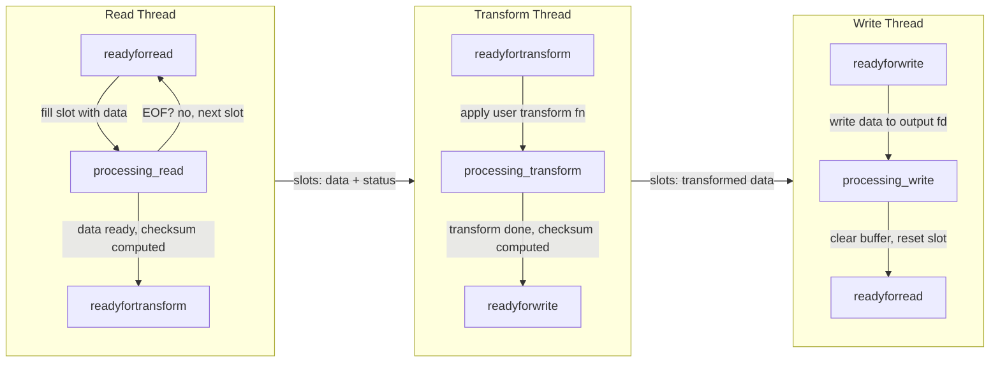
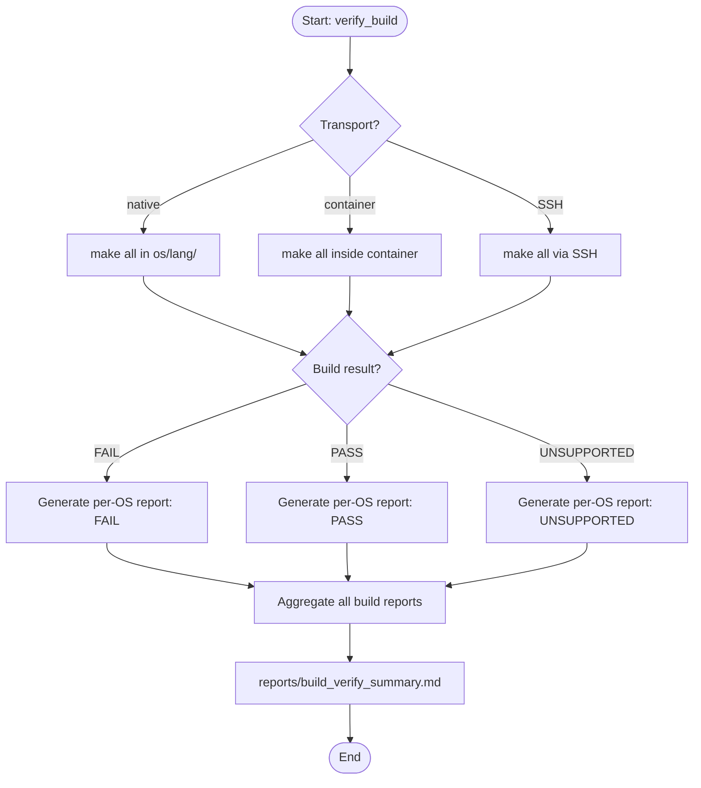
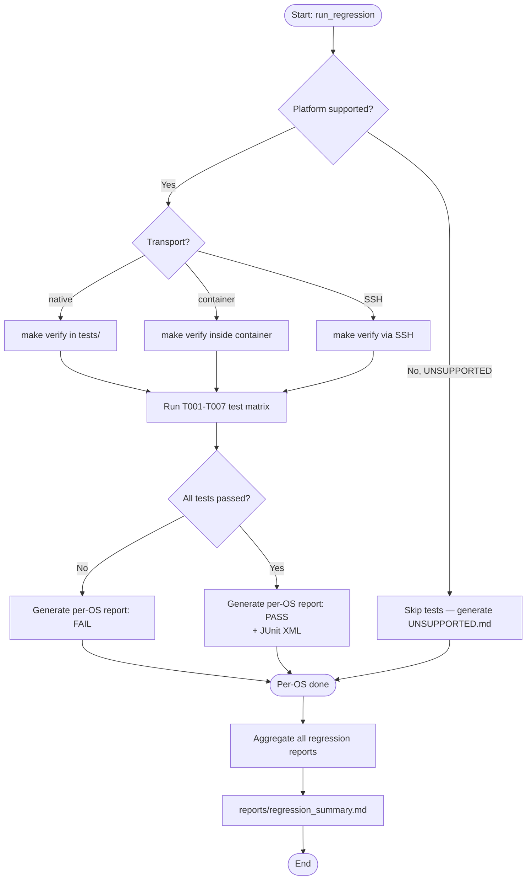
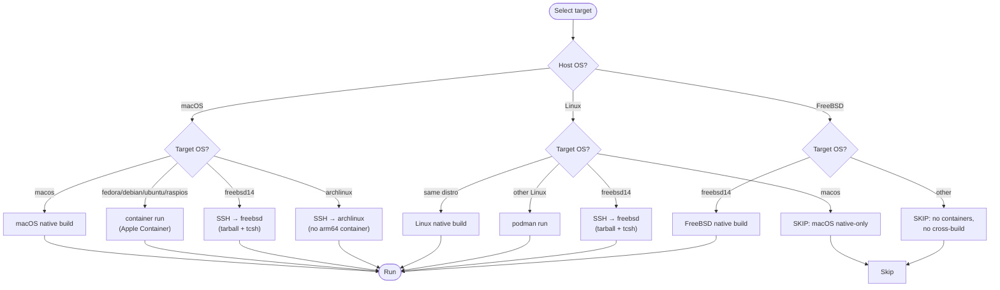

# Ringbuffer

A high-performance, cross-platform circular buffer library designed for binary symmetry and deterministic execution.

**Implemented:** C++, Java, Python &nbsp;|&nbsp; **7 target OSes:** macOS, Fedora, Debian, Ubuntu, Arch Linux, FreeBSD 14, Raspberry Pi OS &nbsp;|&nbsp; **Pipeline:** Read → Transform → Write with lock-free atomic coordination

Built entirely through prompt-driven LLM development using **LM Studio Bionic** with **Qwen 3.6 35B** (local) and **DeepSeek V4 Pro** (cloud). Single canonical source tree with symlinks — byte-identical across all platforms by construction.

<div align="center">
  
</div>

## What is a Circular Buffer?

A **circular buffer** (also called a ring buffer) is a fixed-size data structure that uses a single, pre-allocated array to store streaming data. When the buffer fills up, new data overwrites the oldest entries — hence "circular."

**Why use one?**
- **Zero-allocation streaming**: No dynamic memory allocation during operation — critical for real-time systems, audio processing, and network packet handling
- **Bounded memory usage**: Predictable memory footprint regardless of data volume
- **Lock-free concurrency**: Multiple threads can read/write simultaneously without mutexes when using proper slot-based designs
- **Deterministic latency**: No garbage collection pauses or heap fragmentation

**Common use cases:**
- Audio/video streaming pipelines (capture → process → output)
- Network packet buffers (receive → parse → dispatch)
- Log aggregation systems (collect → transform → persist)
- Real-time sensor data processing

The Ringbuffer library implements a **pipelined circular buffer** — extending the basic concept with three independent processing stages (Read → Transform → Write) that operate concurrently on shared slots.

## Contents

- [What is a Circular Buffer?](#what-is-a-circular-buffer)
- [What It Does](#what-it-does)
- [Implementation Status](#implementation-status)
- [Platform Support](#platform-support)
  - [Development Host vs Target](#development-host-vs-target)
  - [FreeBSD Conditional Compilation](#freebsd-conditional-compilation)
- [Roadmap](#roadmap)
- [Key Specifications](#key-specifications)
- [Core Features](#core-features)
- [Why Ringbuffer?](#why-ringbuffer)
  - [Performance Characteristics](#performance-characteristics)
  - [Reliability Features](#reliability-features)
  - [Developer Experience](#developer-experience)
  - [When to Use Ringbuffer](#when-to-use-ringbuffer)
- [Ringbuffer vs Alternatives](#ringbuffer-vs-alternatives)
  - [C++](#c)
  - [Java](#java)
  - [Python](#python)
- [Extending the Pipeline](#extending-the-pipeline)
  - [Add Custom Pipeline Stages](#add-custom-pipeline-stages)
  - [Common Extension Patterns](#common-extension-patterns)
  - [How It Works](#how-it-works)
  - [When to Extend vs Use Built-in Features](#when-to-extend-vs-use-built-in-features)
- [Library API Example](#library-api-example)
  - [Advanced Configuration](#advanced-configuration)
  - [Version Propagation](#version-propagation)
  - [Pipeline Architecture Diagram](#pipeline-architecture-diagram)
  - [Pipeline Animation](#pipeline-animation)
- [Quick Start: End-to-End Workflow (macOS Example)](#quick-start-end-to-end-workflow-macos-example)
  - [Step 1: Generate Source Code](#step-1-generate-source-code)
  - [Step 2: Create Build Environment](#step-2-create-build-environment)
  - [Step 3: Verify the Build](#step-3-verify-the-build)
  - [Step 4: Set Up Test Infrastructure](#step-4-set-up-test-infrastructure)
  - [Step 5: Execute Regression Tests](#step-5-execute-regression-tests)
  - [Incremental Updates](#incremental-updates)
- [Supported Platforms](#supported-platforms)
  - [Known Issues & Toolchain Limitations](#known-issues-toolchain-limitations)
- [Known Issues](#known-issues)
- [Where We Are At](#where-we-are-at)
  - [Current Status (as of 2026-08-29)](#current-status-as-of-2026-08-29)
  - [What Works Today](#what-works-today)
- [Where We're Going](#where-were-going)
  - [C Implementation Strategy](#c-implementation-strategy)
  - [Go Implementation Strategy](#go-implementation-strategy)
  - [Rust Implementation Strategy](#rust-implementation-strategy)
  - [Near-Term (Next Iterations)](#near-term-next-iterations)
  - [Medium-Term (Roadmap)](#medium-term-roadmap)
  - [Long-Term (Vision)](#long-term-vision)
- [Primary Goal](#primary-goal)
- [Project Structure](#project-structure)
- [Source File Layout & Symlink Usage](#source-file-layout-symlink-usage)
  - [How C++ Source Files Are Organized](#how-c-source-files-are-organized)
  - [Symlink Awareness & Compatibility](#symlink-awareness-compatibility)
  - [Compatibility Matrix](#compatibility-matrix)
  - [Windows Support (Roadmap)](#windows-support-roadmap)
  - [Why Symlinks Over Copying?](#why-symlinks-over-copying)
  - [How to Identify Symlinked vs Real Files](#how-to-identify-symlinked-vs-real-files)
  - [Build Artifact Symlinks (Separate from Source)](#build-artifact-symlinks-separate-from-source)
- [Development Methodology](#development-methodology)
- [LLM Challenges](#llm-challenges)
  - [Portable Shell Scripts (Core Feature)](#portable-shell-scripts-core-feature)
  - [BSD Makefiles vs GNU Make](#bsd-makefiles-vs-gnu-make)
  - [macOS Toolchain Quirks: sed, awk, zsh](#macos-toolchain-quirks-sed-awk-zsh)
  - [tcsh Scripts for FreeBSD 14](#tcsh-scripts-for-freebsd-14)
  - [Key Takeaway](#key-takeaway)
- [Prompt Execution Pattern](#prompt-execution-pattern)
- [Documentation Generation](#documentation-generation)
  - [Makefile Targets](#makefile-targets)
  - [Output Layout](#output-layout)
  - [Python: Two Documentation Backends](#python-two-documentation-backends)
  - [Path Handling](#path-handling)
  - [Doxygen Main Page Regeneration (C++/Java)](#doxygen-main-page-regeneration-cjava)
- [Developer & Maintainer Guide](#developer-maintainer-guide)
  - [Part A: The Golden Rules (Coding Standards)](#part-a-the-golden-rules-coding-standards)
  - [Part B: The Prompt-Driven Workflow](#part-b-the-prompt-driven-workflow)
    - [Prompt-Driven Incremental Regeneration](#prompt-driven-incremental-regeneration)
    - [Execution Examples](#execution-examples)
    - [Build & Test Workflows](#build-test-workflows)
    - [Test Data Pattern System](#test-data-pattern-system)
    - [Part C: Session Best Practices](#part-c-session-best-practices)
    - [Test Matrix (T001–T007)](#test-matrix-t001t007)
    - [Part D: Documentation & Media Assets](#part-d-documentation-media-assets)
  - [Part E: Adding a New Operating System](#part-e-adding-a-new-operating-system)
- [Project Policies](#project-policies)
  - [Shell Script Portability](#shell-script-portability)
  - [SSH Authentication Policy](#ssh-authentication-policy)
  - [Git Discipline](#git-discipline)
  - [Build vs Test Workflow Pattern (All Languages)](#build-vs-test-workflow-pattern-all-languages)
  - [Container Commands (macOS)](#container-commands-macos)
  - [Prompt Changelog Discipline](#prompt-changelog-discipline)
  - [Prompt Deduplication Discipline](#prompt-deduplication-discipline)
  - [Makefile Tab Discipline](#makefile-tab-discipline)
  - [Version Naming Convention](#version-naming-convention)
  - [Mermaid Diagram Validation](#mermaid-diagram-validation)
- [Required Tools](#required-tools)
- [Initial Development Environment](#initial-development-environment)
- [TODO](#todo)
  - [Host-to-Target Routing Configuration](#host-to-target-routing-configuration)
  - [Python Multi-Compiler C++ Library Testing](#python-multi-compiler-c-library-testing)
- [Appendices](#appendices)
- [LLM Knowledge Package](#llm-knowledge-package)
  - [What It Contains](#what-it-contains)
  - [Distribution Paths](#distribution-paths)
  - [Versioning](#versioning)
  - [Update Process](#update-process)
  - [Installation (End Users)](#installation-end-users)
  - [Testing the Knowledge Model](#testing-the-knowledge-model)
  - [Development (Internal)](#development-internal)
- [LinkedIn Post Generator](#linkedin-post-generator)
  - [Usage](#usage)
  - [Project Metadata Files](#project-metadata-files)
  - [Post Guidelines Enforced](#post-guidelines-enforced)
- [License](#license)

## What It Does

The Ringbuffer library implements a **three-stage pipelined architecture** (Read → Transform → Write) that connects independent threads through a fixed-size array of shared slots. Each slot carries its own state machine, checksum, and data buffer, enabling lock-free concurrent processing with cache-line-aligned counters to prevent false sharing.

**Why pipeline?** A pipelined circular buffer achieves higher throughput than sequential processing by allowing stages to operate concurrently:
- While the **read thread** fills slot N, the **transform thread** processes slot N-1, and the **write thread** flushes slot N-2
- Each stage works on independent slots, eliminating contention
- The fixed-size slot pool provides backpressure — if the transform stage is slow, the read thread naturally slows down

**How the pipeline works:**

1. **Read thread** fills slots from an input file descriptor, marking each slot `readyfortransform` when full. On EOF, it marks the final slot with `LAST_BUFFER_TO_TRANSFORM`.
2. **Transform thread** applies a user-supplied `std::function` to each slot's data, computes an atomic checksum (MD5/SHA256/SHA512), and marks the slot `readyforwrite`.
3. **Write thread** writes transformed data to an output file descriptor, clears the slot buffer, and resets it to `readyforread`. On the last buffer, it flushes (`fsync`) before signaling completion.

Each stage uses its own independent atomic index counter, so threads operate on slots without contention. The `wait()` method blocks until all data has flowed through the entire pipeline and threads have joined cleanly via `std::jthread` cooperative cancellation.

The core focus of the project is **binary symmetry within OS families**, with minimal differences allowed when crossing OS boundaries:
- **Same OS Family (e.g., all Linux distros):** Source code is byte-identical across ALL platforms **by construction via symlinks to a single canonical source tree in `src/common/cpp/`**. The build system handles platform-specific flags (linker options, container images), but `.cpp` and `.hpp` files are byte-identical.
- **Cross OS Family (Linux vs macOS vs FreeBSD):** Differences should be minimal — limited only to `#ifdef` guards or macros that wrap OS-specific syscalls (e.g., file sync behavior, threading primitives). The core logic, architecture, and API surface remain identical.
- **Platform-Insensitive Languages (Java, Python, Go, Rust):** Source code is byte-identical across ALL platforms by design. These languages abstract platform differences through their standard libraries.
- **Platform-Sensitive Languages (C, C++):** Source code is byte-identical within the same OS family. Cross-family differences are limited to `#ifdef` guards for OS-specific behavior (e.g., macOS `F_FULLFSYNC` vs Linux `F_DATASYNC`).

**Goal:** A single canonical source tree that compiles and runs correctly on every target platform. The build system, not the source code, is responsible for platform-specific adaptation.


## Implementation Status

| Language | Phase | macOS | Fedora | Debian | Ubuntu | Arch Linux | FreeBSD 14 | Raspios |
|----------|-------|-------|--------|--------|--------|------------|------------|---------|
| C++      | ✅ B  | ✅ | ✅ | ✅ | ✅ | ✅ | ✅ | ⚠️ |
| Java     | ✅ B  | ✅ | ✅ | ✅ | ✅ | ✅ | ✅ | ✅ |
| Python   | ✅ B  | ✅ | ✅ | ✅ | ✅ | ✅ | ✅ | ✅ |
| C        | ⬜ A  | — | — | — | — | — | — | — |
| Go       | ⬜ A  | — | — | — | — | — | — | — |
| Rust     | ⬜ A  | — | — | — | — | — | — | — |

**Phases:** A = common spec written, B = implemented + passes 7-test matrix (T001-T007)  
C, Go, and Rust are next in the pipeline — their common specs are complete and the dispatcher prompt (`add_language.md`) can generate implementations on demand. See [Roadmap](#roadmap).

> ⚠️ Raspios C++ is **UNSUPPORTED** — GCC 12 (the only compiler available via official Raspberry Pi OS repositories) lacks the `<format>` C++20 header required by the ringbuffer library. See `src/raspios/cpp/UNSUPPORTED.md` for details.

## Platform Support

### Development Host vs Target

| System | Development Host | Target | Notes |
|--------|:---:|:---:|-------|
| **macOS** | ✅ Verified | ✅ | Native `container` CLI, `.zsh` scripts |
| **Linux distributions** | ⚠️ Alpha | ✅ | `podman` for containers, `.sh` scripts. Development host capability not yet verified end-to-end |
| **FreeBSD 14/15** | ❌ | ✅ | No container support — SSH deploy only. `.tcsh` scripts, BSD make |
| **MS Windows** | ❌ | ❌ | Not supported as development host or target |

- **Development host** — where code is written, scripts are verified, and containers are run. Must support containers to build/test Linux targets locally.
- **Target** — where `verify_build` or `run_regression` executes. May be local (containers on the development host) or remote (SSH to FreeBSD/Arch Linux).

### FreeBSD Conditional Compilation

FreeBSD lacks `<stop_token>` (C++20) and `std::jthread`, so the ringbuffer uses conditional compilation to provide equivalent functionality:

| Feature | macOS / Linux | FreeBSD |
|---------|--------------|---------|
| Thread stop mechanism | `std::jthread` (auto-stops via `request_stop()`) | Manual `std::atomic<bool>` flag + `while (!stop_flag_.load())` loop |
| Thread type | `std::jthread` (RAII, auto-join) | `std::thread` + explicit `stop()` call |
| Header availability | `<stop_token>` included | Skipped — not available in FreeBSD's libc++ |
| Wait loop | `cv.wait_for()` with stop token predicate | `cv.wait_for()` with manual flag check in predicate |

**Implementation pattern:** Every thread loop checks `stop_flag_.load()` and the condition variable predicate includes the flag. The `stop()` method sets the flag instead of calling `request_stop()`. This keeps the code identical across platforms — only the preprocessor directives differ.

**Files affected:** `ReadOps.cpp`, `TransformOps.cpp`, `WriteOps.cpp`, `Threading.cpp`, `swtr_ringbuffer_impl.hpp`

**Impact:** FreeBSD conditional compilation accounts for **4.5%** of the affected files (18 of 398 lines). The remaining **95.5%** is identical across all platforms.

## Roadmap

- [x] **Phase 1** — Common functional + build specs for all 6 languages
- [x] **Phase 2** — Dispatcher prompt (`add_language.md`) routes any language to any OS
- [x] **Phases A–B** — C++, Java, Python implemented and tested across 7 OSes
- [ ] **Phase 3** — Implement C, Go, Rust from existing specs (dispatcher-ready)
- [ ] **Phase 4** — Cross-language verification, unified README

## Key Specifications
- **Multi-OS Support**: Seamless deployment across macOS, Linux distributions (Fedora, Debian, Ubuntu, Raspberry Pi OS), Arch Linux, and FreeBSD 14.
- **Language Standards and Classification**:
  - C: C23 primary, C17/C11 fallback
  - C++: C++20 primary, C++17 fallback
  - Java: SE 25 primary, SE 24-17 fallback
  - Go: 1.24 primary, 1.23/1.22 fallback
  - Python: 3.14 primary, 3.13-3.10 fallback
  - Rust: 1.84.0 primary, 1.56.0 fallback
  - Minimum supported versions are enforced — implementations must detect and report actual toolchain version, stopping if below minimum.
  - **Platform-sensitive** (c, cpp): require per-OS overrides for threading primitives, I/O multiplexing (epoll vs kqueue), and build flags
  - **Platform-insensitive** (python, java, go, rust): use standard library abstractions for identical source everywhere
- **Language-Specific Build Systems**:
  - C/C++: GNU Make (`Makefile`) → `lib/libswtr_ringbuffer-<version>.{a|so|dylib}`
  - Java: Apache Maven (`pom.xml`) → `target/ringbuffer-<version>.jar`
  - Go: Go Modules (`go.mod`) with `-buildmode=c-{archive,shared}` → `lib/libringbuffer.{a|so|dylib}`
  - Python: Interpreted, no build system; depends on C library shared object via `ctypes`
  - Rust: Cargo (`Cargo.toml`) with `crate-type = ["staticlib", "cdylib"]` → `target/release/libswtr_ringbuffer.{a,so|dylib}`
- **Unified Build/Test Pattern** (all languages):
  - `verify_build` → `<os>/<lang>/Makefile all` — builds artifacts and creates symlinks (no tests)
  - `run_regression` → `tests/Makefile verify` — runs T001–T007 test matrix, generates reports
  - Main Makefile must have `test: all` → calls `$(MAKE) -C tests verify`
  - See `.bionic` section "Build vs Test Workflow Pattern (All Languages)" for full details
- **Multi-Language Support**: C++, Java, Python implementations with shared functional specifications; C, Go, Rust in development pipeline.
- **Multi-Toolchain Compatibility**: Fully buildable using both **GCC** and **Clang**.
- **C++20 Standard**: Leverages `std::jthread`, cooperative cancellation, and advanced synchronization primitives.
- **Library-First API Design**: The Ringbuffer is designed as a reusable library, not an application. All public APIs — including the ~20 slot-level accessor methods on `RingBuffer` (e.g., `get_data_buffer_size()`, `set_transformed_data_buffer_size()`, `get_slot_status()`) — are intentional design choices providing maximum flexibility to library consumers for debugging, monitoring, and testing. Granular slot state visibility is a feature, not a leaky abstraction.
- **Core Principle — Library-First Flexibility**: Consumer flexibility > API simplicity. No hidden abstractions — consumers should be able to observe and control state at any granularity without wrapper code. Opt-in complexity: basic usage is simple (construct, set transform, start), but advanced usage must not require extending the library. The abstract class interface is a stable public API contract.
- **Portable Shell Scripts (Core Feature)**: All shell scripts use only bash/zsh builtins — `awk`, `sed`, `grep` and other external tools are forbidden to ensure identical behavior across macOS (BSD), Linux (GNU), and FreeBSD. See [LLM Challenges — Portable Shell Scripts](#portable-shell-scripts-core-feature) for details on the rule, its rationale, and workarounds.
  - **Default shells per platform**: We only use the default shell for each target — **zsh on macOS**, **bash on Linux**, and **tcsh on FreeBSD**. This ensures best compatibility with each OS's toolchain, package manager, and system utilities.

## Core Features
- **Shared Behavioral Contract (All Languages)**: Every implementation must satisfy these requirements regardless of language:
  - **Three-stage pipeline**: Independent read, transform, and write stages operating on a shared pool of buffer slots
  - **Status-driven coordination**: Slots transition through states (`readyforread` → `readyfortransform` → `readyforwrite` → `readyforread`)
  - **Cooperative cancellation**: Pipeline stages must support graceful shutdown via a stop signal or equivalent mechanism
  - **Error handling**: An error handler callback that returns non-zero to trigger pipeline shutdown
  - **EOF detection**: When read returns EOF (0 bytes), the pipeline must propagate `LAST_BUFFER_TO_TRANSFORM` → `LAST_BUFFER_TO_WRITE` through all stages, then terminate cleanly
  - **Transform in-place**: The transform function receives the slot's data buffer and modifies it directly; `transformed_data_buffer_size` must be updated with the result size
- **Pipelined Architecture**: Decoupled read, transform, and write loops for maximum throughput.
- **Performance**: 
    - **Cache Alignment**: Buffer slots and counters are aligned to 64-byte boundaries to prevent false sharing.
    - **Small Binaries**: Optimized for dead code elimination (`-ffunction-sections`, `-fdata-sections`).
    - **Universal Binaries (macOS)**: Built with both `arm64` and `x86_64` slices via `lipo -create`, enabling execution on both Apple Silicon and Intel Macs.
    - **Compiler Flags**: `-fvisibility=hidden` (hide internal symbols), `-flto=thin` (thin link-time optimization), `-ffunction-sections -fdata-sections` (enable dead code elimination).
- **Data Integrity**: Integrated checksumming (MD5, SHA256, SHA512) for every buffer slot.
- **Diagnostics**: Non-Virtual Public Interface (NVI) logging system with per-stage (read/transform/write) independently configurable verbosity levels.
- **LLM Knowledge Package**: Versioned, shareable context packages that teach LLMs how to use the ringbuffer library. Available as a local Ollama Modelfile (system prompt injection), LM Studio system prompt, and fine-tuned GGUF models. See [LLM Knowledge Package](#llm-knowledge-package) below.

## Why Ringbuffer?

### Performance Characteristics
- **Throughput**: Pipelined architecture achieves near-linear scaling with slot count (4+ slots recommended)
- **Latency**: Single-pass processing — data flows through all stages without intermediate storage
- **Memory efficiency**: Fixed-size allocation, no fragmentation, cache-line aligned

### Reliability Features
- **Data integrity**: Per-slot checksums (MD5/SHA256/SHA512) detect corruption
- **Graceful shutdown**: Cooperative cancellation via `std::jthread` or equivalent
- **Error recovery**: Custom error handlers can inspect slot state and decide whether to continue

### Developer Experience
- **Simple API**: Basic usage requires 5 lines of code; advanced features are opt-in
- **Cross-platform**: Same source compiles on 7 OSes with identical behavior
- **Multi-language**: C++, Java, and Python implementations share the same functional specification

### When to Use Ringbuffer
- ✅ Real-time data processing pipelines (audio, video, network)
- ✅ High-throughput ETL operations (extract → transform → load)
- ✅ Systems requiring deterministic memory usage
- ❌ Variable-size data with frequent resize operations (use std::vector instead)
- ❌ Single-threaded batch processing (overhead not justified)

## Ringbuffer vs Alternatives

### C++

| Feature | Ringbuffer | std::vector | std::queue (deque) | Custom FIFO |
|---------|------------|-------------|-------------------|-------------|
| Fixed memory | ✅ Yes | ❌ No (grows) | ⚠️ Dynamic | ✅ Yes |
| Lock-free multi-threaded | ✅ Yes | ❌ No | ⚠️ Requires mutex | ⚠️ Depends on impl |
| Zero allocation (runtime) | ✅ Yes | ❌ No | ⚠️ Sometimes | ✅ Yes |
| Backpressure support | ✅ Built-in | ❌ No | ⚠️ Manual | ⚠️ Manual |
| Pipeline support | ✅ 3-stage | ❌ No | ❌ No | ❌ No |
| Checksum verification | ✅ Built-in | ❌ No | ❌ No | ❌ No |
| Cross-platform | ✅ 7 OSes | ⚠️ Platform-specific | ⚠️ Platform-specific | ❌ Custom |

### Java

| Feature | Ringbuffer | ArrayList/LinkedList | ArrayBlockingQueue | Custom FIFO |
|---------|------------|---------------------|-------------------|-------------|
| Fixed memory | ✅ Yes | ❌ No (grows) | ✅ Yes | ✅ Yes |
| Lock-free multi-threaded | ✅ Yes | ❌ No | ⚠️ Thread-safe only | ⚠️ Depends on impl |
| Zero allocation (runtime) | ✅ Yes | ❌ No | ⚠️ Sometimes | ✅ Yes |
| Backpressure support | ✅ Built-in | ❌ No | ⚠️ Bounded only | ⚠️ Manual |
| Pipeline support | ✅ 3-stage | ❌ No | ❌ No | ❌ No |
| Checksum verification | ✅ Built-in | ❌ No | ❌ No | ❌ No |
| Cross-platform | ✅ 7 OSes | ⚠️ JVM only | ⚠️ JVM only | ❌ Custom |

### Python

| Feature | Ringbuffer | list (dynamic) | collections.deque | Custom FIFO |
|---------|------------|----------------|-------------------|-------------|
| Fixed memory | ✅ Yes | ❌ No (grows) | ⚠️ Unbounded | ✅ Yes |
| Lock-free multi-threaded | ✅ Yes | ❌ No | ⚠️ Requires lock | ⚠️ Depends on impl |
| Zero allocation (runtime) | ✅ Yes | ❌ No | ⚠️ Sometimes | ✅ Yes |
| Backpressure support | ✅ Built-in | ❌ No | ⚠️ Manual | ⚠️ Manual |
| Pipeline support | ✅ 3-stage | ❌ No | ❌ No | ❌ No |
| Checksum verification | ✅ Built-in | ❌ No | ❌ No | ❌ No |
| Cross-platform | ✅ 7 OSes | ⚠️ Python only | ⚠️ Python only | ❌ Custom |

## Extending the Pipeline

The ringbuffer's class-based design makes it easy to extend beyond the default three-stage pipeline (Read → Transform → Write). Since `RingBuffer` is an abstract base class and the slot state machine is well-defined, you can add custom processing stages while maintaining cross-platform compatibility.

### Add Custom Pipeline Stages

**C++ Example:**
```cpp
// Read → Transform → Validate → Write (4 stages)
class ValidatingRingBuffer : public SwtrRingBuffer {
public:
    ValidatingRingBuffer(size_t num_slots, size_t buffer_size)
        : SwtrRingBuffer(num_slots, BufferStatus::readyforread, buffer_size) {}

protected:
    // Override transform stage to add validation between transform and write
    void do_transform(size_t slot_idx) override {
        SwtrRingBuffer::do_transform(slot_idx);  // Run standard transform
        
        // Add validation logic
        BufferStatus status = get_status(slot_idx);
        if (status == BufferStatus::readyforwrite) {
            // Validate data integrity before write stage
            if (!validate_slot_data(slot_idx)) {
                handle_error(slot_idx, BufferStatus::STATUS_ERROR);
            }
        }
    }

private:
    bool validate_slot_data(size_t slot_idx) {
        // Custom validation logic here
        return true;  // Simplified for example
    }
};
```

**Java Example:**
```java
// Read → Transform → Validate → Write (4 stages)
public class ValidatingRingBuffer extends SwtrRingBuffer {

    public ValidatingRingBuffer(int numSlots, int bufferSize) {
        super(numSlots, BufferStatus.READYFORREAD, bufferSize, null, null);
    }

    @Override
    protected void transformSlot(int slotIdx) {
        super.transformSlot(slotIdx);  // Run standard transform
        
        // Add validation logic after transform
        if (getSlotStatus(slotIdx) == BufferStatus.READYFORWRITE) {
            if (!validateSlotData(slotIdx)) {
                handleError(slotIdx, BufferStatus.STATUS_ERROR);
            }
        }
    }

    private boolean validateSlotData(int slotIdx) {
        // Custom validation logic here
        return true;  // Simplified for example
    }
}
```

**Python Example:**
```python
# Read → Transform → Validate → Write (4 stages)
class ValidatingRingBuffer(SwtrRingBuffer):
    def __init__(self, num_slots: int, buffer_size: int = 4096):
        super().__init__(num_slots=num_slots, buffer_size=buffer_size)

    def _transform_slot(self, slot_idx: int):
        super()._transform_slot(slot_idx)  # Run standard transform
        
        # Add validation logic after transform
        if self.get_slot_status(slot_idx) == BufferStatus.READYFORWRITE:
            if not self._validate_slot_data(slot_idx):
                self.handle_error(slot_idx, BufferStatus.STATUS_ERROR)

    def _validate_slot_data(self, slot_idx: int) -> bool:
        # Custom validation logic here
        return True  # Simplified for example
```

### Common Extension Patterns

| Pattern | Description | Use Case |
|---------|-------------|----------|
| **Read → Transform → Validate → Write** | Add checksum verification or data integrity checks before output | Financial transactions, medical data |
| **Read → Transform → Encrypt → Write** | Insert encryption stage for secure transmission | Secure messaging, payment processing |
| **Read → Transform → Split → Merge → Write** | Fan-out/fan-in for parallel processing | Video frame processing, batch jobs |
| **Read → Transform → Cache → Write** | Add caching layer for retry logic | Unreliable networks, intermittent storage |
| **Read → Transform → Audit → Write** | Add logging/audit trail without affecting data flow | Compliance, debugging |

### How It Works

The slot state machine (`BufferStatus` enum) defines the transitions between stages. Each stage:
1. Reads slots in `readyfor<stage>` state
2. Processes data and updates slot size/checksum
3. Transitions slot to `readyfor<next_stage>` state

By implementing additional stage methods that follow this pattern, you can insert new processing steps without modifying the core pipeline logic.

### When to Extend vs Use Built-in Features

- **Extend** when you need custom processing logic not covered by the transform function
- **Use built-in features** for standard operations (the transform function handles most data manipulation needs)
- **Consider composition** — wrap a `SwtrRingBuffer` instance rather than subclassing for complex scenarios

## Library API Example

The following example demonstrates the core Ringbuffer API — construction, transform setup, and pipeline execution:

```cpp
#include "ringbuffer.hpp"
#include "swtr_ringbuffer_impl.hpp"
using namespace swtr;

int main() {
    // Transform: convert input to uppercase
    auto transform = [](std::vector<uint8_t>& data, size_t& size) {
        for (size_t i = 0; i < size; ++i)
            if (data[i] >= 'a' && data[i] <= 'z') data[i] -= 32;
    };

    // Create a ring buffer with 4 slots, 4096 bytes each
    auto rb = std::make_unique<SwtrRingBuffer>(4, BufferStatus::readyforread, 4096, nullptr, transform);

    // Configure I/O: read from stdin, write to stdout
    rb->set_read_fd(STDIN_FILENO);
    rb->set_write_fd(STDOUT_FILENO);

    // Enable logging for diagnostics
    rb->set_logging_enabled(true);
    rb->set_output_stream(std::cerr);

    // Run the pipeline: reads until EOF, transforms each slot, writes output
    rb->start();
    rb->wait();   // blocks until all data flows through read $\rightarrow$ transform $\rightarrow$ write
    rb->stop();
}
```

Build with: `clang++ -std=c++20 main.cpp -I../src/macos/cpp -L../src/macos/cpp/lib -lswtr_ringbuffer -o main`

### Advanced Configuration

The Ringbuffer API supports per-stage logging, checksum algorithm selection, and custom error handlers:

```cpp
// Per-stage logging configuration (independent verbosity per stage)
rb->set_read_logging_enabled(true);
rb->set_read_verbosity(LogLevel::Debug);
rb->set_transform_logging_enabled(true);
rb->set_write_logging_enabled(true);

// Checksum algorithm per slot (NONE, MD5, SHA256, SHA512)
rb->set_checksum_alg(0, ChecksumAlgorithm::SHA256);

// Custom error handler (plain C function pointer)
int my_error_handler(size_t slot_idx, BufferStatus status) {
    std::cerr << "Error in slot " << slot_idx << ": "
              << static_cast<int>(status) << std::endl;
    return 0; // 0 = continue, non-zero = stop pipeline
}
auto rb = std::make_unique<SwtrRingBuffer>(4, BufferStatus::readyforread, 4096, my_error_handler, transform);
```

**Transform types**: `0` (identity/bypass), `1` (uppercase), `2` (XOR with 0xFF). User-supplied transforms are passed as `std::function<void(std::vector<uint8_t>&, size_t&)>` and can implement any custom logic.

### Version Propagation
All languages derive version from `version.mk` — each has a specific mechanism:
- **C/C++**: Makefile `include version.mk` (direct)
- **Java**: `version.sh` reads `version.mk`, injects into `pom.xml` as Maven properties
- **Go**: `version.sh` reads `version.mk`, generates `version.go` with typed constants
- **Python**: `version.sh` reads `version.mk`, generates `version.py` with module constants
- **Rust**: `build.rs` reads `version.mk`, generates `src/version.rs` with constants
- **Core Principle**: `version.mk` is the single source of truth — no language defines its own version independently.

### Pipeline Architecture Diagram

The following diagram shows how the three pipeline threads interact through shared slots:



**Key points:**
- Each stage uses its own independent atomic index counter (`read_index_`, `transform_index_`, `write_index_`)
- Slots transition through states: `readyforread` $\rightarrow$ `processing_read` $\rightarrow$ `readyfortransform` $\rightarrow$ `processing_transform` $\rightarrow$ `readyforwrite` $\rightarrow$ `processing_write` $\rightarrow$ `readyforread`
- On EOF, the read thread marks the final slot with `LAST_BUFFER_TO_TRANSFORM`, which propagates through transform (`LAST_BUFFER_TO_WRITE`) to write, then all threads break and `wait()` returns

### Pipeline Animation

The following animation (also shown as the [pipeline animation at the top](#ringbuffer) of this README) demonstrates the three-stage pipeline in action, showing how data flows through the read $\rightarrow$ transform $\rightarrow$ write stages.

## Quick Start: End-to-End Workflow (macOS Example)

The following sequence shows the complete prompt-driven workflow for setting up, building, verifying, and testing on macOS. Each step depends on the previous one — execute them in order.

### Step 1: Generate Source Code
```
"Use prompts/macos/cpp/create_functional.md to perform a full generation of the ringbuffer for macos"
```
Produces: `ringbuffer.hpp`, `status.hpp`, `swtr_ringbuffer_impl.hpp`, and all `.cpp` implementation files in `src/macos/cpp/`.

### Step 2: Create Build Environment
```
"Use prompts/macos/cpp/create_build.md to create the build environment for macos"
```
Produces: `Makefile`, `version.mk`, and built library artifacts (`.a` static, `.dylib` shared) in `src/macos/cpp/lib/`. Libraries are versioned as `libswtr_ringbuffer-<MAJOR>.<MINOR>.<SUBVERSION>-<BUILD_ID>` with unversioned symlinks for convenience.

### Step 3: Verify the Build
```
"Use prompts/common/verify_build.md to run build_verify for macos"
```
Runs: `<os>/<lang>/Makefile all` — builds library artifacts and creates symlinks (no tests). Confirms: library compiles, produces correct Mach-O binaries, symbol visibility is correct, and binary sizes are within expected ranges.

### Step 4: Set Up Test Infrastructure
```
"Use prompts/macos/cpp/create_regression.md to create the test environment for macos"
```
Produces: `tests/` directory with Makefile, test data (T001–T007), utility scripts, and builds `test001_staticlib` / `test001_dynamiclib`.

### Step 5: Execute Regression Tests
```
"Use prompts/common/run_regression.md to run regression_test on macos"
```
Runs: `tests/Makefile verify` — executes the full T001–T007 test matrix, generates `regression_report.md` and `regression_report_junit.xml`.

**Linux platforms:** Replace native commands with container-wrapped equivalents. For example, `make` becomes `container run --rm -v $(pwd):/app ringbuffer_ubuntu_test make`. The container runtime (`container` on macOS hosts, `podman` on Linux hosts) is selected automatically by the Makefile.

### Incremental Updates
After the initial setup, use update prompts to synchronize with changed specifications:
```
"Use prompts/macos/cpp/update_functional.md to synchronize the macos implementation with updated common specifications"
```

## Supported Platforms

| OS | Language | Version | Verified Compilers |
| :--- | :--- | :--- | :--- |
| **macOS** | C++ | v1.0.0 | clang++ 21.0.0, g++ 16.1.0 |
| | Java | v1.0.0 | javac 26.x (JDK 26) |
| | Python | v1.0.0 | python 3.14.x |
| **Debian** | C++ | v1.0.0 | g++ 14.x, clang++ 18.x |
| | Java | v1.0.0 | javac 25.x (JDK 25) |
| | Python | v1.0.0 | python 3.14.x |
| **Fedora** | C++ | v1.0.0 | g++ 14.x, clang++ 18.x |
| | Java | v1.0.0 | javac 25.x (JDK 25) |
| | Python | v1.0.0 | python 3.14.x |
| **Ubuntu** | C++ | v1.0.0 | g++ 13.x (clang++ unsupported — see Known Issues) |
| | Java | v1.0.0 | javac 25.x (JDK 25) |
| | Python | v1.0.0 | python 3.14.x |
| **Raspberry Pi OS** | C++ | v1.0.0 | ⚠️ UNSUPPORTED — GCC 12 lacks `<format>` (see `src/raspios/cpp/UNSUPPORTED.md`) |
| | Java | v1.0.0 | javac 25.x (JDK 25) |
| | Python | v1.0.0 | python 3.14.x (Pure Python only — Concurrent skipped, no C++ lib) |
| **ArchLinux** | C++ | v1.0.0[^2] | g++ 16.2.1, clang++ 22.1.8 |
| | Java | v1.0.0 | javac 25.x (JDK 25) |
| | Python | v1.0.0 | python 3.14.x |
| **FreeBSD 14** | C++ | v1.0.0 | clang++ 19.x (static library only — see Known Issues) |
| | Java | v1.0.0 | javac 25.x (JDK 25) |
| | Python | v1.0.0 | python 3.14.x (Pure Python only — Concurrent skipped, RPATH limitation) |
| **FreeBSD 15** | C++ | TBS | — |

> **Go, Rust, C:** Common specs written, scaffolding complete. Implementations pending for all platforms. See [Roadmap](#roadmap).

[^1]: Arch Linux container images are amd64-only. Linux x86_64 hosts use `podman` containers natively. macOS (Apple Silicon) has no project-supported arm64 image — uses SSH to a remote Arch Linux host instead. See [prompts/common/session_hints.md](prompts/common/session_hints.md) Section 3 for details.
[^2]: Arch Linux is a rolling-release distribution. Both g++ and clang++ are fully supported (unlike Ubuntu 24.04 where clang++ is unsupported). See [prompts/common/cpp/session_hints.md](prompts/common/cpp/session_hints.md) Section 10.

`*TBS: To Be Supplied | WIP: Work In Progress`

> **Note:** Compiler versions shown are those verified during implementation. Actual available versions may vary by OS release. See [prompts/common/session_hints.md](prompts/common/session_hints.md) for toolchain detection and fallback logic.

### Known Issues & Toolchain Limitations

| Platform | Issue | Impact | Workaround |
|----------|-------|--------|------------|
| **Ubuntu 24.04** | Clang 18 looks for C++ headers in `/usr/include/c++/14`, but Ubuntu ships only `g++-13` (headers in `/usr/include/c++/13`). The GCC 14 base package (`gcc-14-base`) does not include C++ headers. | `clang++` fails with `'atomic' file not found` and similar errors when compiling C++20 code. | **clang++ is unsupported on Ubuntu.** Use `g++` as the compiler for all build and test operations. The Dockerfiles include clang packages for reference but only g++ is used in practice. |
| **FreeBSD 14** | `ld-elf.so.1` does NOT support `$ORIGIN` in RUNPATH — the dynamic linker strips it to empty at runtime. | **Dynamic library testing is not possible on FreeBSD 14.** The test binary cannot find `libswtr_ringbuffer.so` at runtime. | **Static library only.** Use the `make verify` target which builds and runs tests against the static library (`libswtr_ringbuffer.a`). All 7 regression tests pass via static library. See [freebsd-platform-analysis.md](prompts/common/appendices/freebsd-platform-analysis.md) for details. |

## Known Issues

- **LM Studio shell ENOENT after session compaction:** After a long session hits its first compaction, `shell_command` calls fail with `spawn ... ENOENT`. This is a bug in LM Studio Bionic — the scratchpad directory isn't materialized until a sandboxed Python or file-delivery call creates it. **Workaround:** run a trivial sandboxed Python call first, then retry the shell command. See `.bionic` Common Pitfalls #1 for details. **Remove this note once LM Studio fixes the bug.**

## Where We Are At

### Current Status (as of 2026-08-29)

**Implementation:**

Implementation status is tracked in the [Implementation Status](#implementation-status) table above.

**Verification & Quality Gates:**
- **Automated binary symmetry check** — `verify_binary_symmetry.sh` compares all 21 source files across Linux platforms; integrated into `verify_build.md` as a mandatory post-build step (step 0.5)
- **Automated prompt linting** — `lint_prompts.sh` validates directory structure, required files per platform/language, excluded platform cleanliness, primary document naming, and common workflow completeness; integrated into `verify_build.md` as step 0.6
- **Prompt directory integrity** — All platform/language directories follow established conventions; excluded platforms (FreeBSD 15 only) contain only zero-length placeholder files
- **Multi-language verification** — `verify_build.md` dispatches to language-specific checks: Java (`mvn compile`, `mvn package`, JAR artifact, classload test), Python (syntax check, import verification, class instantiation), C/C++ (binary format, symbol visibility)
- **Java regression testing** — Full T001–T007 test matrix executed across all 7 OSes; Surefire-compatible test harness with `testAll()` method
- **Python build verification** — Pure Python implementation verified via `py_compile`, module import, and class instantiation across all 7 OSes; no compilation required

**Development Methodology:**
- Prompt-driven development with hundreds of prompt files across 8 OSes × 6 languages (common specs)
- Session isolation by design — each prompt file is self-contained for LLM-agent reliability
- Incremental regeneration via `.gen_state.json` delta detection (3-phase sync: Functional → Build → Regression)
- Two verification scripts integrated into the build workflow as mandatory gates
- Post-commit hook (`githooks/post-commit` + `utils/bin/suggest_changelog_entry.sh`) for changelog entry suggestions

### What Works Today

| Capability | Status | Details |
|------------|--------|---------|
| C++ library (macOS) | ✅ Complete | Universal binaries (arm64 + x86_64), static + shared libs |
| C++ library (Linux) | ✅ Complete | Byte-identical source across debian/fedora/ubuntu/raspios/archlinux — enforced by symlinks to `src/common/cpp/` |
| C++ library (FreeBSD 14) | ✅ Complete | Static library only (RPATH limitation), all 7 tests pass |
| Java library (all OS) | ✅ Complete | Maven build, JAR artifact, classload test verified |
| Python library (all OS) | ✅ Complete | Pure Python, syntax/import/instantiation verified |
| Build system | ✅ Complete | Unified `all` target pattern: `<os>/<lang>/Makefile all` (build + symlinks, no tests) |
| Test infrastructure | ✅ Complete | Unified `verify` target pattern: `tests/Makefile verify` (T001–T007, reports) |
| Build/test separation | ✅ Enforced | `verify_build` uses `<os>/<lang>/Makefile all`; `run_regression` uses `tests/Makefile verify` |
| Binary symmetry | ✅ Verified | All compared source files byte-identical across macOS and all Linux platforms — enforced by symlinks to single canonical tree (`src/common/cpp/`)
| Prompt linting | ✅ Operational | 10/13 checks pass (3 warnings for excluded platforms) |
| State tracking | ✅ Operational | `.gen_state.json` on all 8 active platforms |
| Multi-language verify | ✅ Operational | `verify_build.md` dispatches to Java, Python, C/C++ checks |
| Java regression | ✅ Passed | Full T001-T007 test matrix across 7 OSes (see [Implementation Status](#implementation-status)) |
| Python regression | ✅ Passed | Pure Python T001-T007 across 7 OSes; Concurrent skipped on raspios/freebsd14 |
| Go/Rust scaffolding | ✅ Complete | Common specs written; next in pipeline (see [Roadmap](#roadmap)) |
| Changelog suggestions | ✅ Operational | Post-commit hook analyzes prompt diffs and suggests entries |
| Documentation generation | ✅ Operational | C++, Java (Doxygen), Python Breathe + Sphinx; auto-index page at docs/index.html |

## Where We're Going

### C Implementation Strategy

The C implementation targets **C17/C18 (ISO/IEC 9899:2018)** as the universal baseline to ensure compatibility across all seven target platforms, including Raspberry Pi OS (GCC 12).

**Conditional C23 Enhancements:**
Where available, the code uses `#if __STDC_VERSION__ >= 202311L` guards to enable C23 features strictly for **code quality** (e.g., `__VA_OPT__` in logging macros, `char8_t` for diagnostics).

**Compiler Availability:**
- **Full C23 Support:** Fedora (GCC 16), Arch Linux (GCC 16)
- **Mostly Complete:** Debian (GCC 14), macOS (Clang 21), FreeBSD (Clang 19)
- **Limited:** Ubuntu (GCC 13), Raspberry Pi OS (GCC 12) — *requires C17 fallback*

**The Reality Check:**
C23 will not significantly improve the ringbuffer's performance. The library's high-speed architecture relies on:
1. **C11 `<stdatomic.h>`** for lock-free coordination (already universally available).
2. **C11 `alignas`** for cache-line optimization (already universally available).
3. **Algorithmic design** (pipelining, slot state machines) rather than language features.

New C23 features like `_BitInt` or `#embed` do not apply to the core ringbuffer logic.

### Go Implementation Strategy

The Go implementation targets **Go 1.22+** as the minimum version to ensure compatibility across all seven target platforms, with **Go 1.24+** recommended for optimal performance.

**Platform Availability:**
- **Go 1.27+:** macOS, Arch Linux (latest)
- **Go 1.26:** Fedora
- **Go 1.25:** FreeBSD 14
- **Go 1.24:** Debian
- **Go 1.22:** Ubuntu 24.04 (minimum supported)
- **Go 1.19:** Raspberry Pi OS (*requires manual Go installation for full feature support*)

**Key Design Decisions:**
1. **Generics over Channels** — Use `sync/atomic` with pre-allocated slot arrays (like C/C++), not Go channels, to avoid GC overhead in the hot path
2. **Cache-Line Alignment** — Use `unsafe` to ensure 64-byte alignment for false-sharing prevention
3. **GC Mitigation** — Pre-allocate all slots at construction; avoid heap allocations in the pipeline

**The Reality Check:**
Go's goroutines and `sync/atomic` make it an excellent fit for the pipelined architecture, but **Go will not match C/C++ performance** due to:
- Garbage collection pauses (non-deterministic latency)
- No inline assembly (can't use CPU-specific instructions like POPCNT/TZCNT)
- Runtime overhead from the Go scheduler

**Best use case:** High-throughput, non-real-time pipelines where developer productivity and maintainability matter more than microsecond latency.

### Rust Implementation Strategy

The Rust implementation targets **Rust 1.96+** as the minimum version to ensure compatibility across all seven target platforms, with **Rust 1.98+** recommended for optimal performance.

**Platform Availability:**
- **Rust 1.98+:** macOS, Arch Linux, Fedora, Debian, Ubuntu, Raspberry Pi OS (all via rustup)
- **Rust 1.96:** FreeBSD 14 (built from source tarball)

**Key Design Decisions:**
1. **`const` Generics over Channels** — Use `AtomicUsize` with pre-allocated slot arrays (like C/C++), not Rust channels, to avoid runtime overhead in the hot path
2. **Cache-Line Alignment** — Use `#[repr(align(64))]` for false-sharing prevention
3. **Zero-Copy Buffers** — Use `MaybeUninit` to avoid zeroing overhead during slot allocation

**The Reality Check:**
Rust's zero-cost abstractions and `std::sync::atomic` make it an excellent fit for the pipelined architecture, but **Rust will not significantly outperform C/C++** due to:
- No inline assembly (stable) — can't use CPU-specific instructions like POPCNT/TZCNT
- Slightly more overhead in `std::sync` vs raw C11 atomics (negligible)
- Compile-time overhead (doesn't affect runtime performance)

**Best use case:** High-performance, memory-safe pipelines where developer productivity and correctness matter more than microsecond latency gains over C/C++.

### Near-Term (Next Iterations)

- **Additional languages** — Go and Rust scaffolding is complete across all OSes (macos, fedora, debian, ubuntu, archlinux, raspios). C scaffolding is in place with common specs; per-OS overrides are placeholders (unlike C++ which has full platform-specific specs). The multi-language/multi-OS directory structure means adding a new language requires only implementing the spec files; the scaffolding (placeholder prompts, `.required_directory` markers) is already present.
- **Additional patterns** — The test data pattern system supports adding new patterns beyond zigzag (e.g., sequential, random). Each new pattern requires a single spec file in `prompts/common/testing/patterns/` and running `create_scripts.md`.
- **Enhanced CI/CD** — The automated verification scripts (`verify_binary_symmetry.sh`, `lint_prompts.sh`) are ready for CI integration. They can be added as pre-commit hooks or GitHub Actions to enforce quality gates before any code is committed.
- **LLM Knowledge Package** — Versioned knowledge packages for C++, Java, and Python. Available as local Ollama Modelfile, LM Studio system prompt, and fine-tuned GGUF. See [LLM Knowledge Package](#llm-knowledge-package) for details.

### Medium-Term (Roadmap)

- **FreeBSD 15 implementation** — Currently excluded with zero-length placeholder files. FreeBSD 14 C++ is implemented and verified (static library only, all 7 tests pass). Implementation requires writing the platform/language spec files and generating source code.
- **Arch Linux C++ source generation** — Prompts are implemented (`prompts/archlinux/cpp/`); actual source code generation requires executing `create_functional.md`, `create_build.md`, and `create_regression.md` on a Linux host.
- **More comprehensive test coverage** — Additional test scenarios for edge cases (concurrent access patterns, memory pressure, signal handling).
- **Documentation improvements** — Man page generation (pandoc → .1), Doxygen main page regeneration workflow, performance benchmarking documentation, container deployment guides.

### Long-Term (Vision)

- **Full multi-language library** — The architecture is designed so that each language implementation shares the same functional specification. When all 6 languages are implemented, any platform can be built in any language from the same spec.
- **Cross-platform verification suite** — Automated comparison of behavior across all language/platform combinations, not just source-level binary symmetry.
- **Plugin ecosystem** — The transform function abstraction (`std::function<void(std::vector<uint8_t>&, size_t&)>`) is designed to support a plugin model where users can register custom transforms without modifying the library.

## Primary Goal
The objective is to provide a prompt-driven, immediate build-and-run functionality where the codebase can be regenerated or updated across multiple platforms using a single set of functional specifications.

The project follows a **develop-then-refactor** strategy with three phases:
1. **Phase A — Platform Development:** Implement the language on 2–3 representative platforms (typically macOS for native/Apple Silicon, one Linux distro for containerized builds). This validates correctness against real toolchains and OS behaviors.
2. **Phase B — Common Refactor:** Once Phase A passes all tests, extract the common logic into `src/common/<lang>/`. Platform-specific overrides (build flags, container images) remain per-OS; all shared logic lives in common.
3. **Phase C — Platform Rollout:** Generate source for remaining platforms from the common spec + per-OS overrides.

**Current Status:** C++ is in Phase B (common implementations exist at `src/common/cpp/` with symlinks from all 8 OS platforms — macOS, Debian, Fedora, Ubuntu, Raspios, Arch Linux, FreeBSD 14). Java and Python are in Phase B (common implementations exist at `src/common/java/` and `src/common/python/`). C, Go, and Rust are pre-Phase A (specs created, implementation pending).

**Note:** Unimplemented languages should not be considered a negative — the spec scaffolding is in place and the dispatcher prompt (`add_language.md`) routes correctly.

## Project Structure
The project uses a **Deterministic File Mapping** strategy. Logic groups are mapped to specific filenames (e.g., `ReadOps.cpp`, `Threading.cpp`) with a strict constraint of **maximum 3 functions per file** to minimize git collisions and maximize modularity.

Each platform directory (`src/<os>/cpp/`) includes a `specs/` subdirectory containing copies of the specification files used to generate that platform's code, for reference and audit purposes.

**reference_linux**: A canonical reference platform in `src/reference_linux/cpp/` used for cross-platform verification. Contains test infrastructure (Makefile, Dockerfile, test data) but no generated source code — it serves as the authoritative spec against which other platforms are compared.

**Platform-Insensitive Languages**: Java and Python implementations live in `src/common/` (not per-OS), as they are platform-independent. Each language has its own build system: Maven for Java, pure Python with `py_compile` for verification.

**Generated Documentation (`docs/ringbuffer/`)**: API documentation is generated by `make create-doc` and stored in `docs/ringbuffer/`. The directory structure is:

```
docs/ringbuffer/
├── cpp/html/              ← C++ Doxygen output
├── java/html/             ← Java Doxygen output
└── python/
    ├── breathe-html/      ← Python (Doxygen + Breathe)
    ├── sphinx-html/       ← Python (Sphinx autodoc only)
    └── doxygen/           ← Intermediate Doxygen XML (Breathe input)
```

The top-level `docs/index.html` is auto-generated by `make docs-with-index`. All Doxyfiles use `STRIP_FROM_PATH` to ensure relative paths in generated output. The entire `docs/` directory is gitignored (except `.required_directory`) — it contains only generated artifacts, no source files.

## Source File Layout & Symlink Usage

### How C++ Source Files Are Organized

The project uses a **common + per-OS override** pattern for C++ source files:

```
src/
├── common/cpp/                          ← Canonical source of truth (21 .hpp/.cpp files)
│   ├── ringbuffer.hpp                   ← All platforms read this file via symlink
│   ├── Lifecycle.cpp                    ← All platforms read this file via symlink
│   ├── ... (all 21 shared source files)
│   └── tests/                           ← Canonical test infrastructure
│       ├── src/test001.cpp              ← Test source (referenced by OS test Makefiles)
│       ├── data/expected/t*.txt         ← Expected outputs
│       ├── data/inputs/test*.txt        ← Test inputs
│       └── utils/bin/*                  ← Utility scripts (deployed to each OS)
│
├── common/java/                         ← Java implementation (Maven, platform-insensitive)
│   ├── pom.xml                          ← Maven build config
│   ├── swtr/                            ← Java source packages
│   └── tests/                           ← Test harness (T001-T007)
│
├── common/python/                       ← Python implementation (platform-insensitive)
│   ├── Makefile                         ← Build config
│   └── swtr_ringbuffer/                 ← Python source packages
│
├── macos/cpp/                           ← macOS-specific overrides only (real files)
│   ├── Makefile                         ← macOS build config (universal binaries, @rpath)
│   ├── version.mk                       ← BSD make syntax (${VAR})
│   ├── README.md                        ← macOS-specific docs
│   ├── LICENSE                          ← License file
│   └── ringbuffer.hpp → ../../common/cpp/ringbuffer.hpp  ← symlink to common
│   └── ... (all other .hpp/.cpp are symlinks)
│
├── fedora/cpp/                          ← Fedora-specific overrides only (real files)
│   ├── Makefile                         ← Fedora build config (dnf, container image)
│   └── ringbuffer.hpp → ../../common/cpp/ringbuffer.hpp    ← symlink to common
│   └── ... (all other .hpp/.cpp are symlinks)
│
├── debian/cpp/                          ← Debian-specific overrides only
├── ubuntu/cpp/                          ← Ubuntu-specific overrides only
├── raspios/cpp/                         ← Raspberry Pi OS-specific overrides only
├── archlinux/cpp/                       ← Arch Linux-specific overrides only
├── freebsd14/cpp/                       ← FreeBSD 14-specific overrides only
└── reference_linux/cpp/                 ← Reference platform (test infra only, no source)
```

**Key principle:** Source code lives in exactly one place (`src/common/cpp/`). Each OS directory contains only:

1. **Real files** — `Makefile`, `version.mk`, `README.md`, `LICENSE` (OS-specific build config and docs)
2. **Symlinks** — All `.hpp` and `.cpp` files pointing to `src/common/cpp/`
3. **Real `tests/` directory** — Each OS has its own test infrastructure (Makefile, containers/, data/) that references common test source and scripts

This ensures **binary symmetry by construction** — there is no possibility of source drift between platforms because every platform reads from the same canonical file.

### Symlink Awareness & Compatibility

| Aspect | Detail |
|--------|--------|
| **Symlinks are tracked in git** | Git stores symlinks as references on Unix. `git clone` preserves them automatically on macOS, Linux, and FreeBSD. |
| **Build tools** | All standard C++ toolchains (`clang++`, `g++`) follow symlinks transparently. No build changes needed. |
| **Source inspection** | `ls -la` shows symlink targets; `cat`, `grep`, and editors follow symlinks automatically. Use `readlink -f` to resolve the real path. |
| **`git blame`** | Shows history of `src/common/cpp/`, not the symlink. This is correct — the source lives in common/. |
| **`git diff`** | Shows changes to `src/common/cpp/`. Per-OS directories show no diffs for source files (they're symlinks). |
| **Web-based file viewers** | GitHub/GitLab show symlink target paths, not source content. To view source in a browser, navigate to `src/common/cpp/` directly or clone locally. |
| **IDE navigation** | Most IDEs (VS Code, CLion) follow symlinks for go-to-definition and search. Some may show the symlink path in breadcrumbs — this is cosmetic only. |
| **Test infrastructure** | NOT symlinked — each OS has its own real `tests/` directory with Makefile, containers/, and data/. Only the README.md in tests/ is symlinked to `../../../common/cpp/tests/README.md`. |

### Compatibility Matrix

| Platform | Symlink Support | Build Support | Notes |
|----------|----------------|---------------|-------|
| **macOS** | ✅ Native | ✅ Full | All toolchains work natively; universal binaries supported |
| **Linux (all distros)** | ✅ Native | ✅ Full | All toolchains work natively; containerized builds supported |
| **FreeBSD** | ✅ Native | ✅ Full | All toolchains work natively; static library only (RPATH limitation) |
| **Windows** | ⏳ Roadmap | ⏳ Roadmap | Not currently supported — see [Windows Support](#windows-support) below |

### Windows Support (Roadmap)

Windows is **not currently supported**. The project targets macOS, Linux distributions, and FreeBSD — all Unix-family platforms with native symlink support.

**Why Windows is excluded today:**
- Git on Windows defaults to `core.symlinks=false`, storing symlink targets as 0-byte text files instead of actual symlinks
- Without Developer Mode or admin privileges, Windows cannot create the symlinks that `src/<os>/cpp/` depends on
- The project's build toolchains (clang++, g++) are available on Windows via MSYS2/WSL, but the symlink-based source layout would break

**Roadmap:** Windows support is planned for a future release. Two approaches are under consideration:
1. **Symlink fallback** — A `make sync` target that detects broken symlinks and copies common source into per-OS directories, allowing builds without symlink support
2. **Git configuration guidance** — Document the `git config core.symlinks true` + Developer Mode setup required for Windows users

The symlink-based architecture makes this straightforward to support — the only change needed is a copy fallback when symlinks aren't available.

**Estimated timeline:** TBD — depends on demand and resource allocation.

### Why Symlinks Over Copying?

The alternative — copying `src/common/cpp/` into each OS directory before build — introduces **drift risk**: if the copy step is skipped or fails silently, an OS directory contains stale source that compiles but doesn't match the spec. Symlinks make drift **impossible** by construction: every platform always reads the current canonical source.

The tradeoff is reduced web-viewer clarity (GitHub/GitLab show symlink metadata rather than source content) and no Windows support today. For the project's target platforms (macOS + Linux + FreeBSD), symlinks provide the strongest guarantee of source consistency. Windows support is planned for a future release via a `make sync` fallback that copies common source when symlinks aren't available.

### How to Identify Symlinked vs Real Files

When browsing `src/<os>/cpp/`, use these commands to distinguish:

```bash
# List all files with symlink indicators (real files show size, symlinks show →)
ls -la src/macos/cpp/

# Resolve a symlink to its real path
readlink -f src/macos/cpp/ringbuffer.hpp
# → /path/to/ringbuffer/src/common/cpp/ringbuffer.hpp

# Find all symlinks in an OS directory
find src/macos/cpp -maxdepth 1 -type l

# Find all real files in an OS directory
find src/macos/cpp -maxdepth 1 -type f

# Verify a file is symlinked (exit 0 = symlink, exit 1 = real file)
[ -L src/macos/cpp/ringbuffer.hpp ] && echo "symlink" || echo "real file"
```

### Build Artifact Symlinks (Separate from Source)

In addition to source symlinks, each OS directory contains **versioned-name → unversioned-name** symlinks in the `lib/` subdirectory:

```
src/macos/cpp/lib/
├── libswtr_ringbuffer.a → libswtr_ringbuffer-1.0.0-1.a
└── libswtr_ringbuffer.dylib → libswtr_ringbuffer-1.0.0-1.dylib
```

These are build artifacts (gitignored) and serve a different purpose: allowing consumers to link against `libswtr_ringbuffer.a` without knowing the exact version string. They are created by each OS's `Makefile all` target and regenerated on every build.

## Development Methodology

This project was created entirely from scratch using an LLM (Large Language Model) as the primary development tool. Every aspect of the codebase — from architecture decisions to implementation details, build configuration, test infrastructure, and documentation — was generated through interactive prompt-driven development.

**How it works:**
- **Interactive Prompt Generation**: All workflow prompts were created through iterative dialogue with the LLM, refining specifications until they precisely captured the desired behavior.
- **Prompt-Driven Development**: The project follows a strict prompt-driven workflow where each phase (functional implementation, build setup, test infrastructure) is governed by well-defined prompt files in `prompts/`.
- **Binary Symmetry**: Source code is byte-identical across ALL platforms **by construction via symlinks to `src/common/cpp/`** (C++) or shared common directories (`src/common/java/`, `src/common/python/`). The goal is a single canonical source tree that compiles and runs correctly on every target platform. When running on the same OS family (e.g., all Linux distros), source code is naturally identical since toolchain changes are applied uniformly. When using pure C++, pure Java, or pure Python across different Unix-family OSes (Linux vs macOS vs FreeBSD), differences should be minimal — limited only to `#ifdef` guards or macros that wrap OS-specific syscalls. The core logic, architecture, and API surface remain identical across all platforms.
- **Incremental Refinement**: The codebase evolved through multiple iterations — each prompt refinement produced targeted diffs rather than full rewrites, preserving manual overrides and reducing churn.
- **Prompt Versioning**: Prompt files are tracked via `.gen_state.json` SHA-256 hashes for deterministic delta detection. A changelog mechanism (`prompts/common/CHANGELOG.md`) is available to document prompt changes between generations. The **post-commit hook** (`githooks/post-commit` + `utils/bin/suggest_changelog_entry.sh`) analyzes prompt diffs and suggests changelog entries — the hook is scoped to `ringbuffer/prompts/` when in a multi-project repo (controlled by `PROJECT_PREFIX` variable in the script).

**Why this approach:**
- **Reproducibility**: Any platform can be regenerated from the same prompts, ensuring consistency.
- **Maintainability**: Specifications are explicit and version-controlled in the `prompts/` directory.
- **Speed**: Development cycles are dramatically shorter than traditional manual coding, with immediate build-and-run feedback.

## LLM Challenges

This project was built entirely through prompt-driven LLM development. The most persistent and costly issues came from platform-specific shell and build system quirks that are easy for an LLM to get wrong because they contradict the patterns it has seen thousands of times in training data.

### Portable Shell Scripts (Core Feature)

**The Problem:** Across every platform we target — macOS, Linux distros, FreeBSD — the same family of utilities (`grep`, `sed`, `awk`, `find`) behave differently. An LLM will confidently generate code that works on its training data distribution (Linux/GNU) but fails silently or catastrophically elsewhere. This isn't a niche issue — it affects every script in the project, from Makefiles to test harnesses to deployment automation.

**The Rule (enforced in `.bionic`):** Shell scripts must use only bash/zsh builtins and universally available utilities. Forbidden external tools: `awk`, `sed`, `grep`, `cut`, `tr`, `sort`, `uniq`, `find`, `xargs`.

**Default shells per platform:** We only use the default shell for each target platform — **zsh on macOS**, **bash on Linux**, and **tcsh on FreeBSD**. This is intentional: each platform's default shell has the best compatibility with that OS's toolchain, package manager, and system utilities. Scripts never assume a non-default shell is available.

**How it works in practice:**
- **`grep` → `case` pattern matching or `[[ "$var" == *pattern* ]]`**
- **`sed 's/old/new/'` → `${var//old/new}` parameter expansion**
- **`awk '{print $1}'` → `read -ra fields <<< "$data"`**
- **`wc -l` → `${#array[@]}` or bash arithmetic**

**Why it matters:** This single rule eliminates an entire class of cross-platform bugs. Instead of maintaining separate script variants for macOS vs Linux, one portable script works everywhere. It also makes LLM-generated code more reliable — the model doesn't need to know which platform it's targeting because the forbidden tools are never used.

**Exception:** Makefile recipes run under `/bin/sh`, which lacks bash builtins like arrays and `[[ ]]`. In that context, external tools are permitted (but bash-specific features remain forbidden).

> 📋 For the formal portability rules enforced across the project, see [Project Policies → Shell Script Portability](#shell-script-portability).

### BSD Makefiles vs GNU Make

**The Problem:** macOS ships with `make` that is actually BSD make, not GNU make. The syntax differences are subtle but fatal:

| Feature | GNU Make (Linux) | BSD Make (macOS, FreeBSD) |
|---------|-----------------|---------------------------|
| Variable reference | `$(VAR)` or `${VAR}` | `${VAR}` only |
| Shell command | `$(shell echo hello)` | Not supported — use `${.OBJDIR}` or external tools |
| Conditional syntax | `ifeq`, `ifdef` | Not supported — use `.if`, `.elif`, `.else` |
| Built-in defaults | `make` runs `/bin/sh -c` recipes | `make` may use different built-in rules |
| Tab requirement | Required | Required (same) |

**How we solved it:**
- **Installed `bmake` on macOS host:** We installed BSD make (`pkg install bmake`) directly on the development Mac so we can write, test, and debug Makefiles natively without needing a container or remote host. This eliminated the guesswork — we can run `make -n` and see real errors instead of hoping the LLM got it right.
- **Per-OS Makefiles:** Each OS directory gets its own `Makefile` with the correct syntax. macOS uses BSD make syntax (`${VAR}`), Linux distros use GNU make syntax (`$(VAR)`).
- **Common source, separate builds:** Source files live in `src/common/cpp/` and are symlinked to each OS directory. The Makefile is the only per-OS file that differs in syntax.
- **`.bionic` rule:** The shell script portability rules in `.bionic` explicitly forbid `$(shell ...)` and `ifeq/else` in any context that might run on macOS.

**Cost:** This was one of the most expensive bugs in the project. A Makefile generated with GNU make syntax would silently fail on macOS with errors like `undefined variable` or `missing separator`. Installing `bmake` locally was the turning point — it let us iterate on Makefiles interactively instead of through trial-and-error LLM prompts.

### macOS Toolchain Quirks: sed, awk, zsh

**The Problem:** macOS ships with BSD-derived versions of common utilities and uses `zsh` as the default shell (since Catalina). Each has subtle differences from their GNU/Linux counterparts:

| Tool | macOS (BSD) | Linux (GNU) | Gotcha |
|------|-------------|-------------|--------|
| `sed` | BSD sed | GNU sed | `-i` requires backup suffix: `sed -i '' 's/x/y/'` vs Linux's `sed -i 's/x/y/'` |
| `awk` | BSD awk (old nawk) | gawk | No `gsub` with array, limited regex features, no `PROCINFO` |
| `zsh` | Default shell (since Catalina) | bash | Different array syntax, different globbing (`**` vs `find`), different parameter expansion |

**How we solved it:**
- **Shell Script Portability Rule (`.bionic`):** Scripts use only bash/zsh builtins (`printf`, `[[ ]]`, parameter expansion `${var//pattern/replacement}`) and avoid external tools entirely. This sidesteps all `sed`/`awk` differences.
- **`command -v` instead of `which`:** Tool detection uses POSIX-compatible `command -v`.
- **zsh compatibility:** Scripts use `#!/usr/bin/env bash` shebangs explicitly — never relying on the default shell. Where zsh-specific features are needed, they're documented and isolated.
- **Container testing:** OS-specific Makefiles and shell scripts are always tested inside the target OS container, never on the macOS host.

**Cost:** These bugs were insidious because they only manifested when scripts ran on a different platform. A `sed -i` command that worked perfectly in development (macOS) would silently corrupt files on Linux by treating the pattern as a backup suffix. The portability rule was the definitive fix — it eliminated the need for platform-specific script variants entirely.

### tcsh Scripts for FreeBSD 14

**The Problem:** FreeBSD 14's default shell is `tcsh`, not bash or zsh. tcsh has extremely limited scripting capabilities compared to POSIX shells:

| Feature | bash/zsh | tcsh |
|---------|----------|------|
| Arithmetic expansion | `$((a + b))` | `@ x = $a + $b` |
| Error handling | `set -e` | Not supported |
| Redirections | `2>&1` | Not supported — use `grep ---` pattern |
| Here-strings | `<<< "text"` | Not supported |
| Arrays | `${arr[@]}` | `$arr[*]` (no quoting support) |
| Control flow | `if [[ ... ]]; then` | `if ( $cond ) then` (then on own line) |

**How we solved it:**
- **Installed `tcsh` on macOS host:** We installed tcsh (`pkg install tcsh`) directly on the development Mac so we can write, test, and debug FreeBSD scripts locally. This eliminated the round-trip latency of SSHing into a remote FreeBSD box for every syntax error.
- **tcsh reference scripts:** We built a reusable tcsh script library in `rules/tcsh-syntax.md` and supporting scripts that serve as a reference for all FreeBSD 14 operations. These cover the common patterns — SSH execution, tarball unpacking, make invocation, test running — so each new script doesn't start from scratch. The reference is loaded via `.bionic` pre-flight checks before any tcsh script generation, ensuring compliance.
- **Pre-flight check:** Before creating any tcsh script, the `.bionic` rules require loading `rules/tcsh-syntax.md` and verifying every line against its constraints.
- **Shell wrapper pattern:** For complex operations, we use a bash script on the host that SSHes into FreeBSD and runs a minimal tcsh wrapper, avoiding inline tcsh complexity.
- **`tcsh /tmp/run_freebsd_native_or_ssh.tcsh ~/ringbuffer <os> <mode>`:** A single entry-point script handles all FreeBSD 14 operations (cpp, test-cpp, python-build, python-test, java-build, java-test).

**Cost:** tcsh scripting was the second most expensive issue. The syntax is so different from every other shell that even experienced developers make mistakes. Installing `tcsh` locally was a game-changer — it let us iterate interactively instead of through slow SSH round-trips. The reusable tcsh reference library then prevented the same mistakes from recurring across sessions and scripts.

### Key Takeaway

The common thread across all these challenges is **platform divergence in tools that appear identical**. An LLM trained on the vast majority of Linux/GNU examples will confidently generate incorrect macOS/BSD or FreeBSD/tcsh code because the surface syntax looks right — it's only at execution time that the differences matter. The solution is always:

1. **Install target tools on the host** — `bmake` and `tcsh` on macOS let us iterate interactively instead of through slow LLM round-trips
2. **Shell Script Portability Rule** — forbid `awk`, `sed`, `grep` and use bash/zsh builtins instead; this single rule eliminates an entire class of cross-platform bugs
3. **Explicit per-platform templates** — never assume one syntax works everywhere
4. **Reusable reference libraries** — tcsh scripts and rules that persist across sessions, loaded via pre-flight checks
5. **Container-based testing** — always verify inside the target platform, never on the host
6. **Documentation of gotchas** — capture lessons learned in `.bionic` and `rules/` so they persist across sessions

> 📋 The authoritative policy reference is in [Project Policies](#project-policies). The sections above are the background and rationale (the "why"); Project Policies is the reference (the "what").

## Prompt Execution Pattern
Every workflow follows a consistent pattern:
1. **Common workflow** provides structure, image/version resolution, and routing decisions
2. **Platform-specific primary document** (`create_*.md`) is the authoritative execution guide
3. **Common spec** (`common/cpp/*.md` or `common/<lang>/*.md`) provides technical requirements
4. **Platform spec** (`<os>/cpp/*.md` or `<os>/<lang>/*.md`) provides platform-specific overrides

When a common workflow says "execute `create_*.md` as the PRIMARY document," it means: read it for directives and immediate requirements, follow its steps as the main execution path, use the common workflow for infrastructure (image resolution, routing) only.

## Documentation Generation

All documentation is generated via Makefile targets. Run `make create-doc` to generate C++, Java, and Python docs; run `make docs-with-index` to also create a top-level index page.

### Makefile Targets

| Target | Description |
|--------|-------------|
| `make docs-cpp` | Generate C++ Doxygen documentation (with Types section fixup) |
| `make docs-java` | Generate Java Doxygen documentation |
| `make docs-breathe` | Generate Python docs via Doxygen + Breathe (Doxygen XML → Sphinx) |
| `make docs-sphinx` | Generate Python docs via pure Sphinx autodoc/napoleon (no Doxygen) |
| `make create-doc` | Generate all four: C++, Java, Python Breathe, Python Sphinx |
| `make docs-with-index` | Generate all docs + top-level index page at `docs/index.html` |
| `make clean-docs` | Remove all documentation artifacts |

### Output Layout

```
docs/ringbuffer/
├── cpp/html/              ← C++ Doxygen output
├── java/html/             ← Java Doxygen output
└── python/
    ├── breathe-html/      ← Python (Doxygen + Breathe)
    ├── sphinx-html/       ← Python (Sphinx autodoc only)
    └── doxygen/           ← Intermediate Doxygen XML (Breathe input)
```

The top-level `docs/index.html` is auto-generated by `make docs-with-index`. It detects which language documentation exists and creates cards with links to each.

### Python: Two Documentation Backends

Python has two parallel documentation generation paths that produce side-by-side output:

- **`docs-breathe`** (Doxygen + Breathe): Doxygen scans Python source → generates XML → Breathe reads XML → Sphinx renders HTML. Produces `docs/ringbuffer/python/breathe-html/`. Consistent with C++/Java toolchain.
- **`docs-sphinx`** (Pure Sphinx): Sphinx reads Python source directly via autodoc → napoleon parses docstrings → Sphinx renders HTML. Produces `docs/ringbuffer/python/sphinx-html/`. Better Python docstring support (Google/NumPy styles).

Both are generated by `make create-doc`. Use whichever produces better output for your needs.

### Path Handling

All Doxyfiles use `STRIP_FROM_PATH` to ensure generated documentation contains relative paths (e.g., `src/common/cpp/...`) rather than absolute system paths. This makes documentation portable and clean.

### Doxygen Main Page Regeneration (C++/Java)

The Doxygen main page is generated from a curated overview extracted from `README.md`. When the README changes, regenerate:

```
User: "regenerate the swtr_ringbuffer man page"
Agent: Reads prompts/common/cpp/regenerate_doxygen_overview.md → reads README.md → regenerates swtr_ringbuffer_overview.md
```

See `prompts/common/cpp/regenerate_doxygen_overview.md` for the full workflow.

## Developer & Maintainer Guide

### Part A: The Golden Rules (Coding Standards)
- **Binary Symmetry**: Source code MUST be byte-identical across ALL platforms (macOS, Linux — debian, fedora, ubuntu, raspios, archlinux, freebsd14) **by construction via symlinks to `src/common/cpp/`** (C++) or shared common directories (`src/common/java/`, `src/common/python/`). The goal is a single canonical source tree that compiles and runs correctly on every target platform. When running on the same OS family (e.g., all Linux distros), source code is naturally identical since toolchain changes are applied uniformly. When using pure C++, pure Java, or pure Python across different Unix-family OSes (Linux vs macOS vs FreeBSD), differences should be minimal — limited only to `#ifdef` guards or macros that wrap OS-specific syscalls. The core logic, architecture, and API surface remain identical across all platforms.
- **File Distribution**: No `.cpp` file may contain more than 3 function definitions.
- **Include Discipline**: `ringbuffer.hpp` must be the first non-comment include, followed by alphabetical standard headers, then local headers.
- **Naming**: All private member variables MUST use the trailing underscore convention (e.g., `member_variable_`).
- **Hierarchy**: The implementation must strictly follow the `RingBuffer` $\rightarrow$ `SwtrRingBuffer` hierarchy.
- **Platform Sync**: Source code lives in `src/common/cpp/` and is symlinked to all OS directories. Edit the common source — it automatically propagates to every platform. Build artifacts (`Makefile`, `version.mk`) remain per-OS and must be updated independently when platform-specific behavior changes. Test infrastructure (`tests/`) is per-OS (real directories, not symlinks) but references common test source and scripts.
- **Prompt Deduplication**: Repeated content (container runtime rules, host-target compatibility checks, spec precedence statements) MUST be extracted into shared reference documents (e.g., `prompts/common/session_hints.md`) and referenced via relative links rather than duplicated verbatim across functional.md, build.md, and testing.md in every platform directory. This reduces maintenance burden and ensures consistency across 215+ prompt files.
- **Cross-Platform Generation Mandate**: All platform source code lives in `src/common/cpp/` and is symlinked from each OS directory. Do NOT copy source files between platforms — use symlinks to maintain a single canonical source tree. Each platform generates its own build artifacts from the shared spec, then cross-platform verification checks for byte-identical output (minus allowed differences). Test infrastructure (`tests/`) is per-OS with real directories containing OS-specific Makefiles, container configs, and test data.
  - **Allowed Makefile differences**: `CONTAINER_IMAGE` variable value, working directory path in container run commands, host distro detection check.
  - **Allowed Dockerfile differences**: `FROM` base image line, package installation RUN blocks (platform-specific package managers).

### Part B: The Prompt-Driven Workflow
This project is managed via a set of prompts that define the desired state of the codebase. The agent requires a valid path to the prompt file to execute the workflow.

#### Prompt-Driven Incremental Regeneration
The codebase supports incremental synchronization using a state-tracking system (`.gen_state.json`). This allows the AI to update only the files affected by a specification change.
- **State Tracking**: Uses SHA-256 hashes of prompts and file fingerprints to detect changes. Each platform has its own `.gen_state.json` at `src/<os>/cpp/.gen_state.json`.
- **3-Phase Sync**: Execution follows a strict pipeline: **Functional $\rightarrow$ Build $\rightarrow$ Regression**.
- **Delta Updates**: "Update" prompts are used to apply targeted diffs, preserving manual overrides and reducing churn.

#### Execution Examples

**Full Generation (Initial Setup):**
Use this when adding a new platform or resetting the codebase.
- *Prompt:* `prompts/<os>/cpp/create_functional.md`
- *Example:* `"Use prompts/ubuntu/cpp/create_functional.md to perform a full generation of the ringbuffer for ubuntu"`

**Incremental Update (Partial Regeneration):**
Use these to synchronize the codebase with updated specifications.
- *Functional Update:* `prompts/<os>/cpp/update_functional.md`
- *Build Update:* `prompts/<os>/cpp/update_build.md`
- *Testing Update:* `prompts/<os>/cpp/update_testing.md`
- *Example:* `"Use prompts/ubuntu/cpp/update_functional.md to synchronize the ubuntu implementation with the updated common specifications"`

**Verification & Testing:**
- *Build Verify:* `prompts/common/verify_build.md` — Runs `<os>/<lang>/Makefile all` (build only, no tests). Supports C/C++, Java, and Python verification.
  - *Example:* `"Use prompts/common/verify_build.md to run build_verify for debian and fedora"`
- *Regression Test:* `prompts/common/run_regression.md` — Runs `tests/Makefile verify` (build + T001–T007 test matrix). Supports C/C++, Java, and Python.
  - *Example:* `"Use prompts/common/run_regression.md to run regression on debian, fedora, macos"`

#### Build & Test Workflows

The project uses two distinct workflows with strict separation of concerns. **Never cross the boundary** between build verification and regression testing.

##### Scope Patterns

| Pattern | Description | Example Command |
|---------|-------------|----------------|
| **Single OS, Single Lang** | One platform, one language | `verify_build macos cpp` |
| **Single OS, Multiple Lang** | One platform, all languages | `verify_build macos` |
| **Multiple OS, Single Lang** | All platforms, one language | `verify_build cpp` |
| **Multiple OS, Multiple Lang** | All platforms, all languages | `verify_build` |

##### Execution Modes

Every workflow supports three execution modes, selected by the target:

| Mode | Syntax | Requirements |
|------|--------|-------------|
| **Native** | `<os>` (e.g., `macos`, `fedora`) | Toolchain installed on host; no container/SSH needed |
| **Container** | `<os>/container` (e.g., `fedora/container`) | Container runtime (`podman` on Linux, `container` on macOS); full `src/` mount for symlink resolution |
| **SSH Remote** | `<os>/ssh@<host>` (e.g., `archlinux/ssh@10.10.41.227`) | Key-based SSH access; tarball transfer of source + prompts |

**SSH Requirements:**
- **Key-based authentication only** — passwords are prohibited (see [SSH Authentication Policy](#ssh-authentication-policy))
- Remote host must have the target toolchain installed (g++, clang++, etc.)
- Source files transferred via tarball + SCP before workflow execution
- All changes start locally; never edit directly on the remote
- **Clean checkout emulation via tarball:** When using SSH to test an operating system and language, the entire ringbuffer project is placed in a tarball with the top directory being `ringbuffer`. This tarball is copied via SCP to the login user's home directory on the remote host. Any existing `ringbuffer` directory is completely removed before the tarball is unpacked, emulating a clean git checkout.

##### verify_build Workflow

Build verification confirms that source code compiles and produces correct artifacts. It runs `<os>/<lang>/Makefile all` — **no tests are executed**.



##### run_regression Workflow

Regression testing executes the full T001–T007 test matrix and validates output against expected results. It runs `tests/Makefile verify`.

> **Execution mode selection** is covered by the [Execution Mode Decision Flowchart](#execution-mode-decision-flowchart) above. All modes (native, container, SSH remote) converge to the same test execution flow below.



##### Execution Mode Decision Flowchart



##### Platform-Specific Notes

| Platform | Build Command | Test Command | Container Runtime | Special Notes |
|----------|--------------|--------------|-------------------|---------------|
| **macOS** | `make all` (BSD make) | `make test` | N/A — native only | Use `gmake` for GNU make; universal binary via `lipo -create` |
| **Fedora** | `make all` (GNU make) | `make test` | `podman` or `container` | g++ with `-flto=thin`; dnf package manager |
| **Debian** | `make all` (GNU make) | `make test` | `podman` or `container` | g++ uses `-flto` (not `-flto=thin`); apt package manager |
| **Ubuntu** | `make all` (GNU make) | `make test` | `podman` or `container` | g++ with `-flto=thin`; apt package manager |
| **Arch Linux** | `make all` (GNU make) | `make test` | `podman` (Linux) or SSH (macOS) | Multi-compiler Makefile (g++/clang++ auto-detect); amd64-only container — no ARM64 variant available on Apple Silicon |
| **Raspberry Pi OS** | `make all` (GNU make) | `make test` | `podman` or `container` | arm64 container image; apt package manager |
| **FreeBSD 14** | `make all` (BSD make) | `make verify` | N/A — native only | Static library only; no RPATH/$ORIGIN support |

##### Makefile & Shell Script Testing — Always Use OS Containers

**Golden Rule:** Never test OS-specific Makefiles or shell scripts on the macOS host. Always run them inside the target OS container where `/bin/sh` matches the target platform's shell.

**Why:** Debian, Ubuntu, and Raspios use **Dash** (`/bin/sh` → `dash`), which is strict POSIX — no bashisms like `[[ ]]`, arrays, `${var,,}`, or process substitution. Fedora uses Bash. Testing on macOS (zsh) masks these differences entirely.

**Rule:**
- **`make -n` syntax check**: Run inside `ringbuffer_<os>_build` container: `container run --rm -v $(pwd):/app/ringbuffer/<os>/cpp -w /app/ringbuffer/<os>/cpp ringbuffer_<os>_build make -n <target>`
- **Actual test execution**: Run inside `ringbuffer_<os>_build` container (same image, simpler for now): `container run --rm -v $(pwd)/../../..:/app/ringbuffer -w /app/ringbuffer/<os>/cpp/tests ringbuffer_<os>_build make verify`
- **After any Makefile change**: Always run `make -n` inside the container first to verify syntax before running actual builds
- **Container build**: If the image doesn't exist, build it first with `make container` from the OS directory

**OS Container Mapping:**
| OS | Build Container | Shell (`/bin/sh`) | Notes |
|----|-----------------|--------------------|-------|
| Debian | `ringbuffer_debian_build` | Dash | Strict POSIX — no bashisms |
| Fedora | `ringbuffer_fedora_build` | Bash | Supports bashisms |
| Ubuntu | `ringbuffer_ubuntu_build` | Dash | Strict POSIX — no bashisms |
| Raspios | `ringbuffer_raspios_build` | Dash | Strict POSIX — no bashisms |
| Arch Linux | `ringbuffer_archlinux_build` | Bash | amd64-only — macOS skip (see platform analysis) |

**Fallback for macOS skip cases:** When the target OS has no arm64 container image (e.g., Arch Linux amd64-only on Apple Silicon), consult the platform analysis doc for the closest equivalent. If no container is available, `make -n` on host is best-effort only — it cannot catch `/bin/sh` differences.

##### Error Handling & Troubleshooting

| Symptom | Likely Cause | Fix |
|---------|-------------|-----|
| `make: command not found` on macOS | BSD make vs GNU make confusion | Use `gmake` (Homebrew) for GNU syntax; native `make` works for BSD syntax |
| `ENOENT: spawn ... ENOENT` | Shell harness cwd resolution failure | Pass explicit `workdir` to shell command |
| Symlink broken in container | Relative symlink not resolved | Mount full `src/` tree, not just the OS directory |
| `ld: library not found` | RPATH not set for dynamic lib | Check `@rpath` on macOS, `$ORIGIN` on Linux (not supported on FreeBSD 14) |
| Test fails with exit code 1 | Expected for T005 (fatal error mode) | Verify other tests pass; T005 is designed to fail |
| `make: *** No rule to make target` | Space instead of tab in Makefile | Regenerate Makefile with real tabs (`\t`) |
| SSH hangs on password prompt | Key not installed on remote host | Install public key to `~/.ssh/authorized_keys`; passwords prohibited |
| Binary symmetry fails | Source drift between platforms | Rebuild all affected Linux distros from `src/common/cpp/` |

#### Test Data Pattern System
The Ringbuffer project uses a **pattern-driven** approach to test data generation. Instead of hardcoding pattern logic into each script, patterns are defined in standalone specification files that serve as the single source of truth. This ensures binary symmetry across all platforms and languages.

- **Pattern files** live in `prompts/common/testing/patterns/`. Each file defines:
  - The template string (48 characters)
  - Line format: `NNNN <payload> NNNN` (4-digit prefix, 47-char payload with zigzag space position, 4-digit suffix)
  - Validation regex: `^[0-9]{4} .{47} [0-9]{4}$`
  - The transformation algorithm (e.g., zig-zag space position)
  - A Python reference implementation (ground truth for all shell variants)
  - Validation regex, test file line counts, and JUnit test matrix
- **The `create_scripts.md` prompt** reads a pattern file and generates utility scripts in four shell languages (Bash, Zsh, Tcsh, Bourne) that produce byte-identical output.
- **Scripts are deployed** to each platform's `tests/utils/bin/` directory during test environment setup.

**Directory Structure:**
```
prompts/common/testing/
├── create_scripts.md          ← workflow prompt for generating scripts
└── patterns/
    ├── README.md              ← instructions + copy-paste template for new patterns
    └── zigzag.md              ← the default zig-zag pattern (also the only one)
```

**Usage Examples:**

- **Generate scripts from the default pattern:**
  - *Prompt:* `prompts/common/testing/create_scripts.md`
  - *Syntax Example:* `"Use prompts/common/testing/create_scripts.md to create utility scripts from the zigzag pattern"`

- **Update scripts after modifying a pattern:**
  - *Prompt:* `prompts/common/testing/create_scripts.md`
  - *Syntax Example:* `"Use prompts/common/testing/create_scripts.md to update the utility scripts. The pattern file is at prompts/common/testing/patterns/zigzag.md"`

- **Create a new pattern and generate scripts:**
  - *Syntax Example:* `"Create a new test data pattern at prompts/common/testing/patterns/sequential.md with template '0123456789ABCDEFGHIJKLMNOPQRSTUVWXYZ!@#$%^&*()<>', sequential numbering, and validation regex '^[0-9]{4} .{47} [0-9]{4}$'. Then generate the utility scripts."`

- **Verify generated scripts match the Python reference:**
  - *Syntax Example:* `"Use prompts/common/testing/create_scripts.md to regenerate scripts from zigzag.md and verify all shell variants produce byte-identical output against the Python reference implementation"`

#### Part C: Session Best Practices
The agent harness uses two key configuration files to maintain consistency across development sessions. These are **not** part of the generated README — they are operational files that guide how the agent behaves.

- **`.bionic`** — Session startup configuration loaded automatically at the beginning of every session. It contains:
  - Project structure quick-reference and path resolution rules
  - Workflow naming conventions (`implement_*`, `run_*`, `verify_*`)
  - Platform classification (native-only vs. containerized)
  - Operational discipline rules (read-before-write, logging format, scope boundaries)
  - Tool availability check and error handling / loop detection policies
  - Transitory markers for workflow coordination

  > **Note:** LM Studio Bionic does not always reliably auto-load `.bionic`. If you do not see the **Tool Availability Report** at session start, manually ask the agent to read `.bionic` to reinitialize session context.

- **`prompts/common/session_hints.md`** — Host-level quick-reference covering OS detection, macOS/Linux versioning, container runtime configuration, and memory calculation.

- **`prompts/common/cpp/session_hints.md`** — C++-specific quick-reference loaded when working on source code, Makefiles, or build configurations. It provides:
  - Platform-specific toolchain references (Linux tools vs. macOS tools)
  - Binary format quick-reference (ELF vs. Mach-O)
  - Shared library linking conventions per platform
  - Common pitfalls and gotchas (e.g., macOS Make built-in defaults)

**Best practice:** Always review `.bionic` at session start to confirm tool availability and operational rules. Reference `session_hints.md` for host-level context, and `prompts/common/cpp/session_hints.md` when working on C++-specific tasks to avoid platform-specific gotchas.

#### Test Matrix (T001–T007)
The test suite validates functional correctness, error handling, transform operations, and stress conditions:

| Test | Config | Expected Exit | Output Match? |
|------|--------|---------------|---------------|
| T001 | Default (identity transform) | 0 | Yes — output == input |
| T002 | 1 slot, 1-byte buffer (stress) | 0 | Yes — output == input |
| T003 | Uppercase transform | 0 | Yes — output matches expected |
| T004 | Small input, fast EOF | 0 | Yes — output == input |
| T005 | Fatal error mode | **1** | Not checked (partial output) |
| T006 | Non-fatal error mode | 0 | Yes — output == input |
| T007 | XOR transform | 0 | Yes — output matches expected binary data |

**Test program CLI**: `test001_staticlib [-o output_file] [-l log_file] [-s slots] [-b size] [-t transform_type] [-e error_mode] [-r] [-w <ip:port>] <input_file>`

#### Part D: Documentation & Media Assets

**Documentation Generation (`Makefile`)**
All documentation is generated via Makefile targets. Run `make create-doc` to generate C++, Java, and Python docs; run `make docs-with-index` to also create a top-level index page.

| Target | Description |
|--------|-------------|
| `make docs-cpp` | Generate C++ Doxygen documentation (with Types section fixup) |
| `make docs-java` | Generate Java Doxygen documentation |
| `make docs-breathe` | Generate Python docs via Doxygen + Breathe (Doxygen XML → Sphinx) |
| `make docs-sphinx` | Generate Python docs via pure Sphinx autodoc/napoleon (no Doxygen) |
| `make create-doc` | Generate all four: C++, Java, Python Breathe, Python Sphinx |
| `make docs-with-index` | Generate all docs + top-level index page at `docs/index.html` |
| `make clean-docs` | Remove all documentation artifacts |

Python has two parallel backends: `docs-breathe` (Doxygen + Breathe, consistent with C++/Java) and `docs-sphinx` (pure Sphinx autodoc, better Python docstring support). Both are generated by `make create-doc` and live side-by-side in `docs/ringbuffer/python/breathe-html/` and `docs/ringbuffer/python/sphinx-html/`.

All Doxyfiles use `STRIP_FROM_PATH` to ensure generated documentation contains relative paths rather than absolute system paths.

**Doxygen Main Page Regeneration (C++/Java)**
The Doxygen main page is generated from a curated overview extracted from `README.md`. When the README changes, regenerate:

```
User: "regenerate the swtr_ringbuffer man page"
Agent: Reads prompts/common/cpp/regenerate_doxygen_overview.md → reads README.md → regenerates swtr_ringbuffer_overview.md
```

See `prompts/common/cpp/regenerate_doxygen_overview.md` for the full workflow.

**README Template (`prompts/common/templates/readme_template.md`)**
The README template is an outline and hint document describing every section `README.md` should contain. It can be used as a reference to recreate the README if lost, or as a starting point for a new project.
- *Path:* `prompts/common/templates/readme_template.md`
- *Syntax Example:* `"Use prompts/common/templates/readme_template.md to recreate the top-level README.md"`

**When to update:**
- After adding or removing a section in `README.md`
- After restructuring the project directory layout
- After adding a new platform/language or test pattern

**Keeping the template in sync:**
`README.md` is the source of truth. `readme_template.md` must be kept in sync with it. When you edit README.md directly, update the template's Content Structure list to match:
- *Syntax Example:* `"Update readme_template.md to match the current README.md structure"`

**Pipeline Animation (`animated_graphics/bin/generate_pipeline_animation.py`)**
Regenerates the `pipeline_animation.gif` demonstrating the three-stage pipeline with 45 frames at 1000ms each (~45s total cycle). The animation shows the Read → Transform → Write thread progression through shared slots with independent atomic index counters.
- *Usage:* `python3 animated_graphics/bin/generate_pipeline_animation.py [--output PATH]`
- *Output:* `animated_graphics/pipeline_animation.gif` (default)

**GIF to MP4 Conversion (`utils/bin/gif_to_mp4.sh`)**
Converts animated GIFs to MP4 format for embedding in documentation or presentations. Supports 720p and 1080p resolutions with automatic letterboxing/pillarboxing to preserve aspect ratio.
- *Usage:* `./utils/bin/gif_to_mp4.sh <input.gif> [720p|1080p]`
  - No resolution arg → generates BOTH 720p and 1080p
  - Single resolution arg → generates only that resolution
- *Output:* `images/<basename>_720p.mp4` and/or `images/<basename>_1080p.mp4`
- *Requirements:* ffmpeg, ffprobe

**swtr_ringbuffer Man Page (`prompts/common/cpp/swtr_ringbuffer.md`)**
Regenerates the C++ ringbuffer man page markdown from source headers and Makefiles. Structured for pandoc conversion to man pages.
- *Path:* `prompts/common/cpp/swtr_ringbuffer.md`
- *Prompt:* `prompts/common/cpp/implement_manpage.md`
- *Syntax Example:*
  - User: `"regenerate the swtr_ringbuffer man page"`
  - Agent reads `implement_manpage.md` → reads source headers/Makefiles → regenerates `swtr_ringbuffer.md`
- *Sections:* NAME, SYNOPSIS, DESCRIPTION, API REFERENCE, ENUMERATIONS, TRANSFORMS, ERROR HANDLING, COMPILATION PER OS, LINKING PER OS, EXAMPLES, SEE ALSO
- *Per-OS coverage:* macOS (clang++), Linux/g++ (Fedora/Debian/Ubuntu/Arch), FreeBSD (clang++)

**LLM Knowledge Package (`knowledge/`)**
Regenerates the LLM knowledge package from actual source headers and README. Produces API references, examples, build guides, and instruction datasets for all implemented languages (C++, Java, Python). Available as local Ollama Modelfile, LM Studio system prompt, and fine-tuned GGUF.
- *Update docs + dataset:* `./knowledge/update.zsh [-i | -b <number> | -r]` (bash: `update.sh`)
  - `-i`: Increment BUILD_ID in `knowledge/version.mk` only (no regeneration, no tarball)
  - `-b <number>`: Use explicit BUILD_ID for regeneration and tarball (no version.mk change)
  - `-r`: Refresh README.md to point at latest `.tar.gz` in `knowledge/releases/`
  - No flags: Use current BUILD_ID from `version.mk` as-is
  - MAJOR/MINOR/SUBVERSION are read from independent `knowledge/version.mk` (not tied to ringbuffer source)
  - Auto-extracts build/setup guide from test Makefiles and README
  - Auto-extracts LM Studio system prompt + creates `lms-chat` wrapper scripts
- *Chat with knowledge (LM Studio):* `./knowledge/lms-chat.zsh "your question"` (model must be loaded)
- *Build fine-tuned model:* `./knowledge/build_model.sh` (bash) or `./knowledge/build_model.zsh` (zsh)
  - Reads version from `knowledge/version.mk` (source of truth)
  - Runs QLoRA fine-tuning of Qwen2.5-14B-Instruct on M4 Mac mini (~1-3 hours)
  - Exports to GGUF via llama.cpp
- *Version tracking:* `knowledge/version.mk` — independent MAJOR.MINOR.SUBVERSION.BUILD_ID for knowledge package

### Part E: Adding a New Operating System

> 📄 The full reference guide for adding a new OS — including OS classification, detection methods, release naming conventions, container configuration, prompt file templates, implementation checklist, and common pitfalls — has been moved to [prompts/common/adding_new_os.md](prompts/common/adding_new_os.md).
>
> For the interactive setup wizard, see [prompts/common/implement_new_os.md](prompts/common/implement_new_os.md).

**Quick summary:** Every new OS requires classification (native-only, containerized, or Linux-hosts-only), detection logic (`sw_vers` for macOS, `/etc/os-release` for Linux, `/etc/rpi-issue` for Raspios), a Dockerfile (if containerized), and 9 prompt files in `prompts/<os>/cpp/`. The interactive wizard automates scaffolding; the reference guide documents the full decision matrix.

---

## Project Policies

> **Portable Shell Scripts (Core Feature):** This project's most impactful rule — forbidding `awk`, `sed`, `grep` and other external tools in favor of bash/zsh builtins — eliminates an entire class of cross-platform bugs. We only use the default shell for each platform (**zsh on macOS**, **bash on Linux**, **tcsh on FreeBSD**). See [LLM Challenges — Portable Shell Scripts](#portable-shell-scripts-core-feature) for the full story on why this rule exists, how it works, and what problems it solved.

### Shell Script Portability

All shell scripts in this project follow strict portability rules to ensure they work identically across macOS (BSD), Linux (GNU), and FreeBSD. See [LLM Challenges → Portable Shell Scripts](#portable-shell-scripts-core-feature) for the background story and rationale behind these rules.

**Supported shells:**
- **Bash (`bash`)** — primary target for all scripts
- **Zsh (`zsh`)** — acceptable alternative (macOS default)
- **Tcsh (`tcsh`)** — used only for FreeBSD 14 remote builds (FreeBSD default shell)

**Forbidden in bash/zsh scripts:**
The following external tools are **forbidden** because their behavior differs between GNU (Linux) and BSD (macOS/FreeBSD) implementations:
- `awk` — behavior varies between `gawk`, `mawk`, BSD `awk`
- `sed` — syntax differences between GNU `sed` and BSD `sed` (e.g., `-i` flag, extended regex)
- `grep` — feature flags (`-P`, `-E`) and behavior differ between GNU grep and BSD grep
- `cut`, `tr`, `sort`, `uniq` — minor behavioral differences across implementations
- `find`, `xargs` — flag syntax and behavior differ between GNU and BSD implementations
- **`which`** — external binary with inconsistent behavior; use `command -v` instead
- Any other utility not provided by the shell itself whose behavior is not guaranteed to be identical across platforms

**What is permitted:**
- **Shell builtins**: `echo`, `printf`, `test`/`[`, `[[`, `read`, `export`, `source`, `local`, `declare`, arrays, parameter expansion (`${var//pattern/replacement}`, `${#array[@]}`, `${file%.txt}`), arithmetic expansion `$((...))`, globbing
- **Standard POSIX utilities with guaranteed identical behavior**: `date` (timestamps), `cat`, `mkdir -p`, `rm -rf`, `cp`, `mv`, `chmod`
- **`command -v`** — use this instead of `which` to check if a command exists. It is a shell builtin (not an external binary), works identically in bash, zsh, and sh, and is faster (no process fork).

**tcsh exception:**
In tcsh scripts, `which` is a **builtin** (not the external `/usr/bin/which` binary), so it is permitted and preferred for command existence checks:
```csh
# tcsh — which is a builtin, perfectly portable
csh:which gcc && echo "gcc found"

# bash/zsh — use command -v instead (never which)
bash:command -v gcc && echo "gcc found"
```

**Shebang line rule:**
All shell scripts MUST use `env` for portability:
```bash
#!/usr/bin/env bash    # ✅ Correct — finds bash in PATH, works on all platforms
#!/bin/bash            # ❌ Hardcoded — may not exist on all platforms (e.g., Homebrew bash)
```

**Makefile recipe exception:**
Makefile recipes execute under `/bin/sh -c`, which is a restricted POSIX shell environment. Bash/zsh builtins like arrays, `<<<` (here-strings), and `[[ ]]` are **not available**. Makefile recipes may use external tools (`grep`, `sed`, `awk`, etc.) as needed, since the shell is already POSIX sh and cannot support bash/zsh builtins anyway.

### SSH Authentication Policy

**Golden Rule — Key-Based Authentication Only:**
SSH remote execution requires key-based authentication only. **Password authentication is not supported and prohibited.** All remote hosts must have the user's public key installed in `~/.ssh/authorized_keys`. If password authentication is required, the workflow cannot proceed.

**Rationale:**
- Automated workflows (CI pipelines, agent harnesses) cannot interactively enter passwords
- Password-based SSH is a security risk — keys are cryptographically stronger and can be revoked without changing passwords
- Key-based authentication enables passwordless automation, which is essential for remote build/test workflows

**Setup:**
```bash
# Generate a key pair (if you don't have one)
ssh-keygen -t ed25519 -C "ringbuffer-workspace"

# Install public key on remote host
cat ~/.ssh/id_ed25519.pub | ssh <user>@<host> "mkdir -p ~/.ssh && cat >> ~/.ssh/authorized_keys"

# Verify passwordless login works
ssh <user>@<host> "echo 'SSH key authentication working'"
```

**Verification:**
The workflow will fail immediately if SSH requires a password. If you encounter an authentication prompt, the key is not properly installed on the remote host.

### Git Discipline

- **NEVER attempt to commit.** The user always handles all commits. Do not run `git add`, `git commit`, or any git write operation.
- **NEVER commit reports, logs, or build artifacts.** These are regenerated on every run. The `.gitignore` covers them.
- If the user asks you to "commit" or "stage," decline and remind them they handle all commits.
- `.gen_state.json` is also excluded from commits (tracked in `.gitignore`).

### Build vs Test Workflow Pattern (All Languages)

Every language follows the same three-step pattern:

1. **`verify_build`** → `<os>/<lang>/Makefile all` (build only, no tests)
   - C/C++: `src/<os>/cpp/Makefile all` → builds static + shared libs, creates symlinks
   - Java: `src/common/java/Makefile all` → runs Maven, creates JAR symlink
   - Python: `src/common/python/Makefile all` → builds C++ shared lib, creates symlink
   - **Never** runs tests — only produces build artifacts and symlinks

2. **`run_regression`** → `tests/Makefile verify` (build + test matrix T001-T007)
   - C/C++: `src/<os>/cpp/tests/Makefile verify` → runs test harness with T001-T007
   - Java: `src/common/java/tests/Makefile verify` → runs TestRingbuffer T001-T007
   - Python: `src/common/python/tests/Makefile verify` → runs Concurrent + Pure Python T001-T007
   - The `tests/Makefile` has a `test: verify` target so `make test` also works

3. **Documentation generation** → `make create-doc` or `make docs-with-index`
   - C/C++: Doxygen from source headers → `docs/ringbuffer/cpp/html/`
   - Java: Doxygen from source headers → `docs/ringbuffer/java/html/`
   - Python (Breathe): Doxygen XML → Breathe → Sphinx → `docs/ringbuffer/python/breathe-html/`
   - Python (Sphinx): Pure autodoc → `docs/ringbuffer/python/sphinx-html/`
   - Top-level index: Auto-generated at `docs/index.html` with links to all language docs
   - Man page: pandoc from `prompts/common/cpp/swtr_ringbuffer.md` → `.1` man page

**Golden rule:** Never use `tests/Makefile verify` for build verification. Never use `<os>/<lang>/Makefile all` for regression testing.

### Container Commands (macOS)

- **NEVER use `podman` on macOS.** Use only the `container` CLI (Apple Container service).
- **Always omit `localhost/` prefix** from image names. The `container` CLI resolves images locally — prepending `localhost/` forces a network lookup that times out. Use `container run ringbuffer_debian_build:latest ...`, NOT `container run localhost/ringbuffer_debian_build:latest ...`.
- **Debian Makefile LTO_FLAG:** The Debian container's g++ does not support `-flto=thin`. Use `-flto` instead. The Makefile's LTO_FLAG logic must reflect this.

### Prompt Changelog Discipline

When modifying any prompt file that affects generated code, record the change in `prompts/common/CHANGELOG.md` using this format:

```markdown
### [YYYY-MM-DD] <short description>
- **File**: `prompts/<path>/functional.md`
- **Change**: <one-line description>
- **Rationale**: <why this change was made>
```

This is a documentation discipline — no automation logic uses the changelog at this time. The `utils/bin/suggest_changelog_entry.sh` script can analyze git diffs and suggest entries for manual review.

### Prompt Deduplication Discipline

Before adding repeated content (container runtime rules, host-target compatibility, spec precedence) to a new or existing prompt file:
1. Check if the content already exists in `prompts/common/session_hints.md` or another shared reference document.
2. If it does, add a relative link instead of duplicating the text.
3. If it doesn't, add it to `prompts/common/session_hints.md` first, then reference it from the platform-specific prompt.

### Makefile Tab Discipline

Makefiles require **real tab characters**, not spaces, for recipe indentation. When generating Makefiles programmatically (e.g., via Python or heredocs), use explicit `\t` for tabs. This is a common source of build failures — BSD make on macOS and GNU make on Linux both reject space-indented recipes.

### Version Naming Convention

`version.mk` contains the **Ringbuffer library version** (e.g., `1.0.0`), NOT the OS version. All languages derive their version from this single file:
- C/C++: `Makefile include version.mk` (direct)
- Java: `version.sh` reads `version.mk`, injects into `pom.xml`
- Go: `version.sh` generates `version.go` with typed constants
- Python: `version.sh` generates `version.py` with module constants
- Rust: `build.rs` reads `version.mk`, generates `src/version.rs`

### Mermaid Diagram Validation

When adding or updating any mermaid diagram in the README (or any markdown file), **validate that it renders before committing**. Mermaid has strict syntax rules — parentheses `()`, at-signs `@`, and multi-line labels all cause silent parse failures that produce blank diagrams in GitHub/GitLab.

**Common syntax pitfalls:**
- **Parentheses in labels**: Must be quoted — use `["text (with parens)"]` not `[Text (with parens)]`
- **At-signs in edge labels**: Must be quoted — use `-->|"ssh@host"| Node` not `-->|ssh@host| Node`
- **Multi-line labels**: Use `<br>` for line breaks, but single-line labels are safer and render more consistently
- **`direction` inside subgraphs**: Forbidden — causes Safari/GitLab rendering failures. Use only at the top level (`flowchart LR`)
- **Node names starting with reserved words**: Avoid `SSH`, `A`, `B` as node IDs — use descriptive names like `SshRemote`, `BuildStep`

**Validation command:**
```bash
# Render a diagram to PNG and check for errors (exit 0 = success)
mmdc -i diagram.mmd -o /tmp/diagram.png -b white
```

**Workflow:**
1. Write the mermaid diagram in a standalone `.mmd` file (not inline in markdown)
2. Run `mmdc -i diagram.mmd -o /tmp/diagram.png -b white` to validate
3. If it renders successfully, copy the diagram into the markdown file
4. Never commit a diagram that hasn't been validated with `mmdc`

> ⭐ **Key diagrams to keep accurate:** The [`verify_build` Workflow](#verify_build-workflow) and [`run_regression` Workflow](#run_regression-workflow) flowcharts are the most important mermaid diagrams in this document. They define the canonical build and test execution paths. When workflows evolve (new transport methods, new language support, container lifecycle changes), update these diagrams first — they serve as the executable specification for `utils/bin/run_build.*` and `utils/bin/run_regression.*`.

## Required Tools

The following tools are checked at session start by `utils/bin/check_tools.zsh` (macOS) and `utils/bin/check_tools.sh` (Linux). Core development requires the tools in the table below.

| Tool | Type | Purpose |
|------|------|---------|
| `bmake` | Required | BSD Make — used for testing on non-FreeBSD platforms |
| `clang` | Required | C compiler (macOS default) |
| `clang++` | Required | C++ compiler (macOS default) |
| `cmake` | Required | Build system — required for future language implementations |
| `ffmpeg` | Required | Media processing — creates animated GIFs used in README |
| `ffprobe` | Required | Media inspection — validates media assets used in README |
| `g++` | Required | C++ compiler (Linux fallback, cross-platform) |
| `gcc` | Required | C/C++ compiler (Linux fallback, cross-platform) |
| `gh` | Optional | GitHub CLI — repository management workflows |
| `glab` | Optional | GitLab CLI — repository management workflows |
| `jq` | Required | JSON parsing — reads `config/toolchains.json` at runtime |
| `make` | Required | GNU Make — build system for all languages |
| `mmdc` | Required | Mermaid diagram renderer — validates diagrams before README commits |
| `pandoc` | Required | Document conversion — generates man pages from `swtr_ringbuffer.md` |
| `tcsh` | Required | FreeBSD default shell — used for testing on non-FreeBSD platforms |
| `doxygen` | Optional (docs) | API documentation generation — C++, Java, and Python Breathe docs |
| `sphinx` | Optional (docs) | Python documentation — pure Sphinx autodoc backend (`make docs-sphinx`) |
| `breathe` | Optional (docs) | Bridge between Doxygen XML and Sphinx — Python Breathe docs (`make docs-breathe`) |

## Initial Development Environment
- **Operating System**: macOS 26.5.2 (Darwin 25.5.0)
- **Hardware**: Apple M4 Pro (arm64), 14 cores, 64 GB RAM
- **AI Tools**:
    - **Agent Harness**: LM Studio Bionic (CLI commit: 71bd99c)
    - **Model Name**: qwen3.6-35b-a3b-mlx
    - **Model Specs**: 37.75 GB, 162816 context window, parallelism factor 4, Decoder-only Transformer architecture, local execution.

> **Note:** This section documents the environment where the project was created. Development may occur on different hardware/OS configurations — see [Platform-Specific Notes](#platform-specific-notes) for build differences across platforms.

## TODO

### Host-to-Target Routing Configuration

**Goal:** Define a per-host configuration that declares which targets each host can reach and how — container, SSH, or native (host=target is always native).

**Current state:** `config/host_targets.json` has been created as the single source of truth for routing decisions. It defines transport methods (native, container, ssh, skip) for every host→target combination.

**Transport rules:**
- **macOS → macOS**: native
- **macOS → Linux distros**: container (primary), ssh (fallback)
- **macOS → FreeBSD 14**: ssh
- **Linux distro → itself**: native
- **Linux distro → other Linux distros**: container (primary), ssh (fallback)
- **Linux distro → FreeBSD 14**: ssh
- **FreeBSD 14 → itself**: native only (no containers, no SSH to other targets)
- **Any host → macOS**: skip (macOS is native-only, no remote access from Linux/FreeBSD)

**What still needs to happen:**
- Update `run_regression.sh/zsh/tcsh` to read `config/host_targets.json` instead of hardcoding routing decisions
- The `run_regression.md` workflow doc should reference the config as the single source of truth for routing
- This also feeds into CI/CD planning — a future pipeline runner will need the same routing table

### Python Multi-Compiler C++ Library Testing

**Goal:** Test Python concurrent mode (which uses the C++ shared library via ctypes) against multiple C++ compilers, not just the default.

**Current state:** Python tests run via `src/common/python/tests/Makefile` which calls `make -C .. build` in the parent directory. The regression script iterates over compilers from `config/toolchains.json`, but Python only has one entry (`python3`). The C++ library is built once with whatever `CXX` is set in the environment — there's no per-compiler iteration for Python.

**What still needs to happen:**
- Add multiple C++ compiler entries for Python in `config/toolchains.json` (e.g., `g++`, `clang++`) so the regression loop rebuilds the C++ library with each compiler before running Python tests
- Ensure `src/common/python/tests/Makefile` accepts a `CXX` variable to pass through to the parent build
- Verify Python concurrent mode tests pass with each C++ compiler variant (ABI compatibility, ctypes loading)

## Appendices

| Appendix | Description |
|----------|-------------|
| [Arch Linux Platform Analysis](prompts/common/appendices/archlinux-platform-analysis.md) | System info, toolchain versions (g++, clang++), package manager, container considerations |
| [C++ Cross-Compiler Compatibility](prompts/common/appendices/cpp-cross-compiler-compatibility.md) | Detailed analysis of clang++ ↔ g++ ABI compatibility, standard library behavior across macOS/Linux/Windows, and C++ version caveats |
| [Debian Platform Analysis](prompts/common/appendices/debian-platform-analysis.md) | System info, Dash shell behavior, g++ 14.x toolchain, container configuration |
| [Fedora Platform Analysis](prompts/common/appendices/fedora-platform-analysis.md) | System info, Bash shell behavior, g++ 14.x toolchain, container configuration |
| [FreeBSD Platform Analysis](prompts/common/appendices/freebsd-platform-analysis.md) | FreeBSD 14 system info, tcsh shell, clang++ toolchain, RPATH limitations |
| [FreeBSD 14 Java Verification](prompts/common/appendices/freebsd14_java_verification.md) | Build and classload test results for Java on FreeBSD 14 |
| [FreeBSD 14 Python Verification](prompts/common/appendices/freebsd14_python_verification.md) | Syntax check, import verification, and instantiation results for Python on FreeBSD 14 |
| [macOS Platform Analysis](prompts/common/appendices/macos-platform-analysis.md) | System info, zsh shell behavior, clang++ toolchain, universal binary configuration |
| [Raspberry Pi OS Platform Analysis](prompts/common/appendices/raspios-platform-analysis.md) | System info, Dash shell behavior, g++ 12.x arm64 toolchain, container configuration |
| [Ubuntu Platform Analysis](prompts/common/appendices/ubuntu-platform-analysis.md) | System info, Dash shell behavior, g++ 13.x toolchain, clang++ header mismatch issue |

## LLM Knowledge Package

The Ringbuffer project ships versioned knowledge packages that teach LLMs how to use the library. Each package covers all implemented languages (C++, Java, Python) and is available in three forms: LM Studio system prompt (local, instant), Ollama Modelfile (local build), and fine-tuned GGUF (zero-context).

### What It Contains

```
knowledge/
├── manifest.json                   # Version, SHA-256 checksums of every file
├── Modelfile                       # Ollama model definition (wraps Qwen3.6-35B)
├── system-prompt.md                # Lean core knowledge (~3KB, inline in Modelfile)
├── lms-system-prompt.txt           # LM Studio system prompt (auto-extracted from Modelfile)
├── lms-model.txt                   # LM Studio model name (auto-converted for LM Studio)
├── lms-chat.zsh / .sh              # LM Studio convenience wrapper (one-shot or interactive)
├── api-reference/                  # Full API docs by language (external, referenced by system prompt)
│   ├── cpp.md                      # C++ headers, types, full signatures
│   ├── java.md                     # Java API, class hierarchy, usage patterns
│   └── python.md                   # Python API, ctypes FFI, pure-Python impl
├── examples/                       # Copy-pasteable code snippets by language
│   ├── basic.cpp / .java / .py     # Construct, transform, run pipeline
│   └── advanced.cpp / .java / .py  # Per-stage logging, checksumming, error handlers
├── patterns/                       # Common usage patterns (all languages)
│   ├── logging-guide.md            # Per-stage verbosity configuration
│   ├── checksumming.md             # MD5/SHA256/SHA512 per-slot
│   └── build-guide.md              # Build/setup guide (auto-extracted from Makefiles + README)
├── instruction-dataset/            # QLoRA training data (for 14B fine-tuning)
│   ├── train.jsonl                 # Instruction/response pairs
│   └── eval.jsonl                  # Held-out validation set
├── version.mk                      # Independent knowledge package version (MAJOR.MINOR.SUBVERSION.BUILD_ID)
├── update.sh / update.zsh          # Regenerates all docs + dataset; creates tarball in releases/
├── build_model.sh / .zsh           # QLoRA fine-tuning script for M4 Mac mini (reads version.mk)
└── tests/                          # Knowledge package validation
    └── test_knowledge_package.py    # Validates manifest, API refs match source, build Q&A
```

### Distribution Paths

| Path | What it is | User command | Hardware needed |
|---|---|---|---|
| **LM Studio** (system prompt) | Knowledge injected as system prompt via `lms chat -s` | `./knowledge/lms-chat.zsh "question"` | Apple Silicon Mac (model pre-loaded) |
| **Ollama** (Modelfile) | Knowledge injected as text before every conversation | `ollama create swtr-ringbuffer -f Modelfile` | Any Qwen-compatible setup |
| **Fine-Tuned** (14B GGUF) | Knowledge baked into model weights via QLoRA | `ollama create swtr-ringbuffer --from model.gguf` | ~10GB RAM (M4 Mac mini or equivalent) |
| **Knowledge Tarball** | Full library knowledge package (docs, examples, datasets) | [Download Current Model](knowledge/releases/swtr-ringbuffer-knowledge-v1.0.0-build-1.tar.gz) | Any — extract and use locally |

**LM Studio approach:** The `update.zsh` script auto-extracts the system prompt from the Modelfile into `lms-system-prompt.txt` and creates `lms-chat` wrapper scripts. Load the model in LM Studio, then run `./knowledge/lms-chat.zsh "your question"` for one-shot Q&A or `./knowledge/lms-chat.zsh` for interactive chat. The wrapper passes the system prompt via `lms chat -s`. Instant to use — the model is already loaded.

**Ollama System Prompt approach:** The Modelfile wraps a base Qwen model with a lean system prompt (~3KB) containing architecture overview, key types, and quick examples. External API reference files are referenced for deep dives. Instant to use — no training required.

**Fine-Tuned approach:** A Qwen2.5-14B-Instruct model is fine-tuned (QLoRA) on an instruction dataset generated from the knowledge source. The resulting `.gguf` file has ringbuffer knowledge baked into its weights — zero context window cost at inference time. Built on the project's M4 Mac mini (64GB unified memory) and exported via llama.cpp.

### Versioning

Knowledge packages use independent versioning from the ringbuffer source, tracked in `knowledge/version.mk`:

| Component | Source | Example |
|---|---|---|
| MAJOR.MINOR.SUBVERSION | `knowledge/version.mk` | `1.0.0` |
| BUILD_ID | `update.zsh -i` or `-b <number>` | `build-1`, `build-2` |
| Full version string | Assembled from `version.mk` | `1.0.0-build-1` |
| GGUF filename | Generated from version string | `swtr-ringbuffer-qwen2.5-14b-v1.0.0-build-1.gguf` |

The `BUILD_ID` is controlled via flags: `-i` increments it in `version.mk`, `-b <number>` sets an explicit value without modifying the file, and no flags uses the current value as-is. This gives full control over release numbering without auto-increment surprises.

### Update Process

When ringbuffer source code changes:

1. Run `./knowledge/update.zsh [-i | -b <number> | -r]` — regenerates API docs, examples, build guide, and instruction dataset from source headers, test Makefiles, and README for all three languages (C++, Java, Python)
2. Auto-extracts LM Studio system prompt from Modelfile, creates `lms-chat` wrapper scripts
3. Reads MAJOR/MINOR/SUBVERSION/BUILD_ID from `knowledge/version.mk` (independent of ringbuffer source)
4. Updates checksums in `manifest.json` using SHA-256 hashing of all knowledge files
5. Creates release tarball in `knowledge/releases/` (keeps only the 3 most recent)
6. Run `./knowledge/build_model.sh` on the M4 Mac mini — fine-tunes 14B, exports GGUF (~1-3 hours)
7. Release artifacts (`Modelfile` + `lms-system-prompt.txt` + `.gguf`) via GitHub Releases

### Installation (End Users)

**Path A — LM Studio (Apple Silicon, instant):**
```bash
# Model must be loaded in LM Studio first (e.g., qwen3.6-35b-a3b-mlx)
./knowledge/lms-chat.zsh "How do I configure per-stage logging?"
# Or interactive: ./knowledge/lms-chat.zsh
```

**Path B — Ollama System Prompt (any Qwen model, instant):**
```bash
curl -L https://github.com/<user>/ringbuffer/releases/download/v1.0.0-build-1/Modelfile -o Modelfile
ollama create swtr-ringbuffer -f Modelfile
ollama run swtr-ringbuffer "How do I configure per-stage logging?"
```

**Path C — Fine-Tuned 14B (zero-context inference):**
```bash
curl -L https://github.com/<user>/ringbuffer/releases/download/v1.0.0-build-1/swtr-ringbuffer-qwen2.5-14b-v1.0.0-build-1.gguf -o model.gguf
ollama create swtr-ringbuffer --from model.gguf
ollama run swtr-ringbuffer "How do I configure per-stage logging?"
```

### Testing the Knowledge Model

Once installed, verify the model responds with correct ringbuffer knowledge rather than general LLM knowledge:

**LM Studio:**
```bash
# One-shot questions
./knowledge/lms-chat.zsh "What are the three pipeline stages in the ringbuffer?"
./knowledge/lms-chat.zsh "List all BufferStatus enum values and their integer codes."
./knowledge/lms-chat.zsh "Should I use static or dynamic linking for the C++ library on macOS?"

# Interactive chat
./knowledge/lms-chat.zsh
```

Example: *"List all BufferStatus enum values and their integer codes"*

| Enum Value                  | Integer Code |
|-----------------------------|--------------|
| `READYFORREAD`              | 0            |
| `READYFORTRANSFORM`         | 1            |
| `READYFORWRITE`             | 2            |
| `PROCESSING_READ`           | 3            |
| `PROCESSING_TRANSFORM`      | 4            |
| `PROCESSING_WRITE`          | 5            |
| `EMPTY`                     | 6            |
| `FULL`                      | 7            |
| `LAST_BUFFER_TO_TRANSFORM`  | 8            |
| `LAST_BUFFER_TO_WRITE`      | 9            |
| `PENDING_READ`              | 10           |
| `PENDING_TRANSFORM`         | 11           |
| `PENDING_WRITE`             | 12           |
| `STATUS_ERROR`              | 13           |

Example: *"Should I use static or dynamic linking for the C++ library on macOS?"*

> For most macOS projects, prefer **dynamic linking** (`.dylib`). It keeps binaries smaller, enables memory sharing across processes, and aligns with macOS conventions. Use dynamic linking unless you need a fully self-contained distribution binary or want to avoid runtime dependency resolution issues.
>
> If choosing **static linking** (`.a`), note that it increases executable size, may complicate code signing or universal binary builds (Apple Silicon/Intel), and requires careful handling of the C++ standard library (`libc++`). Ensure you set proper `@rpath` for any dynamic dependencies.
>
> **Recommendation:** Use dynamic linking for development, system integration, or shared tools. Switch to static only when distributing standalone executables where dependency availability cannot be guaranteed.

**Ollama:**
```bash
# One-shot questions
ollama run swtr-ringbuffer "What are the three pipeline stages?"
ollama run swtr-ringbuffer "List all BufferStatus enum values."
ollama run swtr-ringbuffer "How do I set up a Java project with Maven?"

# Interactive chat
ollama run swtr-ringbuffer
```

**Expected behavior:** The model should answer from the knowledge package — correct stage names, accurate enum values, and build guidance. If it hallucinates or gives vague answers, the system prompt may not be loading correctly.

### Development (Internal)

All knowledge package development happens in GitLab on private branches. The auto-replication pipeline syncs `main` to a public GitHub mirror, where releases are published. The knowledge source (`knowledge/`) is not visible on the public repo — only the built artifacts (Modelfile, GGUF) and installation instructions (README) are public.

## LinkedIn Post Generator

A lightweight, ad-hoc tool for generating personal LinkedIn posts about projects in this workspace. Posts follow engagement best practices: hook in the first 140 characters, short paragraphs for scannability, first-person tone, a call-to-action question at the end, and 3–5 relevant hashtags.

**Location:** `prompts/common/linkedin/generate_post.py`

### Usage

```bash
# Generate from a project metadata file:
python3 prompts/common/linkedin/generate_post.py --project prompts/common/linkedin/projects/ringbuffer.json
# (Update the `link` field in the JSON to point to your repo, e.g. https://github.com/ebruno/codesamples)

# Generate inline with CLI arguments:
python3 prompts/common/linkedin/generate_post.py \
    --name "My Project" \
    --description "What it does in one sentence" \
    --features "Feature 1, Feature 2, Feature 3" \
    --tech "C++20, Python" \
    --link "https://github.com/youruser/repo"

# Dry-run (show character count and validation warnings only):
python3 prompts/common/linkedin/generate_post.py --project <file> --dry-run

# Write to a file:
python3 prompts/common/linkedin/generate_post.py --project <file> -o post.txt
```

### Project Metadata Files

Store reusable project metadata as JSON in `prompts/common/linkedin/projects/`. Each file defines:

| Field | Description |
|-------|-------------|
| `name` | Project name |
| `description` | One-sentence summary of what it does |
| `features` | Array of key features |
| `tech` | Tech stack (e.g., "C++20, Java, Python") |
| `link` | Repository URL |
| `lesson` | What building it taught you |
| `feedback_area` | Specific area to ask for feedback on |

### Post Guidelines Enforced

- **Character count:** 1,000–1,500 optimal (max 3,000)
- **Hook:** Compelling statement in the first 140 characters (before "See more")
- **Formatting:** Single-sentence paragraphs, bullet-point features
- **Tone:** First-person, authentic and relatable
- **Call to action:** Ends with a question to invite comments
- **Hashtags:** 3–5 relevant tags auto-generated from the tech stack

## License
This project is licensed under the **BSD 3-Clause License**.

