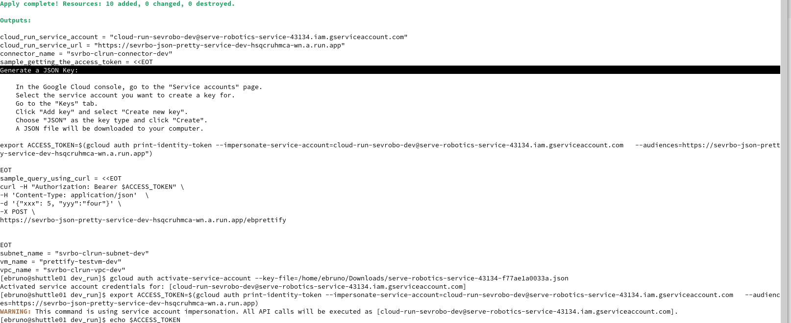
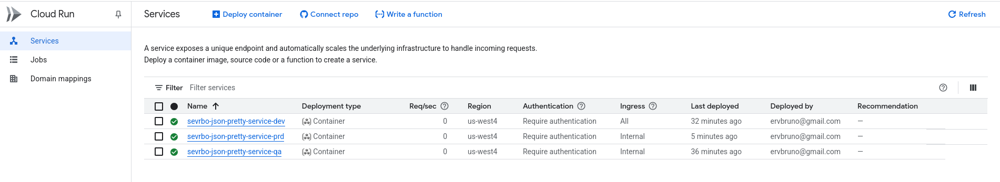

## Deploy a Containerized Service on GCP ##

Demonstrates skills in designing and implementing infrastructure on GCP using
Terraform, including containerization and basic service deployment.

### Scenario ###

Deploy a simple JSON Prettifier microservice. The task is to
to implement and containerize this simple utility, choose an appropriate GCP
compute platform, provision the necessary infrastructure using Terraform, and
deploy the service securely via an HTTPS endpoint accessible only via authenticated requests.

### Comments ###
You can only build and deploy one environment at a time based on the cur_env variable.
The two main plans are:

  - build_containers
  - all\_in\_one_run

A default value for cur_env is not specified in either of the above plans.

### Repository Structure ###
The layout of git repository is shown below:

  - clean_repository : Tools for cleaning the cloud artifact repository.
  - doc : Documentation in pdf and html format.
  - doc_md : Documentation in markdown format.
  - eb_petteyjson : Docker Container definition.
  - environments : The various terraform environments
  - images : Contains png or other graphics files used in documentation.
  - list_projects : List projects under the current login.
  - remove_projects : Cleans up and deletes projects.
  - setup_project : Creates a project with required resources and API's enabled.

### Makefile Targets ###
All makefiles support the following targets:

   - sort : If tfsort is installed it will run tfsort on all *.tf files.
   - fmt  : Runs terraform fmt against all *.tf files.
   - clean: Removes all editor (emacs, vi, vim) backup files.
   - dist-clean: Calls clean and also removes the .tfstate and .tfstate.backup files and the .terraform directory.

### GCP Environment ###
#### Google services to be enable ####
The following Google Services/API's must be enabled for the Project.

  - Artifact Registry API
  - Cloud Identity-Aware Proxy API
  - Cloud Run Admin API
  - Compute Engine API
  - IAM Service Account Credentials API
  - Network Management API

#### Determining Available projects ####
The list_projects terraform module can be used to obtain the list of projects
in a region.  The default region is us-west4.

The project names created with setup\_project create a project
with the prefix "ebdemo-cldrun-srv-"

The repository has a prefix of "ebdemo-service-".

The prefixes are followed by a six digit number that is the same for
the project and repository.

You can get list of active projects and then check the artifact repository with the gcloud command:

```bash
cd list_projects
terraform apply
```
```text
Apply complete! Resources: 0 added, 0 changed, 0 destroyed.

Outputs:

project_info = [
      {
       "lifecyle_state" = "ACTIVE"
       "name" = "Demo Cloudrun Service"
       "project" = "ebdemo-cldrun-srv-859707"
      },
      {
       "lifecyle_state" = "ACTIVE"
        "name" = "Demo Cloudrun Service"
        "project" = "ebdemo-cldrun-srv-599248"
       },
    ]
    gcloud artifacts repositories list --project 'ebdemo-cldrun-srv-859707'
    Listing items under project ebdemo-cldrun-srv-859707, across all locations.

                                                                                    ARTIFACT_REGISTRY
    REPOSITORY             FORMAT  MODE                 DESCRIPTION                                  LOCATION  LABELS  ENCRYPTION          CREATE_TIME          UPDATE_TIME          SIZE (MB)
    ebdemo-service-859707  DOCKER  STANDARD_REPOSITORY  Artifact Registry for Demo Cloudrun Service  us-west4          Google-managed key  2025-07-22T12:43:15  2025-07-23T16:07:47  0


### terraform environments ###

  - Production : Deploys the service to GCP that allows VPC access using an access token.
  - Q/A : Deploys the service to GCP that allows VPC access using an access token.
  - dev : Deploys the service to GCP that allows VPC and external access using an access token if the variable 'service\_network\_traffic' is set to INGRESS\_TRAFFIC\_ALL.
  - local\_dev : Allows the developer to build and test the container on their local machine using docker.
  - all\_in\_one : Allows one of the three enviroments to built by setting the cur_env variable.

On a Intel amd64 machine, use the terraform plan in build\_container to build
the container for dev, qa or prod.
You need to set the cur_env variable to dev, qa or prod.

#### All in One ####

Build any one of the enviroments by setting the cur_env variable to prod, qa or dev.
This can be done by setting TF\_VAR\_cur\_env or

       terraform apply|destroy -var "cur_env=[prod,qa,dev]"

It is necessary to define the project\_id and repository\_id variables
either on the command line or in a tfvars file.

#### Building the docker image ####
Use the module build\_container. Set cur\_env, project\_id and repository\_id.

      terraform apply -var "cur_env=[prod,qa,dev]"

Example run:

```bash
terraform apply -var="cur_env=dev" -var="project_id=ebdemo-cldrun-srv-859707" -var=repository_id=ebdemo-service-859707
```

```text
Terraform will perform the following actions:

  # null_resource.auth_docker will be created
  # null_resource.build_image will be created
  # null_resource.current_images will be created
  # null_resource.push_image will be created

Plan: 4 to add, 0 to change, 0 to destroy.
...

Before you can run the apply again with a different cur_env, you need to do destroy.

```bash
terraform destroy -var="cur_env=dev" -var="project_id=ebdemo-cldrun-srv-859707" -var=repository_id=ebdemo-service-859707
```

```text
Destroy complete! Resources: 4 destroyed.
```

#### Development Environment ####
The development environment consists of two directories:
Use build\_container and all\_in\_one\_run with cur\_env set to dev

build\_container builds the container and pushes to the Google Artifact Registry.
Since the Artifact Registry is flat, the tags are used to identify the correct image
for the environment. Containers to be used in dev are tagged :\<somekey\>_dev

This Environment deploys the service connected to VPC both the service and VPC are
configured to allow external traffic for ease of testing for the developer's local system,
if the variable 'service\_network\_traffic' is set to INGRESS\_TRAFFIC\_ALL.

Terraform is configured to create the following resources:

   - "google\_service\_account" "cloud\_run\_sa"
   - "google\_project\_iam_member" "cloud\_run\_sa\_invoker"
   - "google\_project\_iam_memer" "cloud\_run\_sa\_token\_creator"
   - "google\_project\_iam_member" "cloud\_run\_sa\_user"
   - "google\_compute\_network" "vpc\_network"
   - "google\_compute\_subnetwork" "subnet"
   - "google\_project\_service" "vpcaccess"
   - "google\_vpc\_access\_connector" "connector"
   - "google\_cloud\_run\_v2\_service" "default"

The google service account requires the following roles:

   - roles/run.invoker
   - roles/iam.serviceAccountTokenCreator
   - roles/iam.serviceAccountUser

Note:

   -   private\_ip\_google\_access = true
Must be set in google\_compute\_subnetwork used by the VM's.

To support testing a google compute instance is created and attached to the same VPC as the service.
In order to test from the compute instance or developer's local machine an access token is required.

Generate a JSON Key:

    In the Google Cloud console, go to the "Service accounts" page.
    Select the service account you want to create a key for.
    Go to the "Keys" tab.
    Click "Add key" and select "Create new key".
    Choose "JSON" as the key type and click "Create".
    A JSON file will be downloaded to your computer.

or use the cli.

     gcloud iam service-accounts keys create ../tmp/cloud-run-demosrv-dev-859707-949583750102.json --iam-account=cloud-run-demosrv-dev@ebdemo-cldrun-srv-859707.iam.gserviceaccount.com

Note: The output of the dev environment gives you correct commands to use.

     gcloud auth activate-service-account --key-file=<your home dir>/Downloads/ebdemo-service-service-859707-f77ae1a0033a.json
     Activated service account credentials for: [cloud-run-demosrv-dev@ebdemo-service-service-859707.iam.gserviceaccount.com]
     export ACCESS_TOKEN=$(gcloud auth print-identity-token --impersonate-service-account=cloud-run-demosrv-dev@ebdemo-service-service-859707.iam.gserviceaccount.com   --audiences=https://demosv-json-pretty-service-dev-hsqcruhmca-wn.a.run.app)
     WARNING: This command is a using service account impersonation. All API calls will be executed as [cloud-run-demosrv-dev@ebdemo-service-service-859707.iam.gserviceaccount.com].

The ACCESS\_TOKEN will need to be installed on the test VM.

     curl -H "Authorization: Bearer $ACCESS_TOKEN" \
     -H 'Content-Type: application/json'  \
     -d '{"xxx": 5, "yyy":"four"}' \
     -X POST \
      https://demosv-json-pretty-service-dev-hsqcruhmca-wn.a.run.app/ebprettify
    {
      "xxx": 5,
      "yyy": "four"
    }



You will need to copy the access token to the test VM.
You can either use gcloud to access the VM via ssh or use web console ssh access.

#### QA Environment ####
The Q/A environment consists of two directories:
Use build\_container and all\_in\_one\_run with cur\_env set to qa.
The build_container plan builds the container and pushes to the Google Artifact Registry.

Since the Artifact Registry is flat, the tags are used to identify the correct image
for the environment. Containers to be used in qa are tagged :\<somekey\>\_qa.

See the section [Building the docker image](#building-the-docker-image)

This enviroment deploys the service connected to VPC both the service and VPC
configured to restrict external traffic.

Terraform is configured to create the following resources:

   - "google\_service\_account" "cloud\_run\_sa"
   - "google\_project\_iam_member" "cloud\_run\_sa\_invoker"
   - "google\_project\_iam_member" "cloud\_run\_sa\_token\_creator"
   - "google\_project\_iam_member" "cloud\_run\_sa\_user"
   - "google\_compute\_network" "vpc\_network"
   - "google\_compute\_subnetwork" "subnet"
   - "google\_project\_service" "vpcaccess"
   - "google\_vpc\_access\_connector" "connector"
   - "google\_cloud\_run\_v2\_service" "default"

Note:

   -   private\_ip\_google\_access = true
Must be set in google\_compute\_subnetwork used by the VM's.

To support testing a google compute instance is created and attached to the same VPC as the service.
In order to test from the compute instance an access token is required.

The terraform plan outputs the commands with the correct account and email values.

Generate a JSON Key:

    In the Google Cloud console, go to the "Service accounts" page.
    Select the service account you want to create a key for.
    Go to the "Keys" tab.
    Click "Add key" and select "Create new key".
    Choose "JSON" as the key type and click "Create".
    A JSON file will be downloaded to your computer.

or use the cli.

     gcloud iam service-accounts keys create ../tmp/cloud-run-demosrv-dev-859707-949583750102.json --iam-account=cloud-run-demosrv-dev@ebdemo-cldrun-srv-859707.iam.gserviceaccount.com

Note: The output of the dev environment gives you correct commands to use.

     gcloud auth activate-service-account --key-file=<your home dir>/Downloads/ebdemo-service-service-859707-f77ae1a0033a.json
     Activated service account credentials for: [cloud-run-demosrv-qa@ebdemo-service-service-859707.iam.gserviceaccount.com]
     export ACCESS_TOKEN=$(gcloud auth print-identity-token --impersonate-service-account=cloud-run-demosrv-qa@ebdemo-service-service-859707.iam.gserviceaccount.com   --audiences=https://demosv-json-pretty-service-qa-hsqcruhmca-wn.a.run.app)
     WARNING: This command is using service account impersonation. All API calls will be executed as [cloud-run-demosrv-qa@ebdemo-service-service-859707.iam.gserviceaccount.com].

The ACCESS\_TOKEN will need to be installed on the test VM.

     curl -H "Authorization: Bearer $ACCESS_TOKEN" \
     -H 'Content-Type: application/json'  \
     -d '{"xxx": 5, "yyy":"four"}' \
     -X POST \
      https://demosv-json-pretty-service-qa-hsqcruhmca-wn.a.run.app/ebprettify
    {
      "xxx": 5,
      "yyy": "four"
    }

#### Production Environment ####
The production enviroment consists of two directories:
Use build_container and all\_in\_one\_run with cur\_env set to prod

See the section [Building the docker image](#building-the-docker-image)

build\_container builds the container and pushes to the Google Artifact Registry.
Since the Artifact Registry is flat, the tags are used to identify the correct image
for the environment. Containers to be used in prod are tagged :\<somekey\>\_prod.

Since the Artifact Registry is flat, the tags are used to identify the correct image
for the environment. Containers to be used in prod are tagged :\<somekey\>_prod.
This environment deploys the service connected to VPC both the service and VPC are
configured to restrict external traffic.

Terraform is configured to create the following resources:

   - "google\_service\_account" "cloud\_run\_sa"
   - "google\_project\_iam_member" "cloud\_run\_sa\_invoker"
   - "google\_project\_iam_member" "cloud\_run\_sa\_token\_creator"
   - "google\_project\_iam_member" "cloud\_run\_sa\_user"
   - "google\_compute\_network" "vpc\_network"
   - "google\_compute\_subnetwork" "subnet"
   - "google\_project\_service" "vpcaccess"
   - "google\_vpc\_access\_connector" "connector"
   - "google\_cloud\_run\_v2\_service" "default"

Note:

   -   private\_ip\_google\_access = true
Must be set in google\_compute\_subnetwork used by the VM's that will access the service.

The terraform plan outputs the commands with correct account and email values.

Generate a JSON Key:

    In the Google Cloud console, go to the "Service accounts" page.
    Select the service account you want to create a key for.
    Go to the "Keys" tab.
    Click "Add key" and select "Create new key".
    Choose "JSON" as the key type and click "Create".
    A JSON file will be downloaded to your computer.

or use the cli.

     gcloud iam service-accounts keys create ../tmp/cloud-run-demosrv-dev-859707-949583750102.json --iam-account=cloud-run-demosrv-dev@ebdemo-cldrun-srv-859707.iam.gserviceaccount.com

Note: The output of the dev environment gives you correct commands to use.

     gcloud auth activate-service-account --key-file=<your home dir>/Downloads/ebdemo-service-service-859707-f77ae1a0033a.json
     Activated service account credentials for: [cloud-run-demosrv-prod@ebdemo-service-service-859707.iam.gserviceaccount.com]
     export ACCESS_TOKEN=$(gcloud auth print-identity-token --impersonate-service-account=cloud-run-demosrv-prod@ebdemo-service-service-859707.iam.gserviceaccount.com   --audiences=https://demosv-json-pretty-service-prod-hsqcruhmca-wn.a.run.app)
     WARNING: This command is using service account impersonation. All API calls will be executed as [cloud-run-demosrv-prod@ebdemo-service-service-859707.iam.gserviceaccount.com].
     The resouce that will access the service will need an access token.

     curl -H "Authorization: Bearer $ACCESS_TOKEN" \
     -H 'Content-Type: application/json'  \
     -d '{"xxx": 5, "yyy":"four"}' \
     -X POST \
      https://demosv-json-pretty-service-prod-hsqcruhmca-wn.a.run.app/ebprettify
    {
      "xxx": 5,
      "yyy": "four"
    }


### Screen Shots ###


